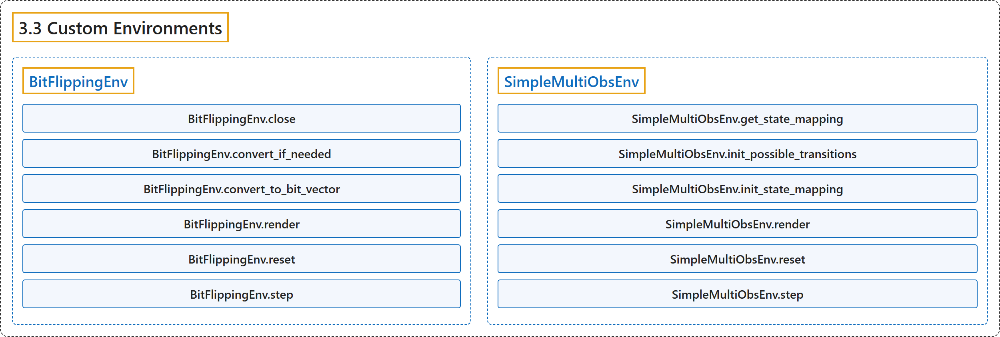

# 3.3 Custom Environments

## Classification

## Glossary

| Term | Definition | 中文翻译 | Source |
|---|---|---|---|
| **3.3 Custom Environments** 自定义环境 | "Those environments were **created for testing purposes**." | 这些环境是**为测试而创建的**。 | [Raffin et al., n.d., "Custom Environments", para. 1](https://stable-baselines3.readthedocs.io/en/master/common/envs.html#custom-environments) |
| **BitFlippingEnv** BitFlippingEnv 比特翻转环境 | "**Simple bit flipping env, useful to test HER**." | **简单的比特翻转环境，可用于测试 HER**。 | [Raffin et al., n.d., "BitFlippingEnv", para. 1](https://stable-baselines3.readthedocs.io/en/master/common/envs.html#stable_baselines3.common.envs.BitFlippingEnv) |
| **BitFlippingEnv.close** close 方法 | "After the user has finished using the environment, **close contains the code necessary to “clean up” the environment**." | 在用户使用完环境之后，**close 包含“清理”环境所需的代码**。 | [Raffin et al., n.d., "BitFlippingEnv", para. 1](https://stable-baselines3.readthedocs.io/en/master/common/envs.html#stable_baselines3.common.envs.BitFlippingEnv.close) |
| **BitFlippingEnv.convert_if_needed** convert_if_needed 方法 | "**Convert to discrete space if needed**." | **在需要时转换为离散空间**。 | [Raffin et al., n.d., "BitFlippingEnv", para. 1](https://stable-baselines3.readthedocs.io/en/master/common/envs.html#stable_baselines3.common.envs.BitFlippingEnv.convert_if_needed) |
| **BitFlippingEnv.convert_to_bit_vector** convert_to_bit_vector 方法 | "**Convert to bit vector if needed**." | **在需要时转换为比特向量**。 | [Raffin et al., n.d., "BitFlippingEnv", para. 1](https://stable-baselines3.readthedocs.io/en/master/common/envs.html#stable_baselines3.common.envs.BitFlippingEnv.convert_to_bit_vector) |
| **BitFlippingEnv.render** render 方法 | "**Compute the render frames as specified by render_mode during the initialization of the environment**." | **按环境初始化时 render_mode 的指定计算渲染帧**。 | [Raffin et al., n.d., "BitFlippingEnv", para. 1](https://stable-baselines3.readthedocs.io/en/master/common/envs.html#stable_baselines3.common.envs.BitFlippingEnv.render) |
| **BitFlippingEnv.reset** reset 方法 | "**Resets the environment to an initial internal state, returning an initial observation and info**." | **把环境重置到初始内部状态，返回初始观测和 info**。 | [Raffin et al., n.d., "BitFlippingEnv", para. 1](https://stable-baselines3.readthedocs.io/en/master/common/envs.html#stable_baselines3.common.envs.BitFlippingEnv.reset) |
| **BitFlippingEnv.step** step 方法 | "**Step into the env**." | **在环境中前进一步**。 | [Raffin et al., n.d., "BitFlippingEnv", para. 1](https://stable-baselines3.readthedocs.io/en/master/common/envs.html#stable_baselines3.common.envs.BitFlippingEnv.step) |
| **SimpleMultiObsEnv** SimpleMultiObsEnv 简单多观测环境 | "**Base class for GridWorld-based MultiObs Environments 4x4 grid world**." | **基于 GridWorld 的多观测环境的基类**，4x4 网格世界。 | [Raffin et al., n.d., "SimpleMultiObsEnv", para. 1](https://stable-baselines3.readthedocs.io/en/master/common/envs.html#stable_baselines3.common.envs.SimpleMultiObsEnv) |
| **SimpleMultiObsEnv.get_state_mapping** get_state_mapping 方法 | "**Uses the state to get the observation mapping**." | **用状态得到观测映射**。 | [Raffin et al., n.d., "SimpleMultiObsEnv", para. 1](https://stable-baselines3.readthedocs.io/en/master/common/envs.html#stable_baselines3.common.envs.SimpleMultiObsEnv.get_state_mapping) |
| **SimpleMultiObsEnv.init_possible_transitions** init_possible_transitions 方法 | "**Initializes the transitions of the environment** The environment exploits the cardinal directions of the grid by noting that they correspond to simple addition and subtraction from the cell id within the grid" | **初始化环境的转移** 环境利用网格的四个基本方向，注意到它们对应于网格内单元 id 的简单加减 | [Raffin et al., n.d., "SimpleMultiObsEnv", para. 1](https://stable-baselines3.readthedocs.io/en/master/common/envs.html#stable_baselines3.common.envs.SimpleMultiObsEnv.init_possible_transitions) |
| **SimpleMultiObsEnv.init_state_mapping** init_state_mapping 方法 | "**Initializes the state_mapping array which holds the observation values for each state**" | **初始化保存每个状态观测值的 state_mapping 数组** | [Raffin et al., n.d., "SimpleMultiObsEnv", para. 1](https://stable-baselines3.readthedocs.io/en/master/common/envs.html#stable_baselines3.common.envs.SimpleMultiObsEnv.init_state_mapping) |
| **SimpleMultiObsEnv.render** render 方法 | "**Prints the log of the environment**." | **打印环境的日志**。 | [Raffin et al., n.d., "SimpleMultiObsEnv", para. 1](https://stable-baselines3.readthedocs.io/en/master/common/envs.html#stable_baselines3.common.envs.SimpleMultiObsEnv.render) |
| **SimpleMultiObsEnv.reset** reset 方法 | "**Resets the environment state and step count and returns reset observation**." | **重置环境状态和步数，并返回重置后的观测**。 | [Raffin et al., n.d., "SimpleMultiObsEnv", para. 1](https://stable-baselines3.readthedocs.io/en/master/common/envs.html#stable_baselines3.common.envs.SimpleMultiObsEnv.reset) |
| **SimpleMultiObsEnv.step** step 方法 | "**Run one timestep of the environment’s dynamics**." | **运行环境动力学的一个时间步**。 | [Raffin et al., n.d., "SimpleMultiObsEnv", para. 1](https://stable-baselines3.readthedocs.io/en/master/common/envs.html#stable_baselines3.common.envs.SimpleMultiObsEnv.step) |

## References

Raffin, A., Hill, A., Gleave, A., Kanervisto, A., Ernestus, M., & Dormann, N.. (n.d.). *Custom Environments*. Stable-Baselines3 docs (Version 2.9.2a0). Retrieved October 31, 2026, from <https://stable-baselines3.readthedocs.io/en/master/common/envs.html>
