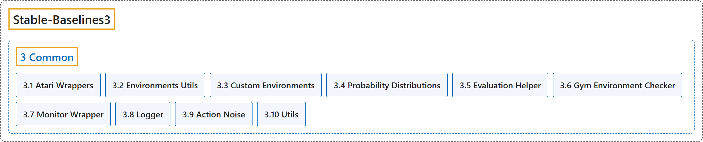

# 3. Common

## Classification

## Glossary

| Term | Definition | 中文翻译 | Source |
|---|---|---|---|
| **3 Common** 通用模块 | (No definition) | （无定义） | [Raffin et al., n.d.-j, "Common", documentation menu](https://stable-baselines3.readthedocs.io/en/master/) |
| **[3.1 Atari Wrappers](atari-wrappers.md)** Atari 包装器 | (context) "**Atari 2600 preprocessings**" | （语境）**Atari 2600 预处理** | [Raffin et al., n.d.-b, "AtariWrapper", para. 1](https://stable-baselines3.readthedocs.io/en/master/common/atari_wrappers.html#stable_baselines3.common.atari_wrappers.AtariWrapper) |
| **[3.2 Environments Utils](environments-utils.md)** 环境工具函数 | (No definition) | （无定义） | [Raffin et al., n.d.-d, "Environments Utils"](https://stable-baselines3.readthedocs.io/en/master/common/env_util.html) |
| **[3.3 Custom Environments](custom-environments.md)** 自定义环境 | "Those environments were **created for testing purposes**." | 这些环境是**为测试而创建的**。 | [Raffin et al., n.d.-c, "Custom Environments", para. 1](https://stable-baselines3.readthedocs.io/en/master/common/envs.html#custom-environments) |
| **[3.4 Probability Distributions](probability-distributions.md)** 概率分布 | "**Probability distributions used for the different action spaces:**" | **用于不同动作空间的概率分布：** | [Raffin et al., n.d.-i, "Probability Distributions", para. 1](https://stable-baselines3.readthedocs.io/en/master/common/distributions.html#probability-distributions) |
| **[3.5 Evaluation Helper](evaluation-helper.md)** 评估辅助函数 | (context) "**Runs the policy for n_eval_episodes episodes and outputs the average return per episode** (sum of undiscounted rewards)." | （语境）**将策略运行 n_eval_episodes 个回合，并输出每回合的平均回报**（未折扣奖励之和）。 | [Raffin et al., n.d.-e, "evaluate_policy", para. 1](https://stable-baselines3.readthedocs.io/en/master/common/evaluation.html#stable_baselines3.common.evaluation.evaluate_policy) |
| **[3.6 Gym Environment Checker](gym-environment-checker.md)** Gym 环境检查器 | "**Check that an environment follows Gym API.**" | **检查一个环境是否遵循 Gym API。** | [Raffin et al., n.d.-f, "check_env", para. 1](https://stable-baselines3.readthedocs.io/en/master/common/env_checker.html#stable_baselines3.common.env_checker.check_env) |
| **[3.7 Monitor Wrapper](monitor-wrapper.md)** 监视器包装器 | "**A monitor wrapper for Gym environments, it is used to know the episode reward, length, time and other data.**" | **一个用于 Gym 环境的监视器包装器，用来了解回合奖励、长度、时间和其他数据。** | [Raffin et al., n.d.-h, "Monitor", para. 1](https://stable-baselines3.readthedocs.io/en/master/common/monitor.html#stable_baselines3.common.monitor.Monitor) |
| **[3.8 Logger](logger.md)** 日志记录器 | (No definition) | （无定义） | [Raffin et al., n.d.-g, "Logger"](https://stable-baselines3.readthedocs.io/en/master/common/logger.html#logger) |
| **[3.9 Action Noise](action-noise.md)** 动作噪声 | (context) "**The action noise base class**" | （语境）**动作噪声的基类** | [Raffin et al., n.d.-a, "ActionNoise", para. 1](https://stable-baselines3.readthedocs.io/en/master/common/noise.html#stable_baselines3.common.noise.ActionNoise) |
| **[3.10 Utils](utils.md)** 工具函数 | (No definition) | （无定义） | [Raffin et al., n.d.-k, "Utils"](https://stable-baselines3.readthedocs.io/en/master/common/utils.html) |

## References

Raffin, A., Hill, A., Gleave, A., Kanervisto, A., Ernestus, M., & Dormann, N.. (n.d.-a). *Action Noise*. Stable-Baselines3 docs (Version 2.9.2a0). Retrieved October 31, 2026, from <https://stable-baselines3.readthedocs.io/en/master/common/noise.html>

Raffin, A., Hill, A., Gleave, A., Kanervisto, A., Ernestus, M., & Dormann, N.. (n.d.-b). *Atari Wrappers*. Stable-Baselines3 docs (Version 2.9.2a0). Retrieved October 31, 2026, from <https://stable-baselines3.readthedocs.io/en/master/common/atari_wrappers.html>

Raffin, A., Hill, A., Gleave, A., Kanervisto, A., Ernestus, M., & Dormann, N.. (n.d.-c). *Custom Environments*. Stable-Baselines3 docs (Version 2.9.2a0). Retrieved October 31, 2026, from <https://stable-baselines3.readthedocs.io/en/master/common/envs.html>

Raffin, A., Hill, A., Gleave, A., Kanervisto, A., Ernestus, M., & Dormann, N.. (n.d.-d). *Environments Utils*. Stable-Baselines3 docs (Version 2.9.2a0). Retrieved October 31, 2026, from <https://stable-baselines3.readthedocs.io/en/master/common/env_util.html>

Raffin, A., Hill, A., Gleave, A., Kanervisto, A., Ernestus, M., & Dormann, N.. (n.d.-e). *Evaluation Helper*. Stable-Baselines3 docs (Version 2.9.2a0). Retrieved October 31, 2026, from <https://stable-baselines3.readthedocs.io/en/master/common/evaluation.html>

Raffin, A., Hill, A., Gleave, A., Kanervisto, A., Ernestus, M., & Dormann, N.. (n.d.-f). *Gym Environment Checker*. Stable-Baselines3 docs (Version 2.9.2a0). Retrieved October 31, 2026, from <https://stable-baselines3.readthedocs.io/en/master/common/env_checker.html>

Raffin, A., Hill, A., Gleave, A., Kanervisto, A., Ernestus, M., & Dormann, N.. (n.d.-g). *Logger*. Stable-Baselines3 docs (Version 2.9.2a0). Retrieved October 31, 2026, from <https://stable-baselines3.readthedocs.io/en/master/common/logger.html>

Raffin, A., Hill, A., Gleave, A., Kanervisto, A., Ernestus, M., & Dormann, N.. (n.d.-h). *Monitor Wrapper*. Stable-Baselines3 docs (Version 2.9.2a0). Retrieved October 31, 2026, from <https://stable-baselines3.readthedocs.io/en/master/common/monitor.html>

Raffin, A., Hill, A., Gleave, A., Kanervisto, A., Ernestus, M., & Dormann, N.. (n.d.-i). *Probability Distributions*. Stable-Baselines3 docs (Version 2.9.2a0). Retrieved October 31, 2026, from <https://stable-baselines3.readthedocs.io/en/master/common/distributions.html>

Raffin, A., Hill, A., Gleave, A., Kanervisto, A., Ernestus, M., & Dormann, N.. (n.d.-j). *Stable-Baselines3 Docs - Reliable Reinforcement Learning Implementations*. Stable-Baselines3 docs (Version 2.9.2a0). Retrieved October 31, 2026, from <https://stable-baselines3.readthedocs.io/en/master/>

Raffin, A., Hill, A., Gleave, A., Kanervisto, A., Ernestus, M., & Dormann, N.. (n.d.-k). *Utils*. Stable-Baselines3 docs (Version 2.9.2a0). Retrieved October 31, 2026, from <https://stable-baselines3.readthedocs.io/en/master/common/utils.html>
