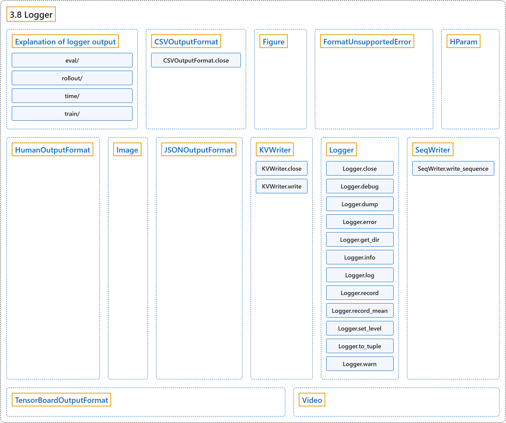

# 3.8 Logger

## Classification

## Glossary

| Term | Definition | 中文翻译 | Source |
|---|---|---|---|
| **3.8 Logger** 日志记录器 | (No definition) | （无定义） | [Raffin et al., n.d., "Logger"](https://stable-baselines3.readthedocs.io/en/master/common/logger.html#logger) |
| **Explanation of logger output** 日志输出说明 | (context) "You can find below **short explanations of the values logged in Stable-Baselines3 (SB3)**." | （语境）下面给出了**对 Stable-Baselines3（SB3）所记录数值的简短说明**。 | [Raffin et al., n.d., "Explanation of logger output", para. 1](https://stable-baselines3.readthedocs.io/en/master/common/logger.html#explanation-of-logger-output) |
| **eval/** eval/ 评估 | (context) "**All eval/ values are computed by the EvalCallback**." | （语境）**所有 eval/ 数值都由 EvalCallback 计算**。 | [Raffin et al., n.d., "eval/", para. 1](https://stable-baselines3.readthedocs.io/en/master/common/logger.html#eval) |
| **rollout/** rollout/ 采集 | (No definition) | （无定义） | [Raffin et al., n.d., "rollout/"](https://stable-baselines3.readthedocs.io/en/master/common/logger.html#rollout) |
| **time/** time/ 时间 | (No definition) | （无定义） | [Raffin et al., n.d., "time/"](https://stable-baselines3.readthedocs.io/en/master/common/logger.html#time) |
| **train/** train/ 训练 | (No definition) | （无定义） | [Raffin et al., n.d., "train/"](https://stable-baselines3.readthedocs.io/en/master/common/logger.html#train) |
| **CSVOutputFormat** CSVOutputFormat CSV 输出格式 | "**Log to a file, in a CSV format**" | **以 CSV 格式记录到文件** | [Raffin et al., n.d., "Logger", para. 1](https://stable-baselines3.readthedocs.io/en/master/common/logger.html#stable_baselines3.common.logger.CSVOutputFormat) |
| **CSVOutputFormat.close** close 方法 | "**closes the file**" | **关闭文件** | [Raffin et al., n.d., "Logger", para. 1](https://stable-baselines3.readthedocs.io/en/master/common/logger.html#stable_baselines3.common.logger.CSVOutputFormat.close) |
| **Figure** Figure 图表数据类 | "**Figure data class storing a matplotlib figure and whether to close the figure after logging it**" | **保存 matplotlib 图表以及记录后是否关闭该图表的图表数据类** | [Raffin et al., n.d., "Logger", para. 1](https://stable-baselines3.readthedocs.io/en/master/common/logger.html#stable_baselines3.common.logger.Figure) |
| **FormatUnsupportedError** FormatUnsupportedError 格式不支持错误 | "**Custom error to display informative message when a value is not supported by some formats**." | **当某个值不被某些格式支持时，用于显示提示信息的自定义错误**。 | [Raffin et al., n.d., "Logger", para. 1](https://stable-baselines3.readthedocs.io/en/master/common/logger.html#stable_baselines3.common.logger.FormatUnsupportedError) |
| **HParam** HParam 超参数数据类 | "**Hyperparameter data class storing hyperparameters and metrics in dictionaries**" | **用字典保存超参数和指标的超参数数据类** | [Raffin et al., n.d., "Logger", para. 1](https://stable-baselines3.readthedocs.io/en/master/common/logger.html#stable_baselines3.common.logger.HParam) |
| **HumanOutputFormat** HumanOutputFormat 人类可读输出格式 | "**A human-readable output format producing ASCII tables of key-value pairs**." | **一种人类可读的输出格式，生成键值对的 ASCII 表格**。 | [Raffin et al., n.d., "Logger", para. 1](https://stable-baselines3.readthedocs.io/en/master/common/logger.html#stable_baselines3.common.logger.HumanOutputFormat) |
| **Image** Image 图像数据类 | "**Image data class storing an image and data format**" | **保存图像及其数据格式的图像数据类** | [Raffin et al., n.d., "Logger", para. 1](https://stable-baselines3.readthedocs.io/en/master/common/logger.html#stable_baselines3.common.logger.Image) |
| **JSONOutputFormat** JSONOutputFormat JSON 输出格式 | "**Log to a file, in the JSON format**" | **以 JSON 格式记录到文件** | [Raffin et al., n.d., "Logger", para. 1](https://stable-baselines3.readthedocs.io/en/master/common/logger.html#stable_baselines3.common.logger.JSONOutputFormat) |
| **KVWriter** KVWriter 键值写入器 | "**Key Value writer**" | **键值写入器** | [Raffin et al., n.d., "Logger", para. 1](https://stable-baselines3.readthedocs.io/en/master/common/logger.html#stable_baselines3.common.logger.KVWriter) |
| **KVWriter.close** close 方法 | "**Close owned resources**" | **关闭所拥有的资源** | [Raffin et al., n.d., "Logger", para. 1](https://stable-baselines3.readthedocs.io/en/master/common/logger.html#stable_baselines3.common.logger.KVWriter.close) |
| **KVWriter.write** write 方法 | "**Write a dictionary to file**" | **把字典写入文件** | [Raffin et al., n.d., "Logger", para. 1](https://stable-baselines3.readthedocs.io/en/master/common/logger.html#stable_baselines3.common.logger.KVWriter.write) |
| **Logger** Logger 日志记录器 | "**The logger class**." | **日志记录器类**。 | [Raffin et al., n.d., "Logger", para. 1](https://stable-baselines3.readthedocs.io/en/master/common/logger.html#stable_baselines3.common.logger.Logger) |
| **Logger.close** close 方法 | "**closes the file**" | **关闭文件** | [Raffin et al., n.d., "Logger", para. 1](https://stable-baselines3.readthedocs.io/en/master/common/logger.html#stable_baselines3.common.logger.Logger.close) |
| **Logger.debug** debug 方法 | "Write the sequence of args, with no separators, to the console and output files (if you’ve configured an output file). **Using the DEBUG level**." | 把参数序列不加分隔符地写到控制台和输出文件（如果你配置了输出文件）。**使用 DEBUG 级别**。 | [Raffin et al., n.d., "Logger", para. 1](https://stable-baselines3.readthedocs.io/en/master/common/logger.html#stable_baselines3.common.logger.Logger.debug) |
| **Logger.dump** dump 方法 | "**Write all of the diagnostics from the current iteration**" | **写出当前迭代的全部诊断信息** | [Raffin et al., n.d., "Logger", para. 1](https://stable-baselines3.readthedocs.io/en/master/common/logger.html#stable_baselines3.common.logger.Logger.dump) |
| **Logger.error** error 方法 | "Write the sequence of args, with no separators, to the console and output files (if you’ve configured an output file). **Using the ERROR level**." | 把参数序列不加分隔符地写到控制台和输出文件（如果你配置了输出文件）。**使用 ERROR 级别**。 | [Raffin et al., n.d., "Logger", para. 1](https://stable-baselines3.readthedocs.io/en/master/common/logger.html#stable_baselines3.common.logger.Logger.error) |
| **Logger.get_dir** get_dir 方法 | "**Get directory that log files are being written to**." | **得到日志文件正在写入的目录**。 | [Raffin et al., n.d., "Logger", para. 1](https://stable-baselines3.readthedocs.io/en/master/common/logger.html#stable_baselines3.common.logger.Logger.get_dir) |
| **Logger.info** info 方法 | "Write the sequence of args, with no separators, to the console and output files (if you’ve configured an output file). **Using the INFO level**." | 把参数序列不加分隔符地写到控制台和输出文件（如果你配置了输出文件）。**使用 INFO 级别**。 | [Raffin et al., n.d., "Logger", para. 1](https://stable-baselines3.readthedocs.io/en/master/common/logger.html#stable_baselines3.common.logger.Logger.info) |
| **Logger.log** log 方法 | "**Write the sequence of args, with no separators, to the console and output files** (if you’ve configured an output file)." | **把参数序列不加分隔符地写到控制台和输出文件**（如果你配置了输出文件）。 | [Raffin et al., n.d., "Logger", para. 1](https://stable-baselines3.readthedocs.io/en/master/common/logger.html#stable_baselines3.common.logger.Logger.log) |
| **Logger.record** record 方法 | "**Log a value of some diagnostic** Call this once for each diagnostic quantity, each iteration If called many times, last value will be used." | **记录某个诊断量的值** 每次迭代对每个诊断量调用一次；如果调用多次，将使用最后一个值。 | [Raffin et al., n.d., "Logger", para. 1](https://stable-baselines3.readthedocs.io/en/master/common/logger.html#stable_baselines3.common.logger.Logger.record) |
| **Logger.record_mean** record_mean 方法 | "**The same as record(), but if called many times, values averaged**." | **与 record() 相同，但如果调用多次，则取各值的平均**。 | [Raffin et al., n.d., "Logger", para. 1](https://stable-baselines3.readthedocs.io/en/master/common/logger.html#stable_baselines3.common.logger.Logger.record_mean) |
| **Logger.set_level** set_level 方法 | "**Set logging threshold on current logger**." | **设置当前日志记录器的日志阈值**。 | [Raffin et al., n.d., "Logger", para. 1](https://stable-baselines3.readthedocs.io/en/master/common/logger.html#stable_baselines3.common.logger.Logger.set_level) |
| **Logger.to_tuple** to_tuple 方法 | "**Helper function to convert str to tuple of str**." | **把 str 转换为 str 元组的辅助函数**。 | [Raffin et al., n.d., "Logger", para. 1](https://stable-baselines3.readthedocs.io/en/master/common/logger.html#stable_baselines3.common.logger.Logger.to_tuple) |
| **Logger.warn** warn 方法 | "Write the sequence of args, with no separators, to the console and output files (if you’ve configured an output file). **Using the WARN level**." | 把参数序列不加分隔符地写到控制台和输出文件（如果你配置了输出文件）。**使用 WARN 级别**。 | [Raffin et al., n.d., "Logger", para. 1](https://stable-baselines3.readthedocs.io/en/master/common/logger.html#stable_baselines3.common.logger.Logger.warn) |
| **SeqWriter** SeqWriter 序列写入器 | "**sequence writer**" | **序列写入器** | [Raffin et al., n.d., "Logger", para. 1](https://stable-baselines3.readthedocs.io/en/master/common/logger.html#stable_baselines3.common.logger.SeqWriter) |
| **SeqWriter.write_sequence** write_sequence 方法 | "**write_sequence an array to file**" | **把一个数组按序列写入文件** | [Raffin et al., n.d., "Logger", para. 1](https://stable-baselines3.readthedocs.io/en/master/common/logger.html#stable_baselines3.common.logger.SeqWriter.write_sequence) |
| **TensorBoardOutputFormat** TensorBoardOutputFormat TensorBoard 输出格式 | "**Dumps key/value pairs into TensorBoard’s numeric format**." | **把键值对输出为 TensorBoard 的数值格式**。 | [Raffin et al., n.d., "Logger", para. 1](https://stable-baselines3.readthedocs.io/en/master/common/logger.html#stable_baselines3.common.logger.TensorBoardOutputFormat) |
| **Video** Video 视频数据类 | "**Video data class storing the video frames and the frame per seconds**" | **保存视频帧和每秒帧数的视频数据类** | [Raffin et al., n.d., "Logger", para. 1](https://stable-baselines3.readthedocs.io/en/master/common/logger.html#stable_baselines3.common.logger.Video) |

## References

Raffin, A., Hill, A., Gleave, A., Kanervisto, A., Ernestus, M., & Dormann, N.. (n.d.). *Logger*. Stable-Baselines3 docs (Version 2.9.2a0). Retrieved October 31, 2026, from <https://stable-baselines3.readthedocs.io/en/master/common/logger.html>
