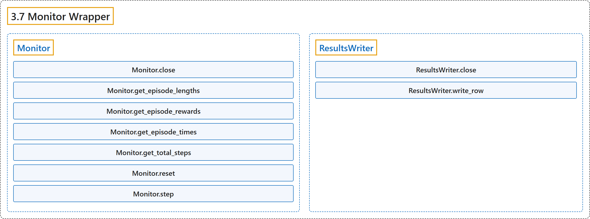

# 3.7 Monitor Wrapper

## Classification

## Glossary

| Term | Definition | 中文翻译 | Source |
|---|---|---|---|
| **3.7 Monitor Wrapper** 监视器包装器 | "**A monitor wrapper for Gym environments, it is used to know the episode reward, length, time and other data.**" | **一个用于 Gym 环境的监视器包装器，用来了解回合奖励、长度、时间和其他数据。** | [Raffin et al., n.d., "Monitor", para. 1](https://stable-baselines3.readthedocs.io/en/master/common/monitor.html#stable_baselines3.common.monitor.Monitor) |
| **Monitor** Monitor 监控包装器 | "**A monitor wrapper for Gym environments, it is used to know the episode reward, length, time and other data**." | **用于 Gym 环境的监控包装器，用来获知回合奖励、长度、时间和其他数据**。 | [Raffin et al., n.d., "Monitor Wrapper", para. 1](https://stable-baselines3.readthedocs.io/en/master/common/monitor.html#stable_baselines3.common.monitor.Monitor) |
| **Monitor.close** close 方法 | "**Closes the environment**" | **关闭环境** | [Raffin et al., n.d., "Monitor Wrapper", para. 1](https://stable-baselines3.readthedocs.io/en/master/common/monitor.html#stable_baselines3.common.monitor.Monitor.close) |
| **Monitor.get_episode_lengths** get_episode_lengths 方法 | "**Returns the number of timesteps of all the episodes**" | **返回所有回合的时间步数** | [Raffin et al., n.d., "Monitor Wrapper", para. 1](https://stable-baselines3.readthedocs.io/en/master/common/monitor.html#stable_baselines3.common.monitor.Monitor.get_episode_lengths) |
| **Monitor.get_episode_rewards** get_episode_rewards 方法 | "**Returns the rewards of all the episodes**" | **返回所有回合的奖励** | [Raffin et al., n.d., "Monitor Wrapper", para. 1](https://stable-baselines3.readthedocs.io/en/master/common/monitor.html#stable_baselines3.common.monitor.Monitor.get_episode_rewards) |
| **Monitor.get_episode_times** get_episode_times 方法 | "**Returns the runtime in seconds of all the episodes**" | **返回所有回合以秒计的运行时间** | [Raffin et al., n.d., "Monitor Wrapper", para. 1](https://stable-baselines3.readthedocs.io/en/master/common/monitor.html#stable_baselines3.common.monitor.Monitor.get_episode_times) |
| **Monitor.get_total_steps** get_total_steps 方法 | "**Returns the total number of timesteps**" | **返回时间步总数** | [Raffin et al., n.d., "Monitor Wrapper", para. 1](https://stable-baselines3.readthedocs.io/en/master/common/monitor.html#stable_baselines3.common.monitor.Monitor.get_total_steps) |
| **Monitor.reset** reset 方法 | "**Calls the Gym environment reset**." | **调用 Gym 环境的 reset**。 | [Raffin et al., n.d., "Monitor Wrapper", para. 1](https://stable-baselines3.readthedocs.io/en/master/common/monitor.html#stable_baselines3.common.monitor.Monitor.reset) |
| **Monitor.step** step 方法 | "**Step the environment with the given action**" | **用给定的动作让环境前进一步** | [Raffin et al., n.d., "Monitor Wrapper", para. 1](https://stable-baselines3.readthedocs.io/en/master/common/monitor.html#stable_baselines3.common.monitor.Monitor.step) |
| **ResultsWriter** ResultsWriter 结果写入器 | "**A result writer that saves the data from the Monitor class**" | **保存 Monitor 类数据的结果写入器** | [Raffin et al., n.d., "Monitor Wrapper", para. 1](https://stable-baselines3.readthedocs.io/en/master/common/monitor.html#stable_baselines3.common.monitor.ResultsWriter) |
| **ResultsWriter.close** close 方法 | "**Close the file handler**" | **关闭文件句柄** | [Raffin et al., n.d., "Monitor Wrapper", para. 1](https://stable-baselines3.readthedocs.io/en/master/common/monitor.html#stable_baselines3.common.monitor.ResultsWriter.close) |
| **ResultsWriter.write_row** write_row 方法 | "**Write row of monitor data to csv log file**." | **把一行监控数据写入 csv 日志文件**。 | [Raffin et al., n.d., "Monitor Wrapper", para. 1](https://stable-baselines3.readthedocs.io/en/master/common/monitor.html#stable_baselines3.common.monitor.ResultsWriter.write_row) |

## References

Raffin, A., Hill, A., Gleave, A., Kanervisto, A., Ernestus, M., & Dormann, N.. (n.d.). *Monitor Wrapper*. Stable-Baselines3 docs (Version 2.9.2a0). Retrieved October 31, 2026, from <https://stable-baselines3.readthedocs.io/en/master/common/monitor.html>
