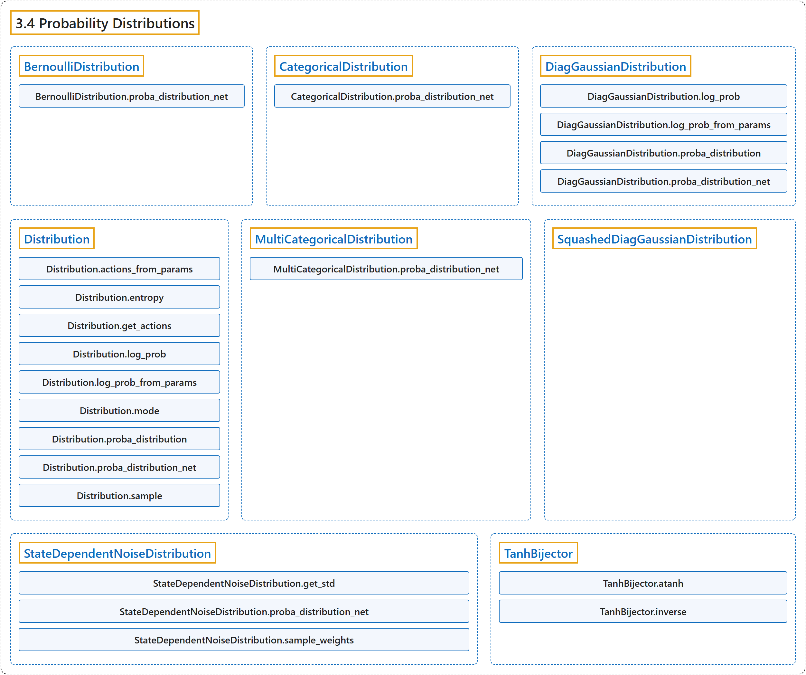

# 3.4 Probability Distributions

## Classification

## Glossary

| Term | Definition | 中文翻译 | Source |
|---|---|---|---|
| **3.4 Probability Distributions** 概率分布 | "**Probability distributions used for the different action spaces:**" | **用于不同动作空间的概率分布：** | [Raffin et al., n.d., "Probability Distributions", para. 1](https://stable-baselines3.readthedocs.io/en/master/common/distributions.html#probability-distributions) |
| **BernoulliDistribution** BernoulliDistribution 伯努利分布 | "**Bernoulli distribution for MultiBinary action spaces**." | **用于 MultiBinary 动作空间的伯努利分布**。 | [Raffin et al., n.d., "Probability Distributions", para. 1](https://stable-baselines3.readthedocs.io/en/master/common/distributions.html#stable_baselines3.common.distributions.BernoulliDistribution) |
| **BernoulliDistribution.proba_distribution_net** proba_distribution_net 方法 | "Create the layer that represents the distribution: **it will be the logits of the Bernoulli distribution**." | 创建表示该分布的层：**它将是伯努利分布的 logits**。 | [Raffin et al., n.d., "Probability Distributions", para. 1](https://stable-baselines3.readthedocs.io/en/master/common/distributions.html#stable_baselines3.common.distributions.BernoulliDistribution.proba_distribution_net) |
| **CategoricalDistribution** CategoricalDistribution 类别分布 | "**Categorical distribution for discrete actions**." | **用于离散动作的类别分布**。 | [Raffin et al., n.d., "Probability Distributions", para. 1](https://stable-baselines3.readthedocs.io/en/master/common/distributions.html#stable_baselines3.common.distributions.CategoricalDistribution) |
| **CategoricalDistribution.proba_distribution_net** proba_distribution_net 方法 | "Create the layer that represents the distribution: **it will be the logits of the Categorical distribution**." | 创建表示该分布的层：**它将是类别分布的 logits**。 | [Raffin et al., n.d., "Probability Distributions", para. 1](https://stable-baselines3.readthedocs.io/en/master/common/distributions.html#stable_baselines3.common.distributions.CategoricalDistribution.proba_distribution_net) |
| **DiagGaussianDistribution** DiagGaussianDistribution 对角高斯分布 | "**Gaussian distribution with diagonal covariance matrix, for continuous actions**." | **具有对角协方差矩阵的高斯分布，用于连续动作**。 | [Raffin et al., n.d., "Probability Distributions", para. 1](https://stable-baselines3.readthedocs.io/en/master/common/distributions.html#stable_baselines3.common.distributions.DiagGaussianDistribution) |
| **DiagGaussianDistribution.log_prob** log_prob 方法 | "**Get the log probabilities of actions according to the distribution**." | **按该分布得到动作的对数概率**。 | [Raffin et al., n.d., "Probability Distributions", para. 1](https://stable-baselines3.readthedocs.io/en/master/common/distributions.html#stable_baselines3.common.distributions.DiagGaussianDistribution.log_prob) |
| **DiagGaussianDistribution.log_prob_from_params** log_prob_from_params 方法 | "**Compute the log probability of taking an action given the distribution parameters**." | **在给定分布参数的情况下，计算采取某个动作的对数概率**。 | [Raffin et al., n.d., "Probability Distributions", para. 1](https://stable-baselines3.readthedocs.io/en/master/common/distributions.html#stable_baselines3.common.distributions.DiagGaussianDistribution.log_prob_from_params) |
| **DiagGaussianDistribution.proba_distribution** proba_distribution 方法 | "**Create the distribution given its parameters (mean, std)**" | **根据参数（均值、标准差）创建分布** | [Raffin et al., n.d., "Probability Distributions", para. 1](https://stable-baselines3.readthedocs.io/en/master/common/distributions.html#stable_baselines3.common.distributions.DiagGaussianDistribution.proba_distribution) |
| **DiagGaussianDistribution.proba_distribution_net** proba_distribution_net 方法 | "Create the layers and parameter that represent the distribution: **one output will be the mean of the Gaussian, the other parameter will be the standard deviation (log std in fact to allow negative values)**" | 创建表示该分布的层和参数：**一个输出将是高斯分布的均值，另一个参数将是标准差（实际上是 log std，以允许负值）** | [Raffin et al., n.d., "Probability Distributions", para. 1](https://stable-baselines3.readthedocs.io/en/master/common/distributions.html#stable_baselines3.common.distributions.DiagGaussianDistribution.proba_distribution_net) |
| **Distribution** Distribution 分布基类 | "**Abstract base class for distributions**." | **分布的抽象基类**。 | [Raffin et al., n.d., "Probability Distributions", para. 1](https://stable-baselines3.readthedocs.io/en/master/common/distributions.html#stable_baselines3.common.distributions.Distribution) |
| **Distribution.actions_from_params** actions_from_params 方法 | "**Returns samples from the probability distribution given its parameters**." | **在给定参数的情况下，从概率分布返回样本**。 | [Raffin et al., n.d., "Probability Distributions", para. 1](https://stable-baselines3.readthedocs.io/en/master/common/distributions.html#stable_baselines3.common.distributions.Distribution.actions_from_params) |
| **Distribution.entropy** entropy 方法 | "**Returns Shannon’s entropy of the probability**" | **返回该概率的香农熵** | [Raffin et al., n.d., "Probability Distributions", para. 1](https://stable-baselines3.readthedocs.io/en/master/common/distributions.html#stable_baselines3.common.distributions.Distribution.entropy) |
| **Distribution.get_actions** get_actions 方法 | "**Return actions according to the probability distribution**." | **按概率分布返回动作**。 | [Raffin et al., n.d., "Probability Distributions", para. 1](https://stable-baselines3.readthedocs.io/en/master/common/distributions.html#stable_baselines3.common.distributions.Distribution.get_actions) |
| **Distribution.log_prob** log_prob 方法 | "**Returns the log likelihood**" | **返回对数似然** | [Raffin et al., n.d., "Probability Distributions", para. 1](https://stable-baselines3.readthedocs.io/en/master/common/distributions.html#stable_baselines3.common.distributions.Distribution.log_prob) |
| **Distribution.log_prob_from_params** log_prob_from_params 方法 | "**Returns samples and the associated log probabilities from the probability distribution given its parameters**." | **在给定参数的情况下，从概率分布返回样本及其对数概率**。 | [Raffin et al., n.d., "Probability Distributions", para. 1](https://stable-baselines3.readthedocs.io/en/master/common/distributions.html#stable_baselines3.common.distributions.Distribution.log_prob_from_params) |
| **Distribution.mode** mode 方法 | "**Returns the most likely action (deterministic output) from the probability distribution**" | **从概率分布返回最可能的动作（确定性输出）** | [Raffin et al., n.d., "Probability Distributions", para. 1](https://stable-baselines3.readthedocs.io/en/master/common/distributions.html#stable_baselines3.common.distributions.Distribution.mode) |
| **Distribution.proba_distribution** proba_distribution 方法 | "**Set parameters of the distribution**." | **设置分布的参数**。 | [Raffin et al., n.d., "Probability Distributions", para. 1](https://stable-baselines3.readthedocs.io/en/master/common/distributions.html#stable_baselines3.common.distributions.Distribution.proba_distribution) |
| **Distribution.proba_distribution_net** proba_distribution_net 方法 | "**Create the layers and parameters that represent the distribution**." | **创建表示该分布的层和参数**。 | [Raffin et al., n.d., "Probability Distributions", para. 1](https://stable-baselines3.readthedocs.io/en/master/common/distributions.html#stable_baselines3.common.distributions.Distribution.proba_distribution_net) |
| **Distribution.sample** sample 方法 | "**Returns a sample from the probability distribution**" | **从概率分布返回一个样本** | [Raffin et al., n.d., "Probability Distributions", para. 1](https://stable-baselines3.readthedocs.io/en/master/common/distributions.html#stable_baselines3.common.distributions.Distribution.sample) |
| **MultiCategoricalDistribution** MultiCategoricalDistribution 多类别分布 | "**MultiCategorical distribution for multi discrete actions**." | **用于多离散动作的多类别分布**。 | [Raffin et al., n.d., "Probability Distributions", para. 1](https://stable-baselines3.readthedocs.io/en/master/common/distributions.html#stable_baselines3.common.distributions.MultiCategoricalDistribution) |
| **MultiCategoricalDistribution.proba_distribution_net** proba_distribution_net 方法 | "Create the layer that represents the distribution: **it will be the logits (flattened) of the MultiCategorical distribution**." | 创建表示该分布的层：**它将是多类别分布的（展平的）logits**。 | [Raffin et al., n.d., "Probability Distributions", para. 1](https://stable-baselines3.readthedocs.io/en/master/common/distributions.html#stable_baselines3.common.distributions.MultiCategoricalDistribution.proba_distribution_net) |
| **SquashedDiagGaussianDistribution** SquashedDiagGaussianDistribution 压缩对角高斯分布 | "**Gaussian distribution with diagonal covariance matrix, followed by a squashing function (tanh) to ensure bounds**." | **具有对角协方差矩阵的高斯分布，后接一个压缩函数（tanh）以确保边界**。 | [Raffin et al., n.d., "Probability Distributions", para. 1](https://stable-baselines3.readthedocs.io/en/master/common/distributions.html#stable_baselines3.common.distributions.SquashedDiagGaussianDistribution) |
| **StateDependentNoiseDistribution** StateDependentNoiseDistribution 状态相关噪声分布 | "**Distribution class for using generalized State Dependent Exploration (gSDE)**." | **用于广义状态相关探索（gSDE）的分布类**。 | [Raffin et al., n.d., "Probability Distributions", para. 1](https://stable-baselines3.readthedocs.io/en/master/common/distributions.html#stable_baselines3.common.distributions.StateDependentNoiseDistribution) |
| **StateDependentNoiseDistribution.get_std** get_std 方法 | "**Get the standard deviation from the learned parameter** (log of it by default)." | **从学到的参数得到标准差**（默认是其对数）。 | [Raffin et al., n.d., "Probability Distributions", para. 1](https://stable-baselines3.readthedocs.io/en/master/common/distributions.html#stable_baselines3.common.distributions.StateDependentNoiseDistribution.get_std) |
| **StateDependentNoiseDistribution.proba_distribution_net** proba_distribution_net 方法 | "Create the layers and parameter that represent the distribution: **one output will be the deterministic action, the other parameter will be the standard deviation of the distribution that control the weights of the noise matrix**." | 创建表示该分布的层和参数：**一个输出将是确定性动作，另一个参数将是控制噪声矩阵权重的分布的标准差**。 | [Raffin et al., n.d., "Probability Distributions", para. 1](https://stable-baselines3.readthedocs.io/en/master/common/distributions.html#stable_baselines3.common.distributions.StateDependentNoiseDistribution.proba_distribution_net) |
| **StateDependentNoiseDistribution.sample_weights** sample_weights 方法 | "**Sample weights for the noise exploration matrix, using a centered Gaussian distribution**." | **使用中心化的高斯分布，为噪声探索矩阵采样权重**。 | [Raffin et al., n.d., "Probability Distributions", para. 1](https://stable-baselines3.readthedocs.io/en/master/common/distributions.html#stable_baselines3.common.distributions.StateDependentNoiseDistribution.sample_weights) |
| **TanhBijector** TanhBijector Tanh 双射 | "**Bijective transformation of a probability distribution using a squashing function (tanh)**" | **使用压缩函数（tanh）对概率分布做的双射变换** | [Raffin et al., n.d., "Probability Distributions", para. 1](https://stable-baselines3.readthedocs.io/en/master/common/distributions.html#stable_baselines3.common.distributions.TanhBijector) |
| **TanhBijector.atanh** atanh 方法 | "**Inverse of Tanh**" | **Tanh 的反函数** | [Raffin et al., n.d., "Probability Distributions", para. 1](https://stable-baselines3.readthedocs.io/en/master/common/distributions.html#stable_baselines3.common.distributions.TanhBijector.atanh) |
| **TanhBijector.inverse** inverse 方法 | "**Inverse tanh**." | **反 tanh**。 | [Raffin et al., n.d., "Probability Distributions", para. 1](https://stable-baselines3.readthedocs.io/en/master/common/distributions.html#stable_baselines3.common.distributions.TanhBijector.inverse) |

## References

Raffin, A., Hill, A., Gleave, A., Kanervisto, A., Ernestus, M., & Dormann, N.. (n.d.). *Probability Distributions*. Stable-Baselines3 docs (Version 2.9.2a0). Retrieved October 31, 2026, from <https://stable-baselines3.readthedocs.io/en/master/common/distributions.html>
