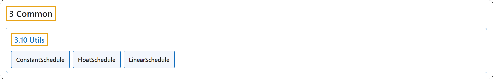

# 3.10 Utils

## Classification

## Glossary

| Term | Definition | 中文翻译 | Source |
|---|---|---|---|
| **3.10 Utils** 工具函数 | (No definition) | （无定义） | [Raffin et al., n.d., "Utils"](https://stable-baselines3.readthedocs.io/en/master/common/utils.html) |
| **ConstantSchedule** ConstantSchedule 常数调度 | "**Constant schedule that always returns the same value**." | **总是返回同一个值的常数调度**。 | [Raffin et al., n.d., "Utils", para. 1](https://stable-baselines3.readthedocs.io/en/master/common/utils.html#stable_baselines3.common.utils.ConstantSchedule) |
| **FloatSchedule** FloatSchedule 浮点调度 | "**Wrapper that ensures the output of a Schedule is cast to float**." | **确保 Schedule 的输出被转换为 float 的包装器**。 | [Raffin et al., n.d., "Utils", para. 1](https://stable-baselines3.readthedocs.io/en/master/common/utils.html#stable_baselines3.common.utils.FloatSchedule) |
| **LinearSchedule** LinearSchedule 线性调度 | "LinearSchedule **interpolates linearly between start and end between progress_remaining = 1 and progress_remaining = end_fraction**." | LinearSchedule **在 progress_remaining = 1 与 progress_remaining = end_fraction 之间，在 start 和 end 之间做线性插值**。 | [Raffin et al., n.d., "Utils", para. 1](https://stable-baselines3.readthedocs.io/en/master/common/utils.html#stable_baselines3.common.utils.LinearSchedule) |

## References

Raffin, A., Hill, A., Gleave, A., Kanervisto, A., Ernestus, M., & Dormann, N.. (n.d.). *Utils*. Stable-Baselines3 docs (Version 2.9.2a0). Retrieved October 31, 2026, from <https://stable-baselines3.readthedocs.io/en/master/common/utils.html>
