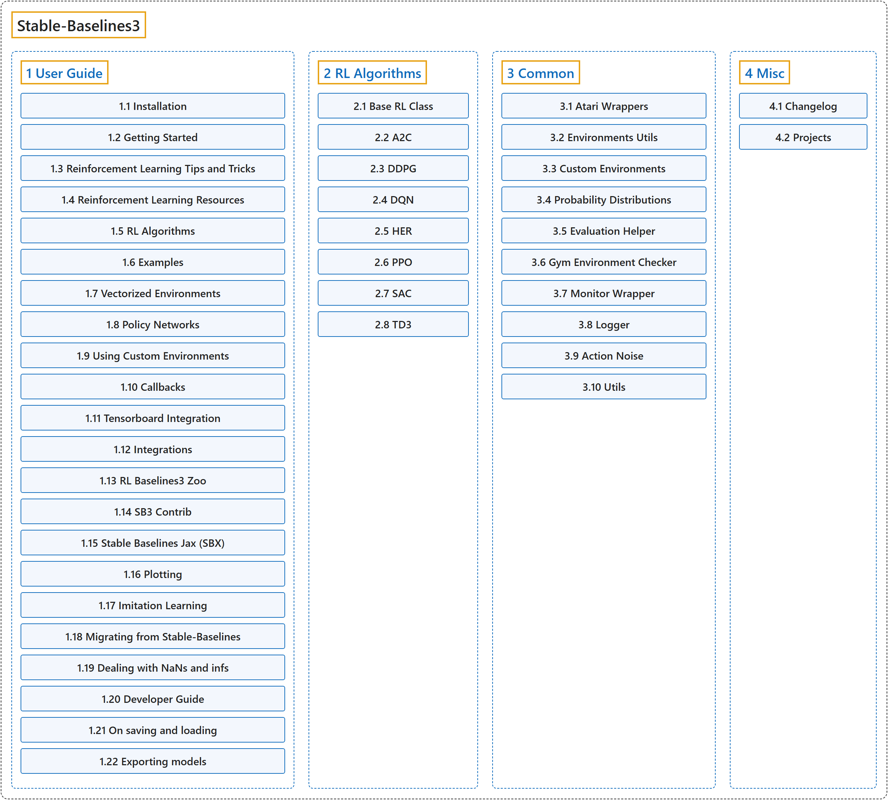

# Stable-Baselines3

## Classification

## Glossary

| Term | Definition | 中文翻译 | Source |
|---|---|---|---|
| **Stable-Baselines3** Stable-Baselines3 | "Stable Baselines3 (SB3) is **a set of reliable implementations of reinforcement learning algorithms in PyTorch**." | Stable Baselines3（SB3）是**一套用 PyTorch 实现的可靠的强化学习算法**。 | [Raffin et al., n.d., "Stable-Baselines3 Docs - Reliable Reinforcement Learning Implementations", para. 1](https://stable-baselines3.readthedocs.io/en/master/#stable-baselines3-docs-reliable-reinforcement-learning-implementations) |
| **[1 User Guide](user-guide/index.md)** 用户指南 | (No definition) | （无定义） | [Raffin et al., n.d., "User Guide", documentation menu](https://stable-baselines3.readthedocs.io/en/master/) |
| **[2 RL Algorithms](rl-algorithms/index.md)** 强化学习算法 | (context) "This table displays **the RL algorithms that are implemented in the Stable Baselines3 project**, along with some useful characteristics: support for discrete/continuous actions, multiprocessing." | （语境）此表列出 **Stable Baselines3 项目中实现的强化学习算法**，以及一些有用的特性：是否支持离散或连续动作、多进程。 | [Raffin et al., n.d., "RL Algorithms", para. 1](https://stable-baselines3.readthedocs.io/en/master/guide/algos.html) |
| **[3 Common](common/index.md)** 通用模块 | (No definition) | （无定义） | [Raffin et al., n.d., "Common", documentation menu](https://stable-baselines3.readthedocs.io/en/master/) |
| **[4 Misc](misc/index.md)** 其他 | (No definition) | （无定义） | [Raffin et al., n.d., "Misc", documentation menu](https://stable-baselines3.readthedocs.io/en/master/) |

## References

Raffin, A., Hill, A., Gleave, A., Kanervisto, A., Ernestus, M., & Dormann, N. (n.d.). *Stable-Baselines3 docs* (Version 2.9.2a0). Retrieved October 30, 2026, from <https://stable-baselines3.readthedocs.io/en/master/>
