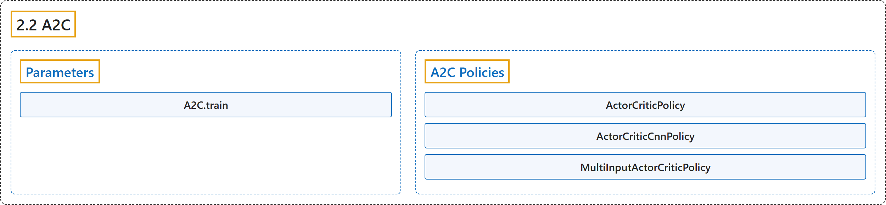

# 2.2 A2C

## Classification

## Glossary

| Term | Definition | 中文翻译 | Source |
|---|---|---|---|
| **2.2 A2C** A2C（优势演员-评论家） | "**A synchronous, deterministic variant of Asynchronous Advantage Actor Critic (A3C).**" | **异步优势演员-评论家（A3C）的同步、确定性变体。** | [Raffin et al., n.d., "A2C", para. 1](https://stable-baselines3.readthedocs.io/en/master/modules/a2c.html#module-stable_baselines3.a2c) |
| **Parameters** 参数 | (No definition) | （无定义） | [Raffin et al., n.d., "Parameters"](https://stable-baselines3.readthedocs.io/en/master/modules/a2c.html#parameters) |
| **A2C.train** train 方法 | "**Update policy using the currently gathered rollout buffer** (one gradient step over whole data)." | **用当前收集的 rollout 缓冲区更新策略**（在全部数据上做一次梯度步）。 | [Raffin et al., n.d., "Parameters", para. 1](https://stable-baselines3.readthedocs.io/en/master/modules/a2c.html#stable_baselines3.a2c.A2C.train) |
| **A2C Policies** A2C 策略 | (No definition) | （无定义） | [Raffin et al., n.d., "A2C Policies"](https://stable-baselines3.readthedocs.io/en/master/modules/a2c.html#a2c-policies) |
| **ActorCriticPolicy** ActorCriticPolicy 演员-评论家策略 | "**Policy class for actor-critic algorithms (has both policy and value prediction)**." | **用于 actor-critic 算法的策略类（同时具有策略预测和价值预测）**。 | [Raffin et al., n.d., "A2C Policies", para. 1](https://stable-baselines3.readthedocs.io/en/master/modules/a2c.html#stable_baselines3.a2c.MlpPolicy) |
| **ActorCriticPolicy.evaluate_actions** evaluate_actions 方法 | "**Evaluate actions according to the current policy, given the observations**." | **在给定观测的情况下，按当前策略评估动作**。 | [Raffin et al., n.d., "A2C Policies", para. 1](https://stable-baselines3.readthedocs.io/en/master/modules/a2c.html#stable_baselines3.a2c.MlpPolicy) |
| **ActorCriticPolicy.extract_features** extract_features 方法 | "**Preprocess the observation if needed and extract features**." | **在需要时预处理观测并提取特征**。 | [Raffin et al., n.d., "A2C Policies", para. 1](https://stable-baselines3.readthedocs.io/en/master/modules/a2c.html#stable_baselines3.a2c.MlpPolicy) |
| **ActorCriticPolicy.forward** forward 方法 | "**Forward pass in all the networks (actor and critic)**" | **在所有网络（actor 和 critic）中做前向传播** | [Raffin et al., n.d., "A2C Policies", para. 1](https://stable-baselines3.readthedocs.io/en/master/modules/a2c.html#stable_baselines3.a2c.MlpPolicy) |
| **ActorCriticPolicy.get_distribution** get_distribution 方法 | "**Get the current policy distribution given the observations**." | **在给定观测的情况下得到当前的策略分布**。 | [Raffin et al., n.d., "A2C Policies", para. 1](https://stable-baselines3.readthedocs.io/en/master/modules/a2c.html#stable_baselines3.a2c.MlpPolicy) |
| **ActorCriticPolicy.predict_values** predict_values 方法 | "**Get the estimated values according to the current policy given the observations**." | **在给定观测的情况下，按当前策略得到估计的价值**。 | [Raffin et al., n.d., "A2C Policies", para. 1](https://stable-baselines3.readthedocs.io/en/master/modules/a2c.html#stable_baselines3.a2c.MlpPolicy) |
| **ActorCriticPolicy.reset_noise** reset_noise 方法 | "**Sample new weights for the exploration matrix**." | **为探索矩阵采样新的权重**。 | [Raffin et al., n.d., "A2C Policies", para. 1](https://stable-baselines3.readthedocs.io/en/master/modules/a2c.html#stable_baselines3.a2c.MlpPolicy) |
| **ActorCriticCnnPolicy** ActorCriticCnnPolicy 演员-评论家 CNN 策略 | "**CNN policy class for actor-critic algorithms (has both policy and value prediction)**." | **用于 actor-critic 算法的 CNN 策略类（同时具有策略预测和价值预测）**。 | [Raffin et al., n.d., "A2C Policies", para. 1](https://stable-baselines3.readthedocs.io/en/master/modules/a2c.html#stable_baselines3.a2c.CnnPolicy) |
| **MultiInputActorCriticPolicy** MultiInputActorCriticPolicy 多输入演员-评论家策略 | "**MultiInputActorClass policy class for actor-critic algorithms (has both policy and value prediction)**." | **用于 actor-critic 算法的 MultiInputActorClass 策略类（同时具有策略预测和价值预测）**。 | [Raffin et al., n.d., "A2C Policies", para. 1](https://stable-baselines3.readthedocs.io/en/master/modules/a2c.html#stable_baselines3.a2c.MultiInputPolicy) |

## References

Raffin, A., Hill, A., Gleave, A., Kanervisto, A., Ernestus, M., & Dormann, N.. (n.d.). *A2C*. Stable-Baselines3 docs (Version 2.9.2a0). Retrieved October 31, 2026, from <https://stable-baselines3.readthedocs.io/en/master/modules/a2c.html>
