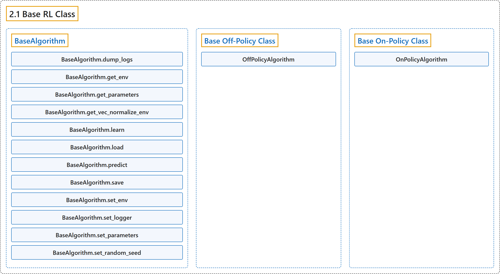

# 2.1 Base RL Class

## Classification

## Glossary

| Term | Definition | 中文翻译 | Source |
|---|---|---|---|
| **2.1 Base RL Class** 强化学习基类 | "**Common interface for all the RL algorithms**" | **所有强化学习算法的公共接口** | [Raffin et al., n.d., "Base RL Class", para. 1](https://stable-baselines3.readthedocs.io/en/master/modules/base.html#base-rl-class) |
| **BaseAlgorithm** BaseAlgorithm（算法基类） | "**The base of RL algorithms**" | **强化学习算法的基类** | [Raffin et al., n.d., "Base RL Class", para. 1](https://stable-baselines3.readthedocs.io/en/master/modules/base.html#stable_baselines3.common.base_class.BaseAlgorithm) |
| **BaseAlgorithm.dump_logs** dump_logs 方法 | "**Write log data**. (Implemented by OffPolicyAlgorithm and OnPolicyAlgorithm)" | **写入日志数据**。（由 OffPolicyAlgorithm 和 OnPolicyAlgorithm 实现） | [Raffin et al., n.d., "Base RL Class", para. 1](https://stable-baselines3.readthedocs.io/en/master/modules/base.html#stable_baselines3.common.base_class.BaseAlgorithm.dump_logs) |
| **BaseAlgorithm.get_env** get_env 方法 | "**Returns the current environment** (can be None if not defined)." | **返回当前环境**（未定义时可为 None）。 | [Raffin et al., n.d., "Base RL Class", para. 1](https://stable-baselines3.readthedocs.io/en/master/modules/base.html#stable_baselines3.common.base_class.BaseAlgorithm.get_env) |
| **BaseAlgorithm.get_parameters** get_parameters 方法 | "**Return the parameters of the agent**." | **返回智能体的参数**。 | [Raffin et al., n.d., "Base RL Class", para. 1](https://stable-baselines3.readthedocs.io/en/master/modules/base.html#stable_baselines3.common.base_class.BaseAlgorithm.get_parameters) |
| **BaseAlgorithm.get_vec_normalize_env** get_vec_normalize_env 方法 | "**Return the VecNormalize wrapper of the training env** if it exists." | 如果存在，**返回训练环境的 VecNormalize 包装器**。 | [Raffin et al., n.d., "Base RL Class", para. 1](https://stable-baselines3.readthedocs.io/en/master/modules/base.html#stable_baselines3.common.base_class.BaseAlgorithm.get_vec_normalize_env) |
| **BaseAlgorithm.learn** learn 方法 | "**Return a trained model**." | **返回训练好的模型**。 | [Raffin et al., n.d., "Base RL Class", para. 1](https://stable-baselines3.readthedocs.io/en/master/modules/base.html#stable_baselines3.common.base_class.BaseAlgorithm.learn) |
| **BaseAlgorithm.load** load 方法 | "**Load the model from a zip-file**." | **从 zip 文件加载模型**。 | [Raffin et al., n.d., "Base RL Class", para. 1](https://stable-baselines3.readthedocs.io/en/master/modules/base.html#stable_baselines3.common.base_class.BaseAlgorithm.load) |
| **BaseAlgorithm.predict** predict 方法 | "**Get the policy action from an observation (and optional hidden state)**." | **根据观测（及可选的隐藏状态）得到策略的动作**。 | [Raffin et al., n.d., "Base RL Class", para. 1](https://stable-baselines3.readthedocs.io/en/master/modules/base.html#stable_baselines3.common.base_class.BaseAlgorithm.predict) |
| **BaseAlgorithm.save** save 方法 | "**Save all the attributes of the object and the model parameters in a zip-file**." | **把对象的全部属性和模型参数保存到一个 zip 文件中**。 | [Raffin et al., n.d., "Base RL Class", para. 1](https://stable-baselines3.readthedocs.io/en/master/modules/base.html#stable_baselines3.common.base_class.BaseAlgorithm.save) |
| **BaseAlgorithm.set_env** set_env 方法 | "Checks the validity of the environment, and if it is coherent, **set it as the current environment**." | 检查环境的有效性，如果一致，**就把它设为当前环境**。 | [Raffin et al., n.d., "Base RL Class", para. 1](https://stable-baselines3.readthedocs.io/en/master/modules/base.html#stable_baselines3.common.base_class.BaseAlgorithm.set_env) |
| **BaseAlgorithm.set_logger** set_logger 方法 | "**Setter for for logger object**." | **日志记录器对象的设置方法**。 | [Raffin et al., n.d., "Base RL Class", para. 1](https://stable-baselines3.readthedocs.io/en/master/modules/base.html#stable_baselines3.common.base_class.BaseAlgorithm.set_logger) |
| **BaseAlgorithm.set_parameters** set_parameters 方法 | "**Load parameters from a given zip-file or a nested dictionary containing parameters for different modules** (see get_parameters)." | **从给定的 zip 文件或包含各模块参数的嵌套字典加载参数**（见 get_parameters）。 | [Raffin et al., n.d., "Base RL Class", para. 1](https://stable-baselines3.readthedocs.io/en/master/modules/base.html#stable_baselines3.common.base_class.BaseAlgorithm.set_parameters) |
| **BaseAlgorithm.set_random_seed** set_random_seed 方法 | "**Set the seed of the pseudo-random generators** (python, numpy, pytorch, gym, action_space)" | **设置伪随机数生成器的种子**（python、numpy、pytorch、gym、action_space） | [Raffin et al., n.d., "Base RL Class", para. 1](https://stable-baselines3.readthedocs.io/en/master/modules/base.html#stable_baselines3.common.base_class.BaseAlgorithm.set_random_seed) |
| **Base Off-Policy Class** 离策略基类 | "**The base RL algorithm for Off-Policy algorithm** (ex: SAC/TD3)" | **离策略算法的基础强化学习算法**（例如 SAC/TD3） | [Raffin et al., n.d., "Base Off-Policy Class", para. 1](https://stable-baselines3.readthedocs.io/en/master/modules/base.html#base-off-policy-class) |
| **OffPolicyAlgorithm** OffPolicyAlgorithm 离策略算法基类 | "**The base for Off-Policy algorithms** (ex: SAC/TD3)" | **离策略算法的基类**（例如 SAC/TD3） | [Raffin et al., n.d., "Base Off-Policy Class", para. 1](https://stable-baselines3.readthedocs.io/en/master/modules/base.html#stable_baselines3.common.off_policy_algorithm.OffPolicyAlgorithm) |
| **OffPolicyAlgorithm.collect_rollouts** collect_rollouts 方法 | "**Collect experiences and store them into a ReplayBuffer**." | **收集经验并存入 ReplayBuffer**。 | [Raffin et al., n.d., "Base Off-Policy Class", para. 1](https://stable-baselines3.readthedocs.io/en/master/modules/base.html#stable_baselines3.common.off_policy_algorithm.OffPolicyAlgorithm.collect_rollouts) |
| **OffPolicyAlgorithm.dump_logs** dump_logs 方法 | "**Write log data**." | **写入日志数据**。 | [Raffin et al., n.d., "Base Off-Policy Class", para. 1](https://stable-baselines3.readthedocs.io/en/master/modules/base.html#stable_baselines3.common.off_policy_algorithm.OffPolicyAlgorithm.dump_logs) |
| **OffPolicyAlgorithm.load_replay_buffer** load_replay_buffer 方法 | "**Load a replay buffer from a pickle file**." | **从 pickle 文件加载回放缓冲区**。 | [Raffin et al., n.d., "Base Off-Policy Class", para. 1](https://stable-baselines3.readthedocs.io/en/master/modules/base.html#stable_baselines3.common.off_policy_algorithm.OffPolicyAlgorithm.load_replay_buffer) |
| **OffPolicyAlgorithm.save_replay_buffer** save_replay_buffer 方法 | "**Save the replay buffer as a pickle file**." | **把回放缓冲区保存为 pickle 文件**。 | [Raffin et al., n.d., "Base Off-Policy Class", para. 1](https://stable-baselines3.readthedocs.io/en/master/modules/base.html#stable_baselines3.common.off_policy_algorithm.OffPolicyAlgorithm.save_replay_buffer) |
| **OffPolicyAlgorithm.train** train 方法 | "**Sample the replay buffer and do the updates** (gradient descent and update target networks)" | **从回放缓冲区采样并执行更新**（梯度下降并更新目标网络） | [Raffin et al., n.d., "Base Off-Policy Class", para. 1](https://stable-baselines3.readthedocs.io/en/master/modules/base.html#stable_baselines3.common.off_policy_algorithm.OffPolicyAlgorithm.train) |
| **Base On-Policy Class** 同策略基类 | "**The base RL algorithm for On-Policy algorithm** (ex: A2C/PPO)" | **同策略算法的基础强化学习算法**（例如 A2C/PPO） | [Raffin et al., n.d., "Base On-Policy Class", para. 1](https://stable-baselines3.readthedocs.io/en/master/modules/base.html#base-on-policy-class) |
| **OnPolicyAlgorithm** OnPolicyAlgorithm 同策略算法基类 | "**The base for On-Policy algorithms** (ex: A2C/PPO)." | **同策略算法的基类**（例如 A2C/PPO）。 | [Raffin et al., n.d., "Base On-Policy Class", para. 1](https://stable-baselines3.readthedocs.io/en/master/modules/base.html#stable_baselines3.common.on_policy_algorithm.OnPolicyAlgorithm) |
| **OnPolicyAlgorithm.collect_rollouts** collect_rollouts 方法 | "**Collect experiences using the current policy and fill a RolloutBuffer**." | **用当前策略收集经验并填充 RolloutBuffer**。 | [Raffin et al., n.d., "Base On-Policy Class", para. 1](https://stable-baselines3.readthedocs.io/en/master/modules/base.html#stable_baselines3.common.on_policy_algorithm.OnPolicyAlgorithm.collect_rollouts) |
| **OnPolicyAlgorithm.dump_logs** dump_logs 方法 | "**Write log**." | **写入日志**。 | [Raffin et al., n.d., "Base On-Policy Class", para. 1](https://stable-baselines3.readthedocs.io/en/master/modules/base.html#stable_baselines3.common.on_policy_algorithm.OnPolicyAlgorithm.dump_logs) |
| **OnPolicyAlgorithm.train** train 方法 | "**Consume current rollout data and update policy parameters**." | **消耗当前的 rollout 数据并更新策略参数**。 | [Raffin et al., n.d., "Base On-Policy Class", para. 1](https://stable-baselines3.readthedocs.io/en/master/modules/base.html#stable_baselines3.common.on_policy_algorithm.OnPolicyAlgorithm.train) |

## References

Raffin, A., Hill, A., Gleave, A., Kanervisto, A., Ernestus, M., & Dormann, N.. (n.d.). *Base RL Class*. Stable-Baselines3 docs (Version 2.9.2a0). Retrieved October 31, 2026, from <https://stable-baselines3.readthedocs.io/en/master/modules/base.html>
