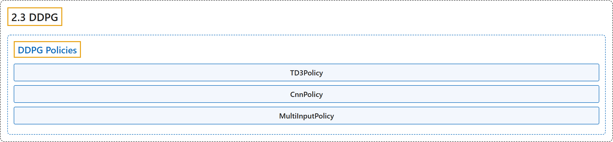

# 2.3 DDPG

## Classification

## Glossary

| Term | Definition | 中文翻译 | Source |
|---|---|---|---|
| **2.3 DDPG** DDPG（深度确定性策略梯度） | "Deep Deterministic Policy Gradient (DDPG) **combines the trick for DQN with the deterministic policy gradient, to obtain an algorithm for continuous actions**." | 深度确定性策略梯度（DDPG）**把 DQN 的技巧与确定性策略梯度结合起来，得到一种用于连续动作的算法**。 | [Raffin et al., n.d., "DDPG", para. 1](https://stable-baselines3.readthedocs.io/en/master/modules/ddpg.html#module-stable_baselines3.ddpg) |
| **DDPG Policies** DDPG 策略 | (No definition) | （无定义） | [Raffin et al., n.d., "DDPG Policies"](https://stable-baselines3.readthedocs.io/en/master/modules/ddpg.html#ddpg-policies) |
| **TD3Policy** TD3Policy TD3 策略 | "**Policy class (with both actor and critic) for TD3**." | **TD3 的策略类（同时具有 actor 和 critic）**。 | [Raffin et al., n.d., "DDPG Policies", para. 1](https://stable-baselines3.readthedocs.io/en/master/modules/ddpg.html#stable_baselines3.ddpg.MlpPolicy) |
| **TD3Policy.forward** forward 方法 | "**Define the computation performed at every call**." | **定义每次调用时执行的计算**。 | [Raffin et al., n.d., "DDPG Policies", para. 1](https://stable-baselines3.readthedocs.io/en/master/modules/ddpg.html#stable_baselines3.ddpg.MlpPolicy) |
| **TD3Policy.set_training_mode** set_training_mode 方法 | "**Put the policy in either training or evaluation mode**." | **把策略置于训练模式或评估模式**。 | [Raffin et al., n.d., "DDPG Policies", para. 1](https://stable-baselines3.readthedocs.io/en/master/modules/ddpg.html#stable_baselines3.ddpg.MlpPolicy) |
| **CnnPolicy** CnnPolicy CNN 策略 | "**Policy class (with both actor and critic) for TD3**." | **TD3 的策略类（同时具有 actor 和 critic）**。 | [Raffin et al., n.d., "DDPG Policies", para. 1](https://stable-baselines3.readthedocs.io/en/master/modules/ddpg.html#ddpg-policies) |
| **MultiInputPolicy** MultiInputPolicy 多输入策略 | "**Policy class (with both actor and critic) for TD3 to be used with Dict observation spaces**." | **TD3 的策略类（同时具有 actor 和 critic），用于 Dict 观测空间**。 | [Raffin et al., n.d., "DDPG Policies", para. 1](https://stable-baselines3.readthedocs.io/en/master/modules/ddpg.html#ddpg-policies) |

## References

Raffin, A., Hill, A., Gleave, A., Kanervisto, A., Ernestus, M., & Dormann, N.. (n.d.). *DDPG*. Stable-Baselines3 docs (Version 2.9.2a0). Retrieved October 31, 2026, from <https://stable-baselines3.readthedocs.io/en/master/modules/ddpg.html>
