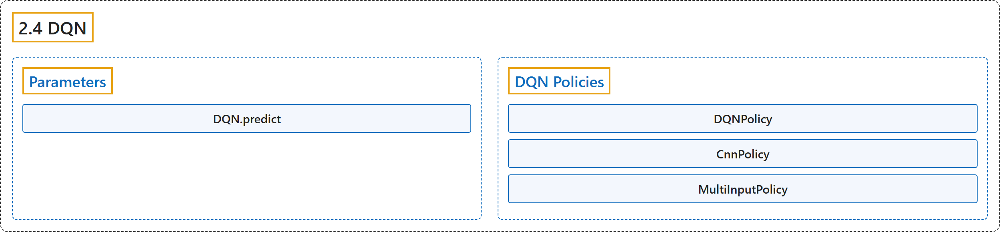

# 2.4 DQN

## Classification

## Glossary

| Term | Definition | 中文翻译 | Source |
|---|---|---|---|
| **2.4 DQN** DQN（深度 Q 网络） | "Deep Q Network (DQN) **builds on Fitted Q-Iteration (FQI) and make use of different tricks to stabilize the learning with neural networks**: it uses a replay buffer, a target network and gradient clipping." | 深度 Q 网络（DQN）**以拟合 Q 迭代（FQI）为基础，并用多种技巧来稳定神经网络的学习**：它使用经验回放缓冲区、目标网络和梯度裁剪。 | [Raffin et al., n.d., "DQN", para. 1](https://stable-baselines3.readthedocs.io/en/master/modules/dqn.html#module-stable_baselines3.dqn) |
| **Parameters** 参数 | (No definition) | （无定义） | [Raffin et al., n.d., "Parameters"](https://stable-baselines3.readthedocs.io/en/master/modules/dqn.html#parameters) |
| **DQN.predict** predict 方法 | "**Overrides the base_class predict function to include epsilon-greedy exploration**." | **重写 base_class 的 predict 函数，加入 epsilon-greedy 探索**。 | [Raffin et al., n.d., "Parameters", para. 1](https://stable-baselines3.readthedocs.io/en/master/modules/dqn.html#stable_baselines3.dqn.DQN.predict) |
| **DQN Policies** DQN 策略 | (No definition) | （无定义） | [Raffin et al., n.d., "DQN Policies"](https://stable-baselines3.readthedocs.io/en/master/modules/dqn.html#dqn-policies) |
| **DQNPolicy** DQNPolicy DQN 策略 | "**Policy class with Q-Value Net and target net for DQN**" | **DQN 的策略类，带有 Q 值网络和目标网络** | [Raffin et al., n.d., "DQN Policies", para. 1](https://stable-baselines3.readthedocs.io/en/master/modules/dqn.html#stable_baselines3.dqn.MlpPolicy) |
| **CnnPolicy** CnnPolicy CNN 策略 | "**Policy class for DQN when using images as input**." | **以图像作为输入时 DQN 的策略类**。 | [Raffin et al., n.d., "DQN Policies", para. 1](https://stable-baselines3.readthedocs.io/en/master/modules/dqn.html#stable_baselines3.dqn.CnnPolicy) |
| **MultiInputPolicy** MultiInputPolicy 多输入策略 | "**Policy class for DQN when using dict observations as input**." | **以字典观测作为输入时 DQN 的策略类**。 | [Raffin et al., n.d., "DQN Policies", para. 1](https://stable-baselines3.readthedocs.io/en/master/modules/dqn.html#stable_baselines3.dqn.MultiInputPolicy) |

## References

Raffin, A., Hill, A., Gleave, A., Kanervisto, A., Ernestus, M., & Dormann, N.. (n.d.). *DQN*. Stable-Baselines3 docs (Version 2.9.2a0). Retrieved October 31, 2026, from <https://stable-baselines3.readthedocs.io/en/master/modules/dqn.html>
