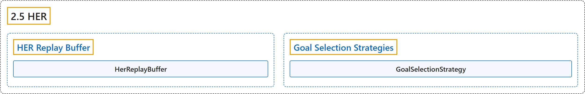

# 2.5 HER

## Classification

## Glossary

| Term | Definition | 中文翻译 | Source |
|---|---|---|---|
| **2.5 HER** HER（事后经验回放） | "HER is **an algorithm that works with off-policy methods** (DQN, SAC, TD3 and DDPG for example)." | HER 是**一种与离策略方法配合使用的算法**（例如 DQN、SAC、TD3 和 DDPG）。 | [Raffin et al., n.d., "HER", para. 2](https://stable-baselines3.readthedocs.io/en/master/modules/her.html#module-stable_baselines3.her) |
| **HER Replay Buffer** HER 回放缓冲区 | (No definition) | （无定义） | [Raffin et al., n.d., "HER Replay Buffer"](https://stable-baselines3.readthedocs.io/en/master/modules/her.html#her-replay-buffer) |
| **HerReplayBuffer** HerReplayBuffer 后见经验回放缓冲区 | "**Hindsight Experience Replay (HER) buffer**." | **后见经验回放（HER）缓冲区**。 | [Raffin et al., n.d., "HER Replay Buffer", para. 1](https://stable-baselines3.readthedocs.io/en/master/modules/her.html#stable_baselines3.her.HerReplayBuffer) |
| **HerReplayBuffer.add** add 方法 | "**Add elements to the buffer**." | **向缓冲区添加元素**。 | [Raffin et al., n.d., "HER Replay Buffer", para. 1](https://stable-baselines3.readthedocs.io/en/master/modules/her.html#stable_baselines3.her.HerReplayBuffer.add) |
| **HerReplayBuffer.extend** extend 方法 | "**Add a new batch of transitions to the buffer**" | **向缓冲区添加一批新的转移** | [Raffin et al., n.d., "HER Replay Buffer", para. 1](https://stable-baselines3.readthedocs.io/en/master/modules/her.html#stable_baselines3.her.HerReplayBuffer.extend) |
| **HerReplayBuffer.reset** reset 方法 | "**Reset the buffer**." | **重置缓冲区**。 | [Raffin et al., n.d., "HER Replay Buffer", para. 1](https://stable-baselines3.readthedocs.io/en/master/modules/her.html#stable_baselines3.her.HerReplayBuffer.reset) |
| **HerReplayBuffer.sample** sample 方法 | "**Sample elements from the replay buffer**." | **从回放缓冲区中采样元素**。 | [Raffin et al., n.d., "HER Replay Buffer", para. 1](https://stable-baselines3.readthedocs.io/en/master/modules/her.html#stable_baselines3.her.HerReplayBuffer.sample) |
| **HerReplayBuffer.set_env** set_env 方法 | "**Sets the environment**." | **设置环境**。 | [Raffin et al., n.d., "HER Replay Buffer", para. 1](https://stable-baselines3.readthedocs.io/en/master/modules/her.html#stable_baselines3.her.HerReplayBuffer.set_env) |
| **HerReplayBuffer.size** size 方法 | (No definition) | （无定义） | [Raffin et al., n.d., "HER Replay Buffer"](https://stable-baselines3.readthedocs.io/en/master/modules/her.html#stable_baselines3.her.HerReplayBuffer.size) |
| **HerReplayBuffer.swap_and_flatten** swap_and_flatten 方法 | "**Swap and then flatten axes 0 (buffer_size) and 1 (n_envs)** to convert shape from [n_steps, n_envs, …] (when … is the shape of the features) to [n_steps * n_envs, …] (which maintain the order)" | **交换然后展平第 0 轴（buffer_size）和第 1 轴（n_envs）**，把形状从 [n_steps, n_envs, …]（… 为特征的形状）转换为 [n_steps * n_envs, …]（保持顺序） | [Raffin et al., n.d., "HER Replay Buffer", para. 1](https://stable-baselines3.readthedocs.io/en/master/modules/her.html#stable_baselines3.her.HerReplayBuffer.swap_and_flatten) |
| **HerReplayBuffer.to_torch** to_torch 方法 | "**Convert a numpy array to a PyTorch tensor**." | **把 numpy 数组转换为 PyTorch 张量**。 | [Raffin et al., n.d., "HER Replay Buffer", para. 1](https://stable-baselines3.readthedocs.io/en/master/modules/her.html#stable_baselines3.her.HerReplayBuffer.to_torch) |
| **HerReplayBuffer.truncate_last_trajectory** truncate_last_trajectory 方法 | "If called, we assume that **the last trajectory in the replay buffer was finished (and truncate it)**." | 如果调用它，我们就认为**回放缓冲区中的最后一条轨迹已经结束（并将其截断）**。 | [Raffin et al., n.d., "HER Replay Buffer", para. 1](https://stable-baselines3.readthedocs.io/en/master/modules/her.html#stable_baselines3.her.HerReplayBuffer.truncate_last_trajectory) |
| **Goal Selection Strategies** 目标选择策略 | (No definition) | （无定义） | [Raffin et al., n.d., "Goal Selection Strategies"](https://stable-baselines3.readthedocs.io/en/master/modules/her.html#goal-selection-strategies) |
| **GoalSelectionStrategy** GoalSelectionStrategy 目标选择策略 | "**The strategies for selecting new goals when creating artificial transitions**." | **创建人工转移时选择新目标的策略**。 | [Raffin et al., n.d., "Goal Selection Strategies", para. 1](https://stable-baselines3.readthedocs.io/en/master/modules/her.html#stable_baselines3.her.GoalSelectionStrategy) |

## References

Raffin, A., Hill, A., Gleave, A., Kanervisto, A., Ernestus, M., & Dormann, N.. (n.d.). *HER*. Stable-Baselines3 docs (Version 2.9.2a0). Retrieved October 31, 2026, from <https://stable-baselines3.readthedocs.io/en/master/modules/her.html>
