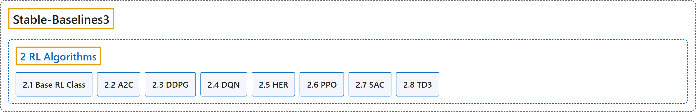

# 2. RL Algorithms

## Classification

## Glossary

| Term | Definition | 中文翻译 | Source |
|---|---|---|---|
| **2 RL Algorithms** 强化学习算法 | (context) "This table displays **the RL algorithms that are implemented in the Stable Baselines3 project**, along with some useful characteristics: support for discrete/continuous actions, multiprocessing." | （语境）此表列出 **Stable Baselines3 项目中实现的强化学习算法**，以及一些有用的特性：是否支持离散或连续动作、多进程。 | [Raffin et al., n.d.-g, "RL Algorithms", para. 1](https://stable-baselines3.readthedocs.io/en/master/guide/algos.html#rl-algorithms) |
| **[2.1 Base RL Class](base-rl-class.md)** 强化学习基类 | "**Common interface for all the RL algorithms**" | **所有强化学习算法的公共接口** | [Raffin et al., n.d.-b, "Base RL Class", para. 1](https://stable-baselines3.readthedocs.io/en/master/modules/base.html#base-rl-class) |
| **[2.2 A2C](a2c.md)** A2C（优势演员-评论家） | "**A synchronous, deterministic variant of Asynchronous Advantage Actor Critic (A3C).**" | **异步优势演员-评论家（A3C）的同步、确定性变体。** | [Raffin et al., n.d.-a, "A2C", para. 1](https://stable-baselines3.readthedocs.io/en/master/modules/a2c.html#module-stable_baselines3.a2c) |
| **[2.3 DDPG](ddpg.md)** DDPG（深度确定性策略梯度） | "Deep Deterministic Policy Gradient (DDPG) **combines the trick for DQN with the deterministic policy gradient, to obtain an algorithm for continuous actions**." | 深度确定性策略梯度（DDPG）**把 DQN 的技巧与确定性策略梯度结合起来，得到一种用于连续动作的算法**。 | [Raffin et al., n.d.-c, "DDPG", para. 1](https://stable-baselines3.readthedocs.io/en/master/modules/ddpg.html#module-stable_baselines3.ddpg) |
| **[2.4 DQN](dqn.md)** DQN（深度 Q 网络） | "Deep Q Network (DQN) **builds on Fitted Q-Iteration (FQI) and make use of different tricks to stabilize the learning with neural networks**: it uses a replay buffer, a target network and gradient clipping." | 深度 Q 网络（DQN）**以拟合 Q 迭代（FQI）为基础，并用多种技巧来稳定神经网络的学习**：它使用经验回放缓冲区、目标网络和梯度裁剪。 | [Raffin et al., n.d.-d, "DQN", para. 1](https://stable-baselines3.readthedocs.io/en/master/modules/dqn.html#module-stable_baselines3.dqn) |
| **[2.5 HER](her.md)** HER（事后经验回放） | "HER is **an algorithm that works with off-policy methods** (DQN, SAC, TD3 and DDPG for example)." | HER 是**一种与离策略方法配合使用的算法**（例如 DQN、SAC、TD3 和 DDPG）。 | [Raffin et al., n.d.-e, "HER", para. 2](https://stable-baselines3.readthedocs.io/en/master/modules/her.html#module-stable_baselines3.her) |
| **[2.6 PPO](ppo.md)** PPO（近端策略优化） | "The Proximal Policy Optimization algorithm **combines ideas from A2C (having multiple workers) and TRPO (it uses a trust region to improve the actor)**." | 近端策略优化算法**结合了 A2C（使用多个工作进程）和 TRPO（用信赖域改进演员）的思想**。 | [Raffin et al., n.d.-f, "PPO", para. 1](https://stable-baselines3.readthedocs.io/en/master/modules/ppo.html#ppo) |
| **[2.7 SAC](sac.md)** SAC（软演员-评论家） | "Soft Actor Critic (SAC) **Off-Policy Maximum Entropy Deep Reinforcement Learning with a Stochastic Actor**." | 软演员-评论家（SAC）：**带随机演员的离策略最大熵深度强化学习**。 | [Raffin et al., n.d.-h, "SAC", para. 1](https://stable-baselines3.readthedocs.io/en/master/modules/sac.html#module-stable_baselines3.sac) |
| **[2.8 TD3](td3.md)** TD3（双延迟 DDPG） | "TD3 is **a direct successor of DDPG and improves it using three major tricks: clipped double Q-Learning, delayed policy update and target policy smoothing**." | TD3 是 **DDPG 的直接后继，用三个主要技巧改进了它：裁剪双 Q 学习、延迟策略更新和目标策略平滑**。 | [Raffin et al., n.d.-i, "TD3", para. 2](https://stable-baselines3.readthedocs.io/en/master/modules/td3.html#module-stable_baselines3.td3) |

## References

Raffin, A., Hill, A., Gleave, A., Kanervisto, A., Ernestus, M., & Dormann, N.. (n.d.-a). *A2C*. Stable-Baselines3 docs (Version 2.9.2a0). Retrieved October 31, 2026, from <https://stable-baselines3.readthedocs.io/en/master/modules/a2c.html>

Raffin, A., Hill, A., Gleave, A., Kanervisto, A., Ernestus, M., & Dormann, N.. (n.d.-b). *Base RL Class*. Stable-Baselines3 docs (Version 2.9.2a0). Retrieved October 31, 2026, from <https://stable-baselines3.readthedocs.io/en/master/modules/base.html>

Raffin, A., Hill, A., Gleave, A., Kanervisto, A., Ernestus, M., & Dormann, N.. (n.d.-c). *DDPG*. Stable-Baselines3 docs (Version 2.9.2a0). Retrieved October 31, 2026, from <https://stable-baselines3.readthedocs.io/en/master/modules/ddpg.html>

Raffin, A., Hill, A., Gleave, A., Kanervisto, A., Ernestus, M., & Dormann, N.. (n.d.-d). *DQN*. Stable-Baselines3 docs (Version 2.9.2a0). Retrieved October 31, 2026, from <https://stable-baselines3.readthedocs.io/en/master/modules/dqn.html>

Raffin, A., Hill, A., Gleave, A., Kanervisto, A., Ernestus, M., & Dormann, N.. (n.d.-e). *HER*. Stable-Baselines3 docs (Version 2.9.2a0). Retrieved October 31, 2026, from <https://stable-baselines3.readthedocs.io/en/master/modules/her.html>

Raffin, A., Hill, A., Gleave, A., Kanervisto, A., Ernestus, M., & Dormann, N.. (n.d.-f). *PPO*. Stable-Baselines3 docs (Version 2.9.2a0). Retrieved October 31, 2026, from <https://stable-baselines3.readthedocs.io/en/master/modules/ppo.html>

Raffin, A., Hill, A., Gleave, A., Kanervisto, A., Ernestus, M., & Dormann, N.. (n.d.-g). *RL Algorithms*. Stable-Baselines3 docs (Version 2.9.2a0). Retrieved October 31, 2026, from <https://stable-baselines3.readthedocs.io/en/master/guide/algos.html>

Raffin, A., Hill, A., Gleave, A., Kanervisto, A., Ernestus, M., & Dormann, N.. (n.d.-h). *SAC*. Stable-Baselines3 docs (Version 2.9.2a0). Retrieved October 31, 2026, from <https://stable-baselines3.readthedocs.io/en/master/modules/sac.html>

Raffin, A., Hill, A., Gleave, A., Kanervisto, A., Ernestus, M., & Dormann, N.. (n.d.-i). *TD3*. Stable-Baselines3 docs (Version 2.9.2a0). Retrieved October 31, 2026, from <https://stable-baselines3.readthedocs.io/en/master/modules/td3.html>
