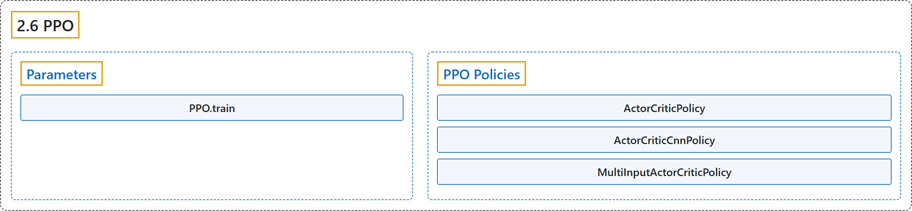

# 2.6 PPO

## Classification

## Glossary

| Term | Definition | 中文翻译 | Source |
|---|---|---|---|
| **2.6 PPO** PPO（近端策略优化） | "The Proximal Policy Optimization algorithm **combines ideas from A2C (having multiple workers) and TRPO (it uses a trust region to improve the actor)**." | 近端策略优化算法**结合了 A2C（使用多个工作进程）和 TRPO（用信赖域改进演员）的思想**。 | [Raffin et al., n.d., "PPO", para. 1](https://stable-baselines3.readthedocs.io/en/master/modules/ppo.html#ppo) |
| **Parameters** 参数 | (No definition) | （无定义） | [Raffin et al., n.d., "Parameters"](https://stable-baselines3.readthedocs.io/en/master/modules/ppo.html#parameters) |
| **PPO.train** train 方法 | "**Update policy using the currently gathered rollout buffer**." | **用当前收集的 rollout 缓冲区更新策略**。 | [Raffin et al., n.d., "Parameters", para. 1](https://stable-baselines3.readthedocs.io/en/master/modules/ppo.html#stable_baselines3.ppo.PPO.train) |
| **PPO Policies** PPO 策略 | (No definition) | （无定义） | [Raffin et al., n.d., "PPO Policies"](https://stable-baselines3.readthedocs.io/en/master/modules/ppo.html#ppo-policies) |
| **ActorCriticPolicy** ActorCriticPolicy 演员-评论家策略 | "**Policy class for actor-critic algorithms (has both policy and value prediction)**." | **用于 actor-critic 算法的策略类（同时具有策略预测和价值预测）**。 | [Raffin et al., n.d., "PPO Policies", para. 1](https://stable-baselines3.readthedocs.io/en/master/modules/ppo.html#stable_baselines3.ppo.MlpPolicy) |
| **ActorCriticCnnPolicy** ActorCriticCnnPolicy 演员-评论家 CNN 策略 | "**CNN policy class for actor-critic algorithms (has both policy and value prediction)**." | **用于 actor-critic 算法的 CNN 策略类（同时具有策略预测和价值预测）**。 | [Raffin et al., n.d., "PPO Policies", para. 1](https://stable-baselines3.readthedocs.io/en/master/modules/ppo.html#stable_baselines3.ppo.CnnPolicy) |
| **MultiInputActorCriticPolicy** MultiInputActorCriticPolicy 多输入演员-评论家策略 | "**MultiInputActorClass policy class for actor-critic algorithms (has both policy and value prediction)**." | **用于 actor-critic 算法的 MultiInputActorClass 策略类（同时具有策略预测和价值预测）**。 | [Raffin et al., n.d., "PPO Policies", para. 1](https://stable-baselines3.readthedocs.io/en/master/modules/ppo.html#stable_baselines3.ppo.MultiInputPolicy) |

## References

Raffin, A., Hill, A., Gleave, A., Kanervisto, A., Ernestus, M., & Dormann, N.. (n.d.). *PPO*. Stable-Baselines3 docs (Version 2.9.2a0). Retrieved October 31, 2026, from <https://stable-baselines3.readthedocs.io/en/master/modules/ppo.html>
