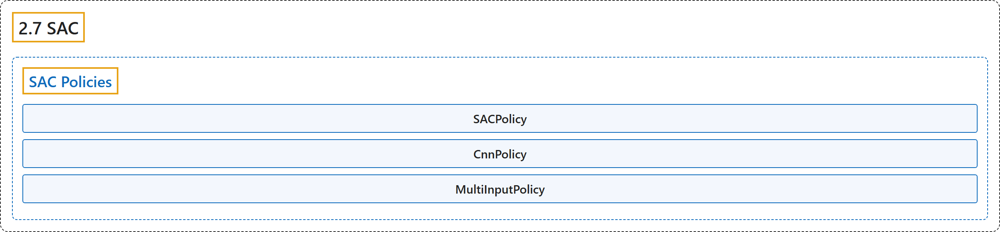

# 2.7 SAC

## Classification

## Glossary

| Term | Definition | 中文翻译 | Source |
|---|---|---|---|
| **2.7 SAC** SAC（软演员-评论家） | "Soft Actor Critic (SAC) **Off-Policy Maximum Entropy Deep Reinforcement Learning with a Stochastic Actor**." | 软演员-评论家（SAC）：**带随机演员的离策略最大熵深度强化学习**。 | [Raffin et al., n.d., "SAC", para. 1](https://stable-baselines3.readthedocs.io/en/master/modules/sac.html#module-stable_baselines3.sac) |
| **SAC Policies** SAC 策略 | (No definition) | （无定义） | [Raffin et al., n.d., "SAC Policies"](https://stable-baselines3.readthedocs.io/en/master/modules/sac.html#sac-policies) |
| **SACPolicy** SACPolicy SAC 策略 | "**Policy class (with both actor and critic) for SAC**." | **SAC 的策略类（同时具有 actor 和 critic）**。 | [Raffin et al., n.d., "SAC Policies", para. 1](https://stable-baselines3.readthedocs.io/en/master/modules/sac.html#stable_baselines3.sac.MlpPolicy) |
| **SACPolicy.reset_noise** reset_noise 方法 | "**Sample new weights for the exploration matrix, when using gSDE**." | **使用 gSDE 时，为探索矩阵采样新的权重**。 | [Raffin et al., n.d., "SAC Policies", para. 1](https://stable-baselines3.readthedocs.io/en/master/modules/sac.html#stable_baselines3.sac.MlpPolicy) |
| **CnnPolicy** CnnPolicy CNN 策略 | "**Policy class (with both actor and critic) for SAC**." | **SAC 的策略类（同时具有 actor 和 critic）**。 | [Raffin et al., n.d., "SAC Policies", para. 1](https://stable-baselines3.readthedocs.io/en/master/modules/sac.html#stable_baselines3.sac.CnnPolicy) |
| **MultiInputPolicy** MultiInputPolicy 多输入策略 | "**Policy class (with both actor and critic) for SAC**." | **SAC 的策略类（同时具有 actor 和 critic）**。 | [Raffin et al., n.d., "SAC Policies", para. 1](https://stable-baselines3.readthedocs.io/en/master/modules/sac.html#stable_baselines3.sac.MultiInputPolicy) |

## References

Raffin, A., Hill, A., Gleave, A., Kanervisto, A., Ernestus, M., & Dormann, N.. (n.d.). *SAC*. Stable-Baselines3 docs (Version 2.9.2a0). Retrieved October 31, 2026, from <https://stable-baselines3.readthedocs.io/en/master/modules/sac.html>
