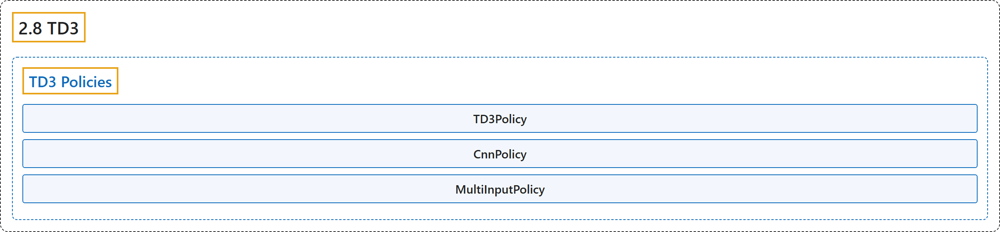

# 2.8 TD3

## Classification

## Glossary

| Term | Definition | 中文翻译 | Source |
|---|---|---|---|
| **2.8 TD3** TD3（双延迟 DDPG） | "TD3 is **a direct successor of DDPG and improves it using three major tricks: clipped double Q-Learning, delayed policy update and target policy smoothing**." | TD3 是 **DDPG 的直接后继，用三个主要技巧改进了它：裁剪双 Q 学习、延迟策略更新和目标策略平滑**。 | [Raffin et al., n.d., "TD3", para. 2](https://stable-baselines3.readthedocs.io/en/master/modules/td3.html#module-stable_baselines3.td3) |
| **TD3 Policies** TD3 策略 | (No definition) | （无定义） | [Raffin et al., n.d., "TD3 Policies"](https://stable-baselines3.readthedocs.io/en/master/modules/td3.html#td3-policies) |
| **TD3Policy** TD3Policy TD3 策略 | "**Policy class (with both actor and critic) for TD3**." | **TD3 的策略类（同时具有 actor 和 critic）**。 | [Raffin et al., n.d., "TD3 Policies", para. 1](https://stable-baselines3.readthedocs.io/en/master/modules/td3.html#stable_baselines3.td3.MlpPolicy) |
| **CnnPolicy** CnnPolicy CNN 策略 | "**Policy class (with both actor and critic) for TD3**." | **TD3 的策略类（同时具有 actor 和 critic）**。 | [Raffin et al., n.d., "TD3 Policies", para. 1](https://stable-baselines3.readthedocs.io/en/master/modules/td3.html#stable_baselines3.td3.CnnPolicy) |
| **MultiInputPolicy** MultiInputPolicy 多输入策略 | "**Policy class (with both actor and critic) for TD3 to be used with Dict observation spaces**." | **TD3 的策略类（同时具有 actor 和 critic），用于 Dict 观测空间**。 | [Raffin et al., n.d., "TD3 Policies", para. 1](https://stable-baselines3.readthedocs.io/en/master/modules/td3.html#stable_baselines3.td3.MultiInputPolicy) |

## References

Raffin, A., Hill, A., Gleave, A., Kanervisto, A., Ernestus, M., & Dormann, N.. (n.d.). *TD3*. Stable-Baselines3 docs (Version 2.9.2a0). Retrieved October 31, 2026, from <https://stable-baselines3.readthedocs.io/en/master/modules/td3.html>
