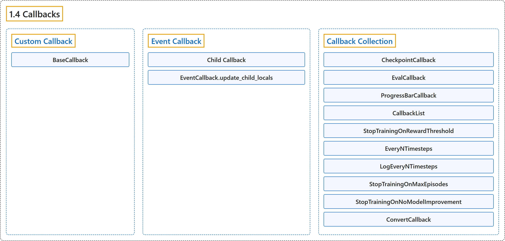

# 1.4 Callbacks

## Classification

## Glossary

| Term | Definition | 中文翻译 | Source |
|---|---|---|---|
| **1.4 Callbacks** 回调 | "A callback is **a set of functions that will be called at given stages of the training procedure**." | 回调是**一组在训练过程的特定阶段被调用的函数**。 | [Raffin et al., n.d., "Callbacks", para. 1](https://stable-baselines3.readthedocs.io/en/master/guide/callbacks.html#callbacks) |
| **Custom Callback** 自定义回调 | "To build a custom callback, you need to **create a class that derives from BaseCallback**." | 要构建自定义回调，你需要**创建一个派生自 BaseCallback 的类**。 | [Raffin et al., n.d., "Custom Callback", para. 1](https://stable-baselines3.readthedocs.io/en/master/guide/callbacks.html#custom-callback) |
| **BaseCallback** BaseCallback 回调基类 | "**Base class for callback**." | **回调的基类**。 | [Raffin et al., n.d., "Callbacks", para. 1](https://stable-baselines3.readthedocs.io/en/master/guide/callbacks.html#stable_baselines3.common.callbacks.BaseCallback) |
| **BaseCallback.init_callback** init_callback 方法 | "**Initialize the callback by saving references to the RL model and the training environment** for convenience." | **通过保存对强化学习模型和训练环境的引用来初始化回调**，以便使用。 | [Raffin et al., n.d., "Callbacks", para. 1](https://stable-baselines3.readthedocs.io/en/master/guide/callbacks.html#stable_baselines3.common.callbacks.BaseCallback.init_callback) |
| **BaseCallback.on_step** on_step 方法 | "This method will be called by the model **after each call to env.step()**." | 该方法会**在每次调用 env.step() 之后**由模型调用。 | [Raffin et al., n.d., "Callbacks", para. 1](https://stable-baselines3.readthedocs.io/en/master/guide/callbacks.html#stable_baselines3.common.callbacks.BaseCallback.on_step) |
| **BaseCallback.update_child_locals** update_child_locals 方法 | "**Update the references to the local variables on sub callbacks**." | **更新子回调上对局部变量的引用**。 | [Raffin et al., n.d., "Callbacks", para. 1](https://stable-baselines3.readthedocs.io/en/master/guide/callbacks.html#stable_baselines3.common.callbacks.BaseCallback.update_child_locals) |
| **BaseCallback.update_locals** update_locals 方法 | "**Update the references to the local variables**." | **更新对局部变量的引用**。 | [Raffin et al., n.d., "Callbacks", para. 1](https://stable-baselines3.readthedocs.io/en/master/guide/callbacks.html#stable_baselines3.common.callbacks.BaseCallback.update_locals) |
| **Event Callback** 事件回调 | "Compared to Keras, Stable Baselines provides **a second type of BaseCallback, named EventCallback that is meant to trigger events**." | 与 Keras 相比，Stable Baselines 提供了**第二种 BaseCallback，名为 EventCallback，用于触发事件**。 | [Raffin et al., n.d., "Event Callback", para. 1](https://stable-baselines3.readthedocs.io/en/master/guide/callbacks.html#event-callback) |
| **Child Callback** 子回调 | (context) "When an event is triggered, then **a child callback is called**." | （语境）当一个事件被触发时，**就会调用一个子回调**。 | [Raffin et al., n.d., "Event Callback", para. 1](https://stable-baselines3.readthedocs.io/en/master/guide/callbacks.html#event-callback) |
| **EventCallback.update_child_locals** update_child_locals 方法 | "**Update the references to the local variables**." | **更新对局部变量的引用**。 | [Raffin et al., n.d., "Callbacks", para. 1](https://stable-baselines3.readthedocs.io/en/master/guide/callbacks.html#stable_baselines3.common.callbacks.EventCallback.update_child_locals) |
| **Callback Collection** 回调集合 | (context) "Stable Baselines provides you with **a set of common callbacks** for:" | （语境）Stable Baselines 为你提供了**一组常用回调**，用于： | [Raffin et al., n.d., "Callback Collection", para. 1](https://stable-baselines3.readthedocs.io/en/master/guide/callbacks.html#callback-collection) |
| **CheckpointCallback** CheckpointCallback 检查点回调 | "Callback for **saving a model every save_freq calls to env.step()**, you must specify a log folder (save_path) and optionally a prefix for the checkpoints (rl_model by default)." | 用于**每调用 save_freq 次 env.step() 就保存一次模型**的回调，你必须指定日志文件夹（save_path），并可选地指定检查点前缀（默认 rl_model）。 | [Raffin et al., n.d., "CheckpointCallback", para. 1](https://stable-baselines3.readthedocs.io/en/master/guide/callbacks.html#checkpointcallback) |
| **EvalCallback** EvalCallback 评估回调 | "**Evaluate periodically the performance of an agent, using a separate test environment**." | **使用单独的测试环境，定期评估智能体的性能**。 | [Raffin et al., n.d., "EvalCallback", para. 1](https://stable-baselines3.readthedocs.io/en/master/guide/callbacks.html#evalcallback) |
| **ProgressBarCallback** ProgressBarCallback 进度条回调 | "**Display a progress bar with the current progress, elapsed time and estimated remaining time**." | **显示一个进度条，包含当前进度、已用时间和预计剩余时间**。 | [Raffin et al., n.d., "ProgressBarCallback", para. 1](https://stable-baselines3.readthedocs.io/en/master/guide/callbacks.html#progressbarcallback) |
| **CallbackList** CallbackList 回调列表 | "**Class for chaining callbacks, they will be called sequentially**." | **用于串联回调的类，这些回调会被依次调用**。 | [Raffin et al., n.d., "CallbackList", para. 1](https://stable-baselines3.readthedocs.io/en/master/guide/callbacks.html#callbacklist) |
| **CallbackList.update_child_locals** update_child_locals 方法 | "**Update the references to the local variables**." | **更新对局部变量的引用**。 | [Raffin et al., n.d., "Callbacks", para. 1](https://stable-baselines3.readthedocs.io/en/master/guide/callbacks.html#stable_baselines3.common.callbacks.CallbackList.update_child_locals) |
| **StopTrainingOnRewardThreshold** StopTrainingOnRewardThreshold 奖励阈值停止回调 | "**Stop the training once a threshold in episodic reward (mean episode reward over the evaluations) has been reached** (i.e., when the model is good enough)." | **一旦回合奖励（各次评估的平均回合奖励）达到阈值就停止训练**（即模型已经足够好时）。 | [Raffin et al., n.d., "StopTrainingOnRewardThreshold", para. 1](https://stable-baselines3.readthedocs.io/en/master/guide/callbacks.html#stoptrainingonrewardthreshold) |
| **EveryNTimesteps** EveryNTimesteps 每 N 步回调 | "An Event Callback that will **trigger its child callback every n_steps timesteps**." | 一个事件回调，**每隔 n_steps 个时间步触发一次其子回调**。 | [Raffin et al., n.d., "EveryNTimesteps", para. 1](https://stable-baselines3.readthedocs.io/en/master/guide/callbacks.html#everyntimesteps) |
| **LogEveryNTimesteps** LogEveryNTimesteps 每 N 步日志回调 | "A callback derived from EveryNTimesteps that will **dump the logged data every n_steps timesteps**." | 一个派生自 EveryNTimesteps 的回调，**每隔 n_steps 个时间步输出一次已记录的数据**。 | [Raffin et al., n.d., "LogEveryNTimesteps", para. 1](https://stable-baselines3.readthedocs.io/en/master/guide/callbacks.html#logeveryntimesteps) |
| **StopTrainingOnMaxEpisodes** StopTrainingOnMaxEpisodes 最大回合数停止回调 | "**Stop the training upon reaching the maximum number of episodes**, regardless of the model’s total_timesteps value." | **达到最大回合数时停止训练**，而不管模型的 total_timesteps 值。 | [Raffin et al., n.d., "StopTrainingOnMaxEpisodes", para. 1](https://stable-baselines3.readthedocs.io/en/master/guide/callbacks.html#stoptrainingonmaxepisodes) |
| **StopTrainingOnNoModelImprovement** StopTrainingOnNoModelImprovement 无改进停止回调 | "**Stop the training if there is no new best model (no new best mean reward) after more than a specific number of consecutive evaluations**." | **如果连续超过特定次数的评估都没有新的最佳模型（没有新的最佳平均奖励），就停止训练**。 | [Raffin et al., n.d., "StopTrainingOnNoModelImprovement", para. 1](https://stable-baselines3.readthedocs.io/en/master/guide/callbacks.html#stoptrainingonnomodelimprovement) |
| **ConvertCallback** ConvertCallback 转换回调 | "**Convert functional callback (old-style) to object**." | **把函数式回调（旧式）转换为对象**。 | [Raffin et al., n.d., "Callbacks", para. 1](https://stable-baselines3.readthedocs.io/en/master/guide/callbacks.html#stable_baselines3.common.callbacks.ConvertCallback) |

## References

Raffin, A., Hill, A., Gleave, A., Kanervisto, A., Ernestus, M., & Dormann, N.. (n.d.). *Callbacks*. Stable-Baselines3 docs (Version 2.9.2a0). Retrieved October 31, 2026, from <https://stable-baselines3.readthedocs.io/en/master/guide/callbacks.html>
