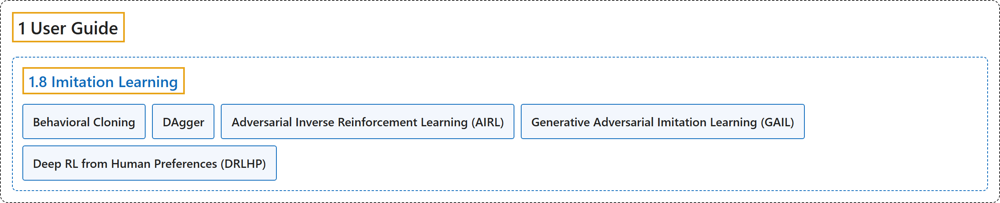

# 1.8 Imitation Learning

## Classification

## Glossary

| Term | Definition | 中文翻译 | Source |
|---|---|---|---|
| **1.8 Imitation Learning** 模仿学习 | (context) "The imitation library **implements imitation learning algorithms on top of Stable-Baselines3**, including:" | （语境）imitation 库**在 Stable-Baselines3 之上实现模仿学习算法**，包括： | [Raffin et al., n.d., "Imitation Learning", para. 1](https://stable-baselines3.readthedocs.io/en/master/guide/imitation.html#imitation-learning) |
| **Behavioral Cloning** 行为克隆 | (No definition) | （无定义） | [Raffin et al., n.d., "Imitation Learning"](https://stable-baselines3.readthedocs.io/en/master/guide/imitation.html#imitation-learning) |
| **DAgger** DAgger 数据集聚合 | (No definition) | （无定义） | [Raffin et al., n.d., "Imitation Learning"](https://stable-baselines3.readthedocs.io/en/master/guide/imitation.html#imitation-learning) |
| **Adversarial Inverse Reinforcement Learning (AIRL)** 对抗式逆强化学习（AIRL） | (No definition) | （无定义） | [Raffin et al., n.d., "Imitation Learning"](https://stable-baselines3.readthedocs.io/en/master/guide/imitation.html#imitation-learning) |
| **Generative Adversarial Imitation Learning (GAIL)** 生成对抗模仿学习（GAIL） | (No definition) | （无定义） | [Raffin et al., n.d., "Imitation Learning"](https://stable-baselines3.readthedocs.io/en/master/guide/imitation.html#imitation-learning) |
| **Deep RL from Human Preferences (DRLHP)** 基于人类偏好的深度强化学习（DRLHP） | (No definition) | （无定义） | [Raffin et al., n.d., "Imitation Learning"](https://stable-baselines3.readthedocs.io/en/master/guide/imitation.html#imitation-learning) |

## References

Raffin, A., Hill, A., Gleave, A., Kanervisto, A., Ernestus, M., & Dormann, N.. (n.d.). *Imitation Learning*. Stable-Baselines3 docs (Version 2.9.2a0). Retrieved October 31, 2026, from <https://stable-baselines3.readthedocs.io/en/master/guide/imitation.html>
