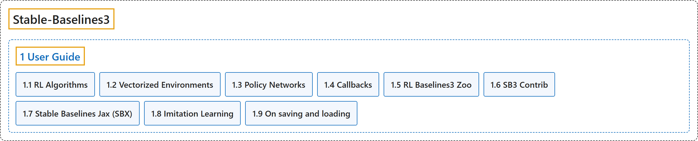

# 1. User Guide

## Classification

## Glossary

| Term | Definition | 中文翻译 | Source |
|---|---|---|---|
| **1 User Guide** 用户指南 | (No definition) | （无定义） | [Raffin et al., n.d.-i, "User Guide", documentation menu](https://stable-baselines3.readthedocs.io/en/master/) |
| **[1.1 RL Algorithms](rl-algorithms.md)** 强化学习算法 | (context) "This table displays **the RL algorithms that are implemented in the Stable Baselines3 project**, along with some useful characteristics: support for discrete/continuous actions, multiprocessing." | （语境）此表列出 **Stable Baselines3 项目中实现的强化学习算法**，以及一些有用的特性：是否支持离散或连续动作、多进程。 | [Raffin et al., n.d.-e, "RL Algorithms", para. 1](https://stable-baselines3.readthedocs.io/en/master/guide/algos.html#rl-algorithms) |
| **[1.2 Vectorized Environments](vectorized-environments.md)** 向量化环境 | "Vectorized Environments are **a method for stacking multiple independent environments into a single environment**." | 向量化环境是**一种把多个独立环境堆叠成单个环境的方法**。 | [Raffin et al., n.d.-j, "Vectorized Environments", para. 1](https://stable-baselines3.readthedocs.io/en/master/guide/vec_envs.html#vectorized-environments) |
| **[1.3 Policy Networks](policy-networks.md)** 策略网络 | (context) "Stable Baselines3 provides **policy networks for images (CnnPolicies), other type of input features (MlpPolicies) and multiple different inputs (MultiInputPolicies)**." | （语境）Stable Baselines3 提供**面向图像（CnnPolicies）、其他类型输入特征（MlpPolicies）和多种不同输入（MultiInputPolicies）的策略网络**。 | [Raffin et al., n.d.-d, "Policy Networks", para. 1](https://stable-baselines3.readthedocs.io/en/master/guide/custom_policy.html#policy-networks) |
| **[1.4 Callbacks](callbacks.md)** 回调 | "A callback is **a set of functions that will be called at given stages of the training procedure**." | 回调是**一组在训练过程的特定阶段被调用的函数**。 | [Raffin et al., n.d.-a, "Callbacks", para. 1](https://stable-baselines3.readthedocs.io/en/master/guide/callbacks.html#callbacks) |
| **[1.5 RL Baselines3 Zoo](rl-baselines3-zoo.md)** RL Baselines3 Zoo | "RL Baselines3 Zoo is **a training framework for Reinforcement Learning (RL)**." | RL Baselines3 Zoo 是**一个强化学习（RL）训练框架**。 | [Raffin et al., n.d.-f, "RL Baselines3 Zoo", para. 1](https://stable-baselines3.readthedocs.io/en/master/guide/rl_zoo.html#rl-baselines3-zoo) |
| **[1.6 SB3 Contrib](sb3-contrib.md)** SB3 Contrib | "We implement **experimental features in a separate contrib repository**: SB3-Contrib" | 我们在**一个单独的 contrib 仓库中实现实验性功能**：SB3-Contrib | [Raffin et al., n.d.-g, "SB3 Contrib", para. 1](https://stable-baselines3.readthedocs.io/en/master/guide/sb3_contrib.html#sb3-contrib) |
| **[1.7 Stable Baselines Jax (SBX)](stable-baselines-jax-sbx.md)** Stable Baselines Jax（SBX） | "Stable Baselines Jax (SBX) is **a proof of concept version of Stable-Baselines3 in Jax**." | Stable Baselines Jax（SBX）是**用 Jax 实现的 Stable-Baselines3 概念验证版本**。 | [Raffin et al., n.d.-h, "Stable Baselines Jax (SBX)", para. 1](https://stable-baselines3.readthedocs.io/en/master/guide/sbx.html#stable-baselines-jax-sbx) |
| **[1.8 Imitation Learning](imitation-learning.md)** 模仿学习 | (context) "The imitation library **implements imitation learning algorithms on top of Stable-Baselines3**, including:" | （语境）imitation 库**在 Stable-Baselines3 之上实现模仿学习算法**，包括： | [Raffin et al., n.d.-b, "Imitation Learning", para. 1](https://stable-baselines3.readthedocs.io/en/master/guide/imitation.html#imitation-learning) |
| **[1.9 On saving and loading](on-saving-and-loading.md)** 保存与加载 | (context) "Stable Baselines3 (SB3) **stores both neural network parameters and algorithm-related parameters such as exploration schedule, number of environments and observation/action space**." | （语境）Stable Baselines3（SB3）**既保存神经网络参数，也保存与算法相关的参数，如探索计划、环境数量和观测/动作空间**。 | [Raffin et al., n.d.-c, "On saving and loading", para. 1](https://stable-baselines3.readthedocs.io/en/master/guide/save_format.html#on-saving-and-loading) |

## References

Raffin, A., Hill, A., Gleave, A., Kanervisto, A., Ernestus, M., & Dormann, N.. (n.d.-a). *Callbacks*. Stable-Baselines3 docs (Version 2.9.2a0). Retrieved October 31, 2026, from <https://stable-baselines3.readthedocs.io/en/master/guide/callbacks.html>

Raffin, A., Hill, A., Gleave, A., Kanervisto, A., Ernestus, M., & Dormann, N.. (n.d.-b). *Imitation Learning*. Stable-Baselines3 docs (Version 2.9.2a0). Retrieved October 31, 2026, from <https://stable-baselines3.readthedocs.io/en/master/guide/imitation.html>

Raffin, A., Hill, A., Gleave, A., Kanervisto, A., Ernestus, M., & Dormann, N.. (n.d.-c). *On saving and loading*. Stable-Baselines3 docs (Version 2.9.2a0). Retrieved October 31, 2026, from <https://stable-baselines3.readthedocs.io/en/master/guide/save_format.html>

Raffin, A., Hill, A., Gleave, A., Kanervisto, A., Ernestus, M., & Dormann, N.. (n.d.-d). *Policy Networks*. Stable-Baselines3 docs (Version 2.9.2a0). Retrieved October 31, 2026, from <https://stable-baselines3.readthedocs.io/en/master/guide/custom_policy.html>

Raffin, A., Hill, A., Gleave, A., Kanervisto, A., Ernestus, M., & Dormann, N.. (n.d.-e). *RL Algorithms*. Stable-Baselines3 docs (Version 2.9.2a0). Retrieved October 31, 2026, from <https://stable-baselines3.readthedocs.io/en/master/guide/algos.html>

Raffin, A., Hill, A., Gleave, A., Kanervisto, A., Ernestus, M., & Dormann, N.. (n.d.-f). *RL Baselines3 Zoo*. Stable-Baselines3 docs (Version 2.9.2a0). Retrieved October 31, 2026, from <https://stable-baselines3.readthedocs.io/en/master/guide/rl_zoo.html>

Raffin, A., Hill, A., Gleave, A., Kanervisto, A., Ernestus, M., & Dormann, N.. (n.d.-g). *SB3 Contrib*. Stable-Baselines3 docs (Version 2.9.2a0). Retrieved October 31, 2026, from <https://stable-baselines3.readthedocs.io/en/master/guide/sb3_contrib.html>

Raffin, A., Hill, A., Gleave, A., Kanervisto, A., Ernestus, M., & Dormann, N.. (n.d.-h). *Stable Baselines Jax (SBX)*. Stable-Baselines3 docs (Version 2.9.2a0). Retrieved October 31, 2026, from <https://stable-baselines3.readthedocs.io/en/master/guide/sbx.html>

Raffin, A., Hill, A., Gleave, A., Kanervisto, A., Ernestus, M., & Dormann, N.. (n.d.-i). *Stable-Baselines3 Docs - Reliable Reinforcement Learning Implementations*. Stable-Baselines3 docs (Version 2.9.2a0). Retrieved October 31, 2026, from <https://stable-baselines3.readthedocs.io/en/master/>

Raffin, A., Hill, A., Gleave, A., Kanervisto, A., Ernestus, M., & Dormann, N.. (n.d.-j). *Vectorized Environments*. Stable-Baselines3 docs (Version 2.9.2a0). Retrieved October 31, 2026, from <https://stable-baselines3.readthedocs.io/en/master/guide/vec_envs.html>
