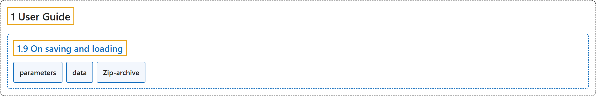

# 1.9 On saving and loading

## Classification

## Glossary

| Term | Definition | 中文翻译 | Source |
|---|---|---|---|
| **1.9 On saving and loading** 保存与加载 | (context) "Stable Baselines3 (SB3) **stores both neural network parameters and algorithm-related parameters such as exploration schedule, number of environments and observation/action space**." | （语境）Stable Baselines3（SB3）**既保存神经网络参数，也保存与算法相关的参数，如探索计划、环境数量和观测/动作空间**。 | [Raffin et al., n.d., "On saving and loading", para. 1](https://stable-baselines3.readthedocs.io/en/master/guide/save_format.html#on-saving-and-loading) |
| **parameters** 参数（parameters） | "parameters refer to **neural network parameters (also called “weights”)**." | parameters 指**神经网络参数（也称为“权重”）**。 | [Raffin et al., n.d., "On saving and loading", item 1](https://stable-baselines3.readthedocs.io/en/master/guide/save_format.html#on-saving-and-loading) |
| **data** 数据（data） | "data refers to **RL algorithm parameters, e.g. learning rate, exploration schedule, action/observation space**." | data 指**强化学习算法参数，例如学习率、探索计划、动作/观测空间**。 | [Raffin et al., n.d., "On saving and loading", item 2](https://stable-baselines3.readthedocs.io/en/master/guide/save_format.html#on-saving-and-loading) |
| **Zip-archive** Zip 归档 | "**A zip-archived JSON dump, PyTorch state dictionaries and PyTorch variables**." | **一个以 zip 归档的 JSON 转储、PyTorch 状态字典和 PyTorch 变量**。 | [Raffin et al., n.d., "Zip-archive", para. 1](https://stable-baselines3.readthedocs.io/en/master/guide/save_format.html#zip-archive) |

## References

Raffin, A., Hill, A., Gleave, A., Kanervisto, A., Ernestus, M., & Dormann, N.. (n.d.). *On saving and loading*. Stable-Baselines3 docs (Version 2.9.2a0). Retrieved October 31, 2026, from <https://stable-baselines3.readthedocs.io/en/master/guide/save_format.html>
