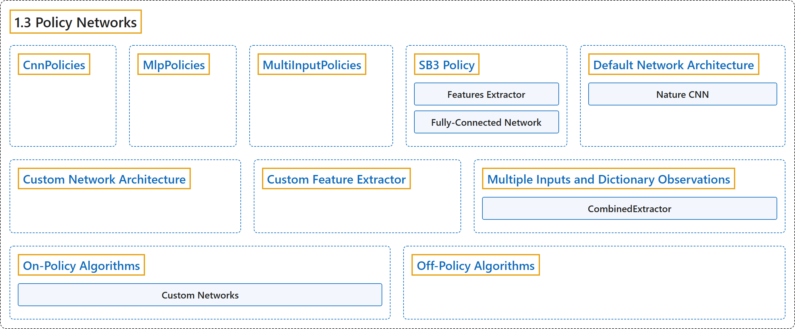

# 1.3 Policy Networks

## Classification

## Glossary

| Term | Definition | 中文翻译 | Source |
|---|---|---|---|
| **1.3 Policy Networks** 策略网络 | (context) "Stable Baselines3 provides **policy networks for images (CnnPolicies), other type of input features (MlpPolicies) and multiple different inputs (MultiInputPolicies)**." | （语境）Stable Baselines3 提供**面向图像（CnnPolicies）、其他类型输入特征（MlpPolicies）和多种不同输入（MultiInputPolicies）的策略网络**。 | [Raffin et al., n.d., "Policy Networks", para. 1](https://stable-baselines3.readthedocs.io/en/master/guide/custom_policy.html#policy-networks) |
| **CnnPolicies** CNN 策略 | "Stable Baselines3 provides policy networks for **images (CnnPolicies)**, other type of input features (MlpPolicies) and multiple different inputs (MultiInputPolicies)." | Stable Baselines3 提供了用于**图像的策略网络（CnnPolicies）**、用于其他类型输入特征的策略网络（MlpPolicies）以及用于多种不同输入的策略网络（MultiInputPolicies）。 | [Raffin et al., n.d., "Policy Networks", para. 1](https://stable-baselines3.readthedocs.io/en/master/guide/custom_policy.html#policy-networks) |
| **MlpPolicies** MLP 策略 | "Stable Baselines3 provides policy networks for images (CnnPolicies), **other type of input features (MlpPolicies)** and multiple different inputs (MultiInputPolicies)." | Stable Baselines3 提供了用于图像的策略网络（CnnPolicies）、**用于其他类型输入特征的策略网络**（MlpPolicies）以及用于多种不同输入的策略网络（MultiInputPolicies）。 | [Raffin et al., n.d., "Policy Networks", para. 1](https://stable-baselines3.readthedocs.io/en/master/guide/custom_policy.html#policy-networks) |
| **MultiInputPolicies** 多输入策略 | "Stable Baselines3 provides policy networks for images (CnnPolicies), other type of input features (MlpPolicies) and **multiple different inputs (MultiInputPolicies)**." | Stable Baselines3 提供了用于图像的策略网络（CnnPolicies）、用于其他类型输入特征的策略网络（MlpPolicies）以及**用于多种不同输入的策略网络（MultiInputPolicies）**。 | [Raffin et al., n.d., "Policy Networks", para. 1](https://stable-baselines3.readthedocs.io/en/master/guide/custom_policy.html#policy-networks) |
| **SB3 Policy** SB3 策略 | "SB3 policies are usually composed of **several networks (actor/critic networks + target networks when applicable) together with the associated optimizers**." | SB3 策略通常由**若干网络（actor/critic 网络，适用时再加目标网络）以及相应的优化器**组成。 | [Raffin et al., n.d., "SB3 Policy", para. 2](https://stable-baselines3.readthedocs.io/en/master/guide/custom_policy.html#sb3-policy) |
| **Features Extractor** 特征提取器 | "A features extractor (usually shared between actor and critic when applicable, to save computation) whose role is to **extract features (i.e. convert to a feature vector) from high-dimensional observations**, for instance, a CNN that extracts features from images." | 特征提取器（适用时通常由 actor 和 critic 共享，以节省计算），其作用是**从高维观测中提取特征（即转换为特征向量）**，例如从图像中提取特征的 CNN。 | [Raffin et al., n.d., "SB3 Policy", item 1](https://stable-baselines3.readthedocs.io/en/master/guide/custom_policy.html#sb3-policy) |
| **Fully-Connected Network** 全连接网络 | "A (fully-connected) network that **maps the features to actions/value**." | 一个（全连接）网络，**把特征映射为动作/价值**。 | [Raffin et al., n.d., "SB3 Policy", item 2](https://stable-baselines3.readthedocs.io/en/master/guide/custom_policy.html#sb3-policy) |
| **Default Network Architecture** 默认网络架构 | (context) "The default network architecture used by SB3 **depends on the algorithm and the observation space**." | （语境）SB3 使用的默认网络架构**取决于算法和观测空间**。 | [Raffin et al., n.d., "Default Network Architecture", para. 1](https://stable-baselines3.readthedocs.io/en/master/guide/custom_policy.html#default-network-architecture) |
| **Nature CNN** Nature CNN | (context) "For image observation spaces, **the “Nature CNN” (see code for more details) is used for feature extraction**, and SAC/TD3 also keeps the same fully connected network after it." | （语境）对于图像观测空间，**使用“Nature CNN”（详见代码）进行特征提取**，SAC/TD3 还会在其后保留同样的全连接网络。 | [Raffin et al., n.d., "Default Network Architecture", para. 3](https://stable-baselines3.readthedocs.io/en/master/guide/custom_policy.html#default-network-architecture) |
| **Custom Network Architecture** 自定义网络架构 | (context) "One way of customising the policy network architecture is to **pass arguments when creating the model, using policy_kwargs parameter**:" | （语境）自定义策略网络架构的一种方式，是**在创建模型时通过 policy_kwargs 参数传入参数**： | [Raffin et al., n.d., "Custom Network Architecture", para. 1](https://stable-baselines3.readthedocs.io/en/master/guide/custom_policy.html#custom-network-architecture) |
| **Custom Feature Extractor** 自定义特征提取器 | (context) "If you want to have a custom features extractor (e.g. custom CNN when using images), you can **define class that derives from BaseFeaturesExtractor and then pass it to the model when training**." | （语境）如果你想要自定义特征提取器（例如使用图像时的自定义 CNN），可以**定义一个派生自 BaseFeaturesExtractor 的类，然后在训练时把它传给模型**。 | [Raffin et al., n.d., "Custom Feature Extractor", para. 1](https://stable-baselines3.readthedocs.io/en/master/guide/custom_policy.html#custom-feature-extractor) |
| **Multiple Inputs and Dictionary Observations** 多输入与字典观测 | (context) "Stable Baselines3 supports **handling of multiple inputs by using Dict Gym space**." | （语境）Stable Baselines3 支持**通过使用 Dict Gym 空间来处理多个输入**。 | [Raffin et al., n.d., "Multiple Inputs and Dictionary Observations", para. 1](https://stable-baselines3.readthedocs.io/en/master/guide/custom_policy.html#multiple-inputs-and-dictionary-observations) |
| **CombinedExtractor** CombinedExtractor 组合提取器 | "This can be done using MultiInputPolicy, which by default uses the CombinedExtractor **features extractor to turn multiple inputs into a single vector**, handled by the net_arch network." | 这可以用 MultiInputPolicy 来实现，它默认使用 CombinedExtractor 这一**把多个输入转换为单个向量的特征提取器**，再交由 net_arch 网络处理。 | [Raffin et al., n.d., "Multiple Inputs and Dictionary Observations", para. 1](https://stable-baselines3.readthedocs.io/en/master/guide/custom_policy.html#multiple-inputs-and-dictionary-observations) |
| **On-Policy Algorithms** 同策略算法 | (No definition) | （无定义） | [Raffin et al., n.d., "On-Policy Algorithms"](https://stable-baselines3.readthedocs.io/en/master/guide/custom_policy.html#on-policy-algorithms) |
| **Custom Networks** 自定义网络 | (context) "If you need a network architecture that is different for the actor and the critic when using PPO, A2C or TRPO, you can **pass a dictionary of the following structure: dict(pi=[<actor network architecture>], vf=[<critic network architecture>])**." | （语境）如果使用 PPO、A2C 或 TRPO 时需要 actor 和 critic 采用不同的网络架构，可以**传入如下结构的字典：dict(pi=[<actor network architecture>], vf=[<critic network architecture>])**。 | [Raffin et al., n.d., "Custom Networks", para. 1](https://stable-baselines3.readthedocs.io/en/master/guide/custom_policy.html#custom-networks) |
| **Off-Policy Algorithms** 离策略算法 | (context) "If you need a network architecture that is different for the actor and the critic when using SAC, DDPG, TQC or TD3, you can **pass a dictionary of the following structure: dict(pi=[<actor network architecture>], qf=[<critic network architecture>])**." | （语境）如果使用 SAC、DDPG、TQC 或 TD3 时需要 actor 和 critic 采用不同的网络架构，可以**传入如下结构的字典：dict(pi=[<actor network architecture>], qf=[<critic network architecture>])**。 | [Raffin et al., n.d., "Off-Policy Algorithms", para. 1](https://stable-baselines3.readthedocs.io/en/master/guide/custom_policy.html#off-policy-algorithms) |

## References

Raffin, A., Hill, A., Gleave, A., Kanervisto, A., Ernestus, M., & Dormann, N.. (n.d.). *Policy Networks*. Stable-Baselines3 docs (Version 2.9.2a0). Retrieved October 31, 2026, from <https://stable-baselines3.readthedocs.io/en/master/guide/custom_policy.html>
