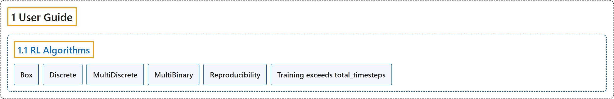

# 1.1 RL Algorithms

## Classification

## Glossary

| Term | Definition | 中文翻译 | Source |
|---|---|---|---|
| **1.1 RL Algorithms** 强化学习算法 | (context) "This table displays **the RL algorithms that are implemented in the Stable Baselines3 project**, along with some useful characteristics: support for discrete/continuous actions, multiprocessing." | （语境）此表列出 **Stable Baselines3 项目中实现的强化学习算法**，以及一些有用的特性：是否支持离散或连续动作、多进程。 | [Raffin et al., n.d., "RL Algorithms", para. 1](https://stable-baselines3.readthedocs.io/en/master/guide/algos.html#rl-algorithms) |
| **Box** Box 空间 | "Box: **A N-dimensional box that contains every point in the action space**." | Box：**一个包含动作空间中每一个点的 N 维盒子**。 | [Raffin et al., n.d., "RL Algorithms", item 1](https://stable-baselines3.readthedocs.io/en/master/guide/algos.html#rl-algorithms) |
| **Discrete** Discrete 空间 | "Discrete: **A list of possible actions, where each timestep only one of the actions can be used**." | Discrete：**一个可能动作的列表，每个时间步只能使用其中一个动作**。 | [Raffin et al., n.d., "RL Algorithms", item 2](https://stable-baselines3.readthedocs.io/en/master/guide/algos.html#rl-algorithms) |
| **MultiDiscrete** MultiDiscrete 空间 | "MultiDiscrete: **A list of possible actions, where each timestep only one action of each discrete set can be used**." | MultiDiscrete：**一个可能动作的列表，每个时间步每个离散集合中只能使用一个动作**。 | [Raffin et al., n.d., "RL Algorithms", item 3](https://stable-baselines3.readthedocs.io/en/master/guide/algos.html#rl-algorithms) |
| **MultiBinary** MultiBinary 空间 | "MultiBinary: **A list of possible actions, where each timestep any of the actions can be used in any combination**." | MultiBinary：**一个可能动作的列表，每个时间步可以任意组合使用其中任何动作**。 | [Raffin et al., n.d., "RL Algorithms", item 4](https://stable-baselines3.readthedocs.io/en/master/guide/algos.html#rl-algorithms) |
| **Reproducibility** 可复现性 | (context) "In order to make computations deterministic for your specific problem on one specific platform, you need to **pass a seed argument at the creation of a model**." | （语境）要让你的具体问题在某一特定平台上的计算是确定性的，你需要**在创建模型时传入 seed 参数**。 | [Raffin et al., n.d., "Reproducibility", para. 2](https://stable-baselines3.readthedocs.io/en/master/guide/algos.html#reproducibility) |
| **Training exceeds total_timesteps** 训练超出 total_timesteps | (context) "Because of the way the algorithms work, **total_timesteps is a lower bound** (see issue #1150)." | （语境）由于算法的工作方式，**total_timesteps 是一个下限**（见 issue #1150）。 | [Raffin et al., n.d., "Training exceeds total_timesteps", para. 2](https://stable-baselines3.readthedocs.io/en/master/guide/algos.html#training-exceeds-total-timesteps) |

## References

Raffin, A., Hill, A., Gleave, A., Kanervisto, A., Ernestus, M., & Dormann, N.. (n.d.). *RL Algorithms*. Stable-Baselines3 docs (Version 2.9.2a0). Retrieved October 31, 2026, from <https://stable-baselines3.readthedocs.io/en/master/guide/algos.html>
