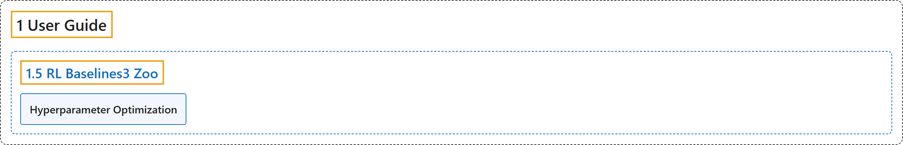

# 1.5 RL Baselines3 Zoo

## Classification

## Glossary

| Term | Definition | 中文翻译 | Source |
|---|---|---|---|
| **1.5 RL Baselines3 Zoo** RL Baselines3 Zoo | "RL Baselines3 Zoo is **a training framework for Reinforcement Learning (RL)**." | RL Baselines3 Zoo 是**一个强化学习（RL）训练框架**。 | [Raffin et al., n.d., "RL Baselines3 Zoo", para. 1](https://stable-baselines3.readthedocs.io/en/master/guide/rl_zoo.html#rl-baselines3-zoo) |
| **Hyperparameter Optimization** 超参数优化 | (context) "We use Optuna for **optimizing the hyperparameters**." | （语境）我们使用 Optuna 来**优化超参数**。 | [Raffin et al., n.d., "Hyperparameter Optimization", para. 1](https://stable-baselines3.readthedocs.io/en/master/guide/rl_zoo.html#hyperparameter-optimization) |

## References

Raffin, A., Hill, A., Gleave, A., Kanervisto, A., Ernestus, M., & Dormann, N.. (n.d.). *RL Baselines3 Zoo*. Stable-Baselines3 docs (Version 2.9.2a0). Retrieved October 31, 2026, from <https://stable-baselines3.readthedocs.io/en/master/guide/rl_zoo.html>
