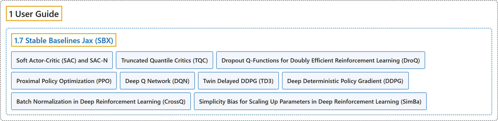

# 1.7 Stable Baselines Jax (SBX)

## Classification

## Glossary

| Term | Definition | 中文翻译 | Source |
|---|---|---|---|
| **1.7 Stable Baselines Jax (SBX)** Stable Baselines Jax（SBX） | "Stable Baselines Jax (SBX) is **a proof of concept version of Stable-Baselines3 in Jax**." | Stable Baselines Jax（SBX）是**用 Jax 实现的 Stable-Baselines3 概念验证版本**。 | [Raffin et al., n.d., "Stable Baselines Jax (SBX)", para. 1](https://stable-baselines3.readthedocs.io/en/master/guide/sbx.html#stable-baselines-jax-sbx) |
| **Soft Actor-Critic (SAC) and SAC-N** 软演员-评论家（SAC）与 SAC-N | (No definition) | （无定义） | [Raffin et al., n.d., "Stable Baselines Jax (SBX)"](https://stable-baselines3.readthedocs.io/en/master/guide/sbx.html#stable-baselines-jax-sbx) |
| **Truncated Quantile Critics (TQC)** 截断分位数评论家（TQC） | (No definition) | （无定义） | [Raffin et al., n.d., "Stable Baselines Jax (SBX)"](https://stable-baselines3.readthedocs.io/en/master/guide/sbx.html#stable-baselines-jax-sbx) |
| **Dropout Q-Functions for Doubly Efficient Reinforcement Learning (DroQ)** 用于双重高效强化学习的 Dropout Q 函数（DroQ） | (No definition) | （无定义） | [Raffin et al., n.d., "Stable Baselines Jax (SBX)"](https://stable-baselines3.readthedocs.io/en/master/guide/sbx.html#stable-baselines-jax-sbx) |
| **Proximal Policy Optimization (PPO)** 近端策略优化（PPO） | (No definition) | （无定义） | [Raffin et al., n.d., "Stable Baselines Jax (SBX)"](https://stable-baselines3.readthedocs.io/en/master/guide/sbx.html#stable-baselines-jax-sbx) |
| **Deep Q Network (DQN)** 深度 Q 网络（DQN） | (No definition) | （无定义） | [Raffin et al., n.d., "Stable Baselines Jax (SBX)"](https://stable-baselines3.readthedocs.io/en/master/guide/sbx.html#stable-baselines-jax-sbx) |
| **Twin Delayed DDPG (TD3)** 双延迟 DDPG（TD3） | (No definition) | （无定义） | [Raffin et al., n.d., "Stable Baselines Jax (SBX)"](https://stable-baselines3.readthedocs.io/en/master/guide/sbx.html#stable-baselines-jax-sbx) |
| **Deep Deterministic Policy Gradient (DDPG)** 深度确定性策略梯度（DDPG） | (No definition) | （无定义） | [Raffin et al., n.d., "Stable Baselines Jax (SBX)"](https://stable-baselines3.readthedocs.io/en/master/guide/sbx.html#stable-baselines-jax-sbx) |
| **Batch Normalization in Deep Reinforcement Learning (CrossQ)** 深度强化学习中的批归一化（CrossQ） | (No definition) | （无定义） | [Raffin et al., n.d., "Stable Baselines Jax (SBX)"](https://stable-baselines3.readthedocs.io/en/master/guide/sbx.html#stable-baselines-jax-sbx) |
| **Simplicity Bias for Scaling Up Parameters in Deep Reinforcement Learning (SimBa)** 深度强化学习中用于扩大参数规模的简单性偏置（SimBa） | (No definition) | （无定义） | [Raffin et al., n.d., "Stable Baselines Jax (SBX)"](https://stable-baselines3.readthedocs.io/en/master/guide/sbx.html#stable-baselines-jax-sbx) |

## References

Raffin, A., Hill, A., Gleave, A., Kanervisto, A., Ernestus, M., & Dormann, N.. (n.d.). *Stable Baselines Jax (SBX)*. Stable-Baselines3 docs (Version 2.9.2a0). Retrieved October 31, 2026, from <https://stable-baselines3.readthedocs.io/en/master/guide/sbx.html>
