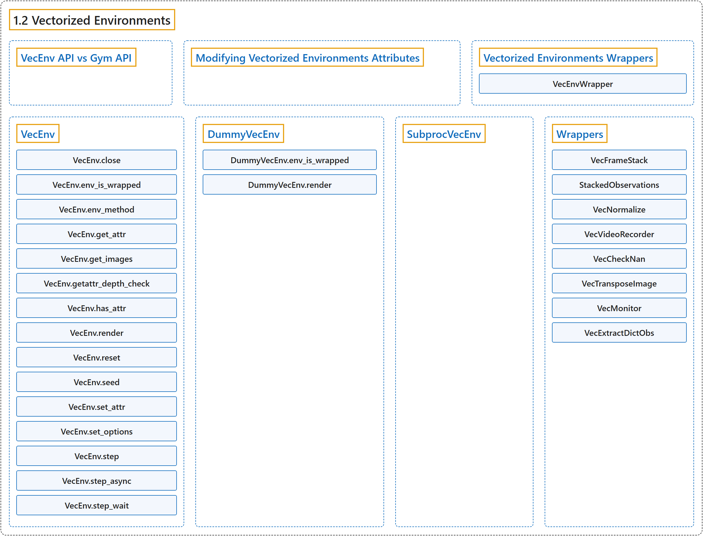

# 1.2 Vectorized Environments

## Classification

## Glossary

| Term | Definition | 中文翻译 | Source |
|---|---|---|---|
| **1.2 Vectorized Environments** 向量化环境 | "Vectorized Environments are **a method for stacking multiple independent environments into a single environment**." | 向量化环境是**一种把多个独立环境堆叠成单个环境的方法**。 | [Raffin et al., n.d., "Vectorized Environments", para. 1](https://stable-baselines3.readthedocs.io/en/master/guide/vec_envs.html#vectorized-environments) |
| **VecEnv API vs Gym API** VecEnv API 与 Gym API | (context) "For consistency across Stable-Baselines3 (SB3) versions and because of its special requirements and features, **SB3 VecEnv API is not the same as Gym API**." | （语境）为了在 Stable-Baselines3（SB3）各版本之间保持一致，也因为它的特殊需求和功能，**SB3 的 VecEnv API 与 Gym API 并不相同**。 | [Raffin et al., n.d., "VecEnv API vs Gym API", para. 1](https://stable-baselines3.readthedocs.io/en/master/guide/vec_envs.html#vecenv-api-vs-gym-api) |
| **Modifying Vectorized Environments Attributes** 修改向量化环境的属性 | (context) "If you plan to modify the attributes of an environment while it is used (e.g., modifying an attribute specifying the task carried out for a portion of training when doing multi-task learning, or a parameter of the environment dynamics), **you must expose a setter method**." | （语境）如果你打算在环境使用期间修改它的属性（例如在多任务学习中修改一个指定某段训练所执行任务的属性，或环境动力学的某个参数），**你必须暴露一个 setter 方法**。 | [Raffin et al., n.d., "Modifying Vectorized Environments Attributes", para. 1](https://stable-baselines3.readthedocs.io/en/master/guide/vec_envs.html#modifying-vectorized-environments-attributes) |
| **Vectorized Environments Wrappers** 向量化环境包装器 | (context) "If you want to **alter or augment a VecEnv without redefining it completely** (e.g. stack multiple frames, monitor the VecEnv, normalize the observation, …), you can use VecEnvWrapper for that." | （语境）如果你想**在不完全重新定义的情况下修改或增强一个 VecEnv**（例如堆叠多帧、监控 VecEnv、归一化观测……），可以使用 VecEnvWrapper。 | [Raffin et al., n.d., "Vectorized Environments Wrappers", para. 1](https://stable-baselines3.readthedocs.io/en/master/guide/vec_envs.html#vectorized-environments-wrappers) |
| **VecEnvWrapper** VecEnvWrapper 向量化环境包装器 | "They are **the vectorized equivalents (i.e., they act on multiple environments at the same time) of gym.Wrapper**." | 它们是 **gym.Wrapper 的向量化对应物（即同时作用于多个环境）**。 | [Raffin et al., n.d., "Vectorized Environments Wrappers", para. 1](https://stable-baselines3.readthedocs.io/en/master/guide/vec_envs.html#vectorized-environments-wrappers) |
| **VecEnv** VecEnv 向量化环境 | "**An abstract asynchronous, vectorized environment**." | **一个抽象的异步向量化环境**。 | [Raffin et al., n.d., "VecEnv", para. 1](https://stable-baselines3.readthedocs.io/en/master/guide/vec_envs.html#stable_baselines3.common.vec_env.VecEnv) |
| **VecEnv.close** close 方法 | "**Clean up the environment’s resources**." | **清理环境的资源**。 | [Raffin et al., n.d., "VecEnv", para. 1](https://stable-baselines3.readthedocs.io/en/master/guide/vec_envs.html#stable_baselines3.common.vec_env.VecEnv.close) |
| **VecEnv.env_is_wrapped** env_is_wrapped 方法 | "**Check if environments are wrapped with a given wrapper**." | **检查各环境是否被给定的包装器包装**。 | [Raffin et al., n.d., "VecEnv", para. 1](https://stable-baselines3.readthedocs.io/en/master/guide/vec_envs.html#stable_baselines3.common.vec_env.VecEnv.env_is_wrapped) |
| **VecEnv.env_method** env_method 方法 | "**Call instance methods of vectorized environments**." | **调用向量化环境的实例方法**。 | [Raffin et al., n.d., "VecEnv", para. 1](https://stable-baselines3.readthedocs.io/en/master/guide/vec_envs.html#stable_baselines3.common.vec_env.VecEnv.env_method) |
| **VecEnv.get_attr** get_attr 方法 | "**Return attribute from vectorized environment**." | **从向量化环境返回属性**。 | [Raffin et al., n.d., "VecEnv", para. 1](https://stable-baselines3.readthedocs.io/en/master/guide/vec_envs.html#stable_baselines3.common.vec_env.VecEnv.get_attr) |
| **VecEnv.get_images** get_images 方法 | "**Return RGB images from each environment when available**" | **在可用时从每个环境返回 RGB 图像** | [Raffin et al., n.d., "VecEnv", para. 1](https://stable-baselines3.readthedocs.io/en/master/guide/vec_envs.html#stable_baselines3.common.vec_env.VecEnv.get_images) |
| **VecEnv.getattr_depth_check** getattr_depth_check 方法 | "**Check if an attribute reference is being hidden in a recursive call to __getattr__**" | **检查某个属性引用是否在对 __getattr__ 的递归调用中被隐藏** | [Raffin et al., n.d., "VecEnv", para. 1](https://stable-baselines3.readthedocs.io/en/master/guide/vec_envs.html#stable_baselines3.common.vec_env.VecEnv.getattr_depth_check) |
| **VecEnv.has_attr** has_attr 方法 | "**Check if an attribute exists for a vectorized environment**." | **检查向量化环境是否存在某个属性**。 | [Raffin et al., n.d., "VecEnv", para. 1](https://stable-baselines3.readthedocs.io/en/master/guide/vec_envs.html#stable_baselines3.common.vec_env.VecEnv.has_attr) |
| **VecEnv.render** render 方法 | "**Gym environment rendering**" | **Gym 环境渲染** | [Raffin et al., n.d., "VecEnv", para. 1](https://stable-baselines3.readthedocs.io/en/master/guide/vec_envs.html#stable_baselines3.common.vec_env.VecEnv.render) |
| **VecEnv.reset** reset 方法 | "**Reset all the environments and return an array of observations, or a tuple of observation arrays**." | **重置所有环境并返回一个观测数组，或一个由观测数组组成的元组**。 | [Raffin et al., n.d., "VecEnv", para. 1](https://stable-baselines3.readthedocs.io/en/master/guide/vec_envs.html#stable_baselines3.common.vec_env.VecEnv.reset) |
| **VecEnv.seed** seed 方法 | "**Sets the random seeds for all environments, based on a given seed**." | **基于给定的种子为所有环境设置随机种子**。 | [Raffin et al., n.d., "VecEnv", para. 1](https://stable-baselines3.readthedocs.io/en/master/guide/vec_envs.html#stable_baselines3.common.vec_env.VecEnv.seed) |
| **VecEnv.set_attr** set_attr 方法 | "**Set attribute inside vectorized environments**." | **在向量化环境内部设置属性**。 | [Raffin et al., n.d., "VecEnv", para. 1](https://stable-baselines3.readthedocs.io/en/master/guide/vec_envs.html#stable_baselines3.common.vec_env.VecEnv.set_attr) |
| **VecEnv.set_options** set_options 方法 | "**Set environment options for all environments**." | **为所有环境设置环境选项**。 | [Raffin et al., n.d., "VecEnv", para. 1](https://stable-baselines3.readthedocs.io/en/master/guide/vec_envs.html#stable_baselines3.common.vec_env.VecEnv.set_options) |
| **VecEnv.step** step 方法 | "**Step the environments with the given action**" | **用给定的动作让各环境前进一步** | [Raffin et al., n.d., "VecEnv", para. 1](https://stable-baselines3.readthedocs.io/en/master/guide/vec_envs.html#stable_baselines3.common.vec_env.VecEnv.step) |
| **VecEnv.step_async** step_async 方法 | "**Tell all the environments to start taking a step with the given actions**." | **通知所有环境开始用给定的动作执行一步**。 | [Raffin et al., n.d., "VecEnv", para. 1](https://stable-baselines3.readthedocs.io/en/master/guide/vec_envs.html#stable_baselines3.common.vec_env.VecEnv.step_async) |
| **VecEnv.step_wait** step_wait 方法 | "**Wait for the step taken with step_async()**." | **等待用 step_async() 执行的那一步完成**。 | [Raffin et al., n.d., "VecEnv", para. 1](https://stable-baselines3.readthedocs.io/en/master/guide/vec_envs.html#stable_baselines3.common.vec_env.VecEnv.step_wait) |
| **DummyVecEnv** DummyVecEnv 顺序向量化环境 | "Creates **a simple vectorized wrapper for multiple environments, calling each environment in sequence on the current Python process**." | 创建**一个用于多个环境的简单向量化包装器，在当前 Python 进程中依次调用每个环境**。 | [Raffin et al., n.d., "DummyVecEnv", para. 1](https://stable-baselines3.readthedocs.io/en/master/guide/vec_envs.html#stable_baselines3.common.vec_env.DummyVecEnv) |
| **DummyVecEnv.env_is_wrapped** env_is_wrapped 方法 | "**Check if worker environments are wrapped with a given wrapper**" | **检查各工作环境是否被给定的包装器包装** | [Raffin et al., n.d., "DummyVecEnv", para. 1](https://stable-baselines3.readthedocs.io/en/master/guide/vec_envs.html#stable_baselines3.common.vec_env.DummyVecEnv.env_is_wrapped) |
| **DummyVecEnv.render** render 方法 | "Gym environment rendering. If there are multiple environments then **they are tiled together in one image** via BaseVecEnv.render()." | Gym 环境渲染。如果有多个环境，**它们会通过 BaseVecEnv.render() 拼接成一张图像**。 | [Raffin et al., n.d., "DummyVecEnv", para. 1](https://stable-baselines3.readthedocs.io/en/master/guide/vec_envs.html#stable_baselines3.common.vec_env.DummyVecEnv.render) |
| **SubprocVecEnv** SubprocVecEnv 多进程向量化环境 | "Creates **a multiprocess vectorized wrapper for multiple environments, distributing each environment to its own process**, allowing significant speed up when the environment is computationally complex." | 创建**一个用于多个环境的多进程向量化包装器，把每个环境分配到各自的进程中**，在环境计算复杂时可以显著提速。 | [Raffin et al., n.d., "SubprocVecEnv", para. 1](https://stable-baselines3.readthedocs.io/en/master/guide/vec_envs.html#stable_baselines3.common.vec_env.SubprocVecEnv) |
| **Wrappers** 包装器 | (No definition) | （无定义） | [Raffin et al., n.d., "Wrappers"](https://stable-baselines3.readthedocs.io/en/master/guide/vec_envs.html#wrappers) |
| **VecFrameStack** VecFrameStack 帧堆叠包装器 | "**Frame stacking wrapper for vectorized environment**." | **用于向量化环境的帧堆叠包装器**。 | [Raffin et al., n.d., "VecFrameStack", para. 1](https://stable-baselines3.readthedocs.io/en/master/guide/vec_envs.html#stable_baselines3.common.vec_env.VecFrameStack) |
| **VecFrameStack.reset** reset 方法 | "**Reset all environments**" | **重置所有环境** | [Raffin et al., n.d., "VecFrameStack", para. 1](https://stable-baselines3.readthedocs.io/en/master/guide/vec_envs.html#stable_baselines3.common.vec_env.VecFrameStack.reset) |
| **StackedObservations** StackedObservations 堆叠观测 | "**Frame stacking wrapper for data**." | **用于数据的帧堆叠包装器**。 | [Raffin et al., n.d., "StackedObservations", para. 1](https://stable-baselines3.readthedocs.io/en/master/guide/vec_envs.html#stable_baselines3.common.vec_env.stacked_observations.StackedObservations) |
| **StackedObservations.compute_stacking** compute_stacking 方法 | "**Calculates the parameters in order to stack observations**" | **计算堆叠观测所需的参数** | [Raffin et al., n.d., "StackedObservations", para. 1](https://stable-baselines3.readthedocs.io/en/master/guide/vec_envs.html#stable_baselines3.common.vec_env.stacked_observations.StackedObservations.compute_stacking) |
| **StackedObservations.reset** reset 方法 | "**Reset the stacked_obs, add the reset observation to the stack, and return the stack**." | **重置 stacked_obs，把重置后的观测加入堆栈，并返回该堆栈**。 | [Raffin et al., n.d., "StackedObservations", para. 1](https://stable-baselines3.readthedocs.io/en/master/guide/vec_envs.html#stable_baselines3.common.vec_env.stacked_observations.StackedObservations.reset) |
| **StackedObservations.update** update 方法 | "**Add the observations to the stack and use the dones to update the infos**." | **把观测加入堆栈，并用 dones 更新 infos**。 | [Raffin et al., n.d., "StackedObservations", para. 1](https://stable-baselines3.readthedocs.io/en/master/guide/vec_envs.html#stable_baselines3.common.vec_env.stacked_observations.StackedObservations.update) |
| **VecNormalize** VecNormalize 归一化包装器 | "**A moving average, normalizing wrapper for vectorized environment**." | **用于向量化环境的滑动平均归一化包装器**。 | [Raffin et al., n.d., "VecNormalize", para. 1](https://stable-baselines3.readthedocs.io/en/master/guide/vec_envs.html#stable_baselines3.common.vec_env.VecNormalize) |
| **VecNormalize.get_original_obs** get_original_obs 方法 | "**Returns an unnormalized version of the observations from the most recent step or reset**." | **返回最近一次 step 或 reset 得到的观测的未归一化版本**。 | [Raffin et al., n.d., "VecNormalize", para. 1](https://stable-baselines3.readthedocs.io/en/master/guide/vec_envs.html#stable_baselines3.common.vec_env.VecNormalize.get_original_obs) |
| **VecNormalize.get_original_reward** get_original_reward 方法 | "**Returns an unnormalized version of the rewards from the most recent step**." | **返回最近一次 step 得到的奖励的未归一化版本**。 | [Raffin et al., n.d., "VecNormalize", para. 1](https://stable-baselines3.readthedocs.io/en/master/guide/vec_envs.html#stable_baselines3.common.vec_env.VecNormalize.get_original_reward) |
| **VecNormalize.load** load 方法 | "**Loads a saved VecNormalize object**." | **加载一个已保存的 VecNormalize 对象**。 | [Raffin et al., n.d., "VecNormalize", para. 1](https://stable-baselines3.readthedocs.io/en/master/guide/vec_envs.html#stable_baselines3.common.vec_env.VecNormalize.load) |
| **VecNormalize.normalize_obs** normalize_obs 方法 | "**Normalize observations using this VecNormalize’s observations statistics**." | **用这个 VecNormalize 的观测统计量归一化观测**。 | [Raffin et al., n.d., "VecNormalize", para. 1](https://stable-baselines3.readthedocs.io/en/master/guide/vec_envs.html#stable_baselines3.common.vec_env.VecNormalize.normalize_obs) |
| **VecNormalize.normalize_reward** normalize_reward 方法 | "**Normalize rewards using this VecNormalize’s rewards statistics**." | **用这个 VecNormalize 的奖励统计量归一化奖励**。 | [Raffin et al., n.d., "VecNormalize", para. 1](https://stable-baselines3.readthedocs.io/en/master/guide/vec_envs.html#stable_baselines3.common.vec_env.VecNormalize.normalize_reward) |
| **VecNormalize.reset** reset 方法 | "**Reset all environments** :return: first observation of the episode" | **重置所有环境** :return: 回合的第一个观测 | [Raffin et al., n.d., "VecNormalize", para. 1](https://stable-baselines3.readthedocs.io/en/master/guide/vec_envs.html#stable_baselines3.common.vec_env.VecNormalize.reset) |
| **VecNormalize.save** save 方法 | "**Save current VecNormalize object with all running statistics and settings** (e.g. clip_obs)" | **保存当前的 VecNormalize 对象及其全部运行统计量和设置**（例如 clip_obs） | [Raffin et al., n.d., "VecNormalize", para. 1](https://stable-baselines3.readthedocs.io/en/master/guide/vec_envs.html#stable_baselines3.common.vec_env.VecNormalize.save) |
| **VecNormalize.set_venv** set_venv 方法 | "**Sets the vector environment to wrap to venv**." | **把要包装的向量环境设为 venv**。 | [Raffin et al., n.d., "VecNormalize", para. 1](https://stable-baselines3.readthedocs.io/en/master/guide/vec_envs.html#stable_baselines3.common.vec_env.VecNormalize.set_venv) |
| **VecNormalize.step_wait** step_wait 方法 | "**Apply sequence of actions to sequence of environments** actions -> (observations, rewards, dones)" | **把一组动作施加到一组环境上** actions -> (observations, rewards, dones) | [Raffin et al., n.d., "VecNormalize", para. 1](https://stable-baselines3.readthedocs.io/en/master/guide/vec_envs.html#stable_baselines3.common.vec_env.VecNormalize.step_wait) |
| **VecVideoRecorder** VecVideoRecorder 视频录制包装器 | "**Wraps a VecEnv or VecEnvWrapper object to record rendered image as mp4 video**." | **包装一个 VecEnv 或 VecEnvWrapper 对象，把渲染的图像录制为 mp4 视频**。 | [Raffin et al., n.d., "VecVideoRecorder", para. 1](https://stable-baselines3.readthedocs.io/en/master/guide/vec_envs.html#stable_baselines3.common.vec_env.VecVideoRecorder) |
| **VecVideoRecorder.close** close 方法 | "**Closes the wrapper then the video recorder**." | **先关闭包装器，再关闭视频录制器**。 | [Raffin et al., n.d., "VecVideoRecorder", para. 1](https://stable-baselines3.readthedocs.io/en/master/guide/vec_envs.html#stable_baselines3.common.vec_env.VecVideoRecorder.close) |
| **VecCheckNan** VecCheckNan NaN 检查包装器 | "**NaN and inf checking wrapper for vectorized environment**, will raise a warning by default, allowing you to know from what the NaN of inf originated from." | **用于向量化环境的 NaN 与 inf 检查包装器**，默认会发出警告，让你知道 NaN 或 inf 源自何处。 | [Raffin et al., n.d., "VecCheckNan", para. 1](https://stable-baselines3.readthedocs.io/en/master/guide/vec_envs.html#stable_baselines3.common.vec_env.VecCheckNan) |
| **VecCheckNan.check_array_value** check_array_value 方法 | "**Check for inf and NaN for a single numpy array**." | **检查单个 numpy 数组中的 inf 和 NaN**。 | [Raffin et al., n.d., "VecCheckNan", para. 1](https://stable-baselines3.readthedocs.io/en/master/guide/vec_envs.html#stable_baselines3.common.vec_env.VecCheckNan.check_array_value) |
| **VecTransposeImage** VecTransposeImage 图像转置包装器 | "**Re-order channels, from HxWxC to CxHxW**." | **重新排列通道，从 HxWxC 变为 CxHxW**。 | [Raffin et al., n.d., "VecTransposeImage", para. 1](https://stable-baselines3.readthedocs.io/en/master/guide/vec_envs.html#stable_baselines3.common.vec_env.VecTransposeImage) |
| **VecTransposeImage.transpose_image** transpose_image 方法 | "**Transpose an image or batch of images (re-order channels)**." | **转置一张图像或一批图像（重新排列通道）**。 | [Raffin et al., n.d., "VecTransposeImage", para. 1](https://stable-baselines3.readthedocs.io/en/master/guide/vec_envs.html#stable_baselines3.common.vec_env.VecTransposeImage.transpose_image) |
| **VecTransposeImage.transpose_observations** transpose_observations 方法 | "**Transpose (if needed) and return new observations**." | **（在需要时）转置并返回新的观测**。 | [Raffin et al., n.d., "VecTransposeImage", para. 1](https://stable-baselines3.readthedocs.io/en/master/guide/vec_envs.html#stable_baselines3.common.vec_env.VecTransposeImage.transpose_observations) |
| **VecTransposeImage.transpose_space** transpose_space 方法 | "**Transpose an observation space (re-order channels)**." | **转置一个观测空间（重新排列通道）**。 | [Raffin et al., n.d., "VecTransposeImage", para. 1](https://stable-baselines3.readthedocs.io/en/master/guide/vec_envs.html#stable_baselines3.common.vec_env.VecTransposeImage.transpose_space) |
| **VecMonitor** VecMonitor 向量化监控包装器 | "**A vectorized monitor wrapper for vectorized Gym environments**, it is used to record the episode reward, length, time and other data." | **用于向量化 Gym 环境的向量化监控包装器**，用来记录回合奖励、长度、时间和其他数据。 | [Raffin et al., n.d., "VecMonitor", para. 1](https://stable-baselines3.readthedocs.io/en/master/guide/vec_envs.html#stable_baselines3.common.vec_env.VecMonitor) |
| **VecExtractDictObs** VecExtractDictObs 字典观测提取包装器 | "**A vectorized wrapper for extracting dictionary observations**." | **用于提取字典观测的向量化包装器**。 | [Raffin et al., n.d., "VecExtractDictObs", para. 1](https://stable-baselines3.readthedocs.io/en/master/guide/vec_envs.html#stable_baselines3.common.vec_env.VecExtractDictObs) |

## References

Raffin, A., Hill, A., Gleave, A., Kanervisto, A., Ernestus, M., & Dormann, N.. (n.d.). *Vectorized Environments*. Stable-Baselines3 docs (Version 2.9.2a0). Retrieved October 31, 2026, from <https://stable-baselines3.readthedocs.io/en/master/guide/vec_envs.html>
