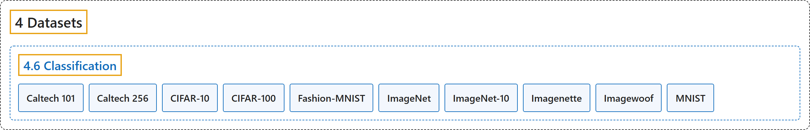

# 4.6 Classification

## Classification

## Glossary

| Term | Definition | 中文翻译 | Source |
|---|---|---|---|
| **4.6 Classification** 分类数据集 | (No definition) | （无定义） | [Ultralytics, n.d.-f, "Image Classification Datasets Overview"](https://docs.ultralytics.com/datasets/classify/#image-classification-datasets-overview) |
| **Caltech 101** Caltech-101 | "The Caltech-101 dataset is **a classic image classification benchmark of 9,144 images spanning 101 object categories plus one background class**." | Caltech-101 数据集是**一个经典的图像分类基准，含 9,144 张图像，涵盖 101 个物体类别和一个背景类别**。 | [Ultralytics, n.d.-a, "Caltech-101 Dataset", para. 1](https://docs.ultralytics.com/datasets/classify/caltech101/#caltech-101-dataset) |
| **Caltech 256** Caltech-256 | "The Caltech-256 dataset is **a classic image classification benchmark of 30,607 images spanning 256 object categories plus one background class**." | Caltech-256 数据集是**一个经典的图像分类基准，含 30,607 张图像，涵盖 256 个物体类别和一个背景类别**。 | [Ultralytics, n.d.-b, "Caltech-256 Dataset", para. 1](https://docs.ultralytics.com/datasets/classify/caltech256/#caltech-256-dataset) |
| **CIFAR-10** CIFAR-10 | "The CIFAR-10 (Canadian Institute For Advanced Research) dataset is **a classic image classification benchmark of 60,000 32x32 color images evenly split across 10 classes** — airplane, automobile, bird, cat, deer, dog, frog, horse, ship, and truck." | CIFAR-10（加拿大高等研究院）数据集是**一个经典的图像分类基准，含 60,000 张 32×32 的彩色图像，平均分为 10 个类别**：飞机、汽车、鸟、猫、鹿、狗、青蛙、马、船和卡车。 | [Ultralytics, n.d.-c, "CIFAR-10 Dataset", para. 1](https://docs.ultralytics.com/datasets/classify/cifar10/#cifar-10-dataset) |
| **CIFAR-100** CIFAR-100 | "The CIFAR-100 (Canadian Institute For Advanced Research) dataset is **an image classification benchmark of 60,000 32x32 color images spread evenly across 100 fine-grained classes** (600 images each), which are in turn grouped into 20 coarse superclasses." | CIFAR-100（加拿大高等研究院）数据集是**一个图像分类基准，含 60,000 张 32×32 的彩色图像，平均分布在 100 个细粒度类别中**（每类 600 张），这些类别又归为 20 个粗粒度超类。 | [Ultralytics, n.d.-d, "CIFAR-100 Dataset", para. 1](https://docs.ultralytics.com/datasets/classify/cifar100/#cifar-100-dataset) |
| **Fashion-MNIST** Fashion-MNIST | "The Fashion-MNIST dataset is **an image classification benchmark of 70,000 28x28 grayscale images of Zalando's clothing articles, evenly split across 10 classes** — T-shirt/top, trouser, pullover, dress, coat, sandal, shirt, sneaker, bag, and ankle boot." | Fashion-MNIST 数据集是**一个图像分类基准，含 70,000 张 28×28 的 Zalando 服装商品灰度图像，平均分为 10 个类别**：T 恤/上衣、裤子、套头衫、连衣裙、外套、凉鞋、衬衫、运动鞋、包和短靴。 | [Ultralytics, n.d.-e, "Fashion-MNIST Dataset", para. 1](https://docs.ultralytics.com/datasets/classify/fashion-mnist/#fashion-mnist-dataset) |
| **ImageNet** ImageNet | "The Ultralytics ImageNet dataset (data="imagenet") is **the ImageNet-1k / ILSVRC-2012 subset used to train and benchmark image classification models**." | Ultralytics ImageNet 数据集（data="imagenet"）是**用于训练和评测图像分类模型的 ImageNet-1k / ILSVRC-2012 子集**。 | [Ultralytics, n.d.-g, "ImageNet Dataset", para. 1](https://docs.ultralytics.com/datasets/classify/imagenet/#imagenet-dataset) |
| **ImageNet-10** ImageNet-10 | "The Ultralytics ImageNet10 dataset (data="imagenet10") is **a tiny 24-image subset of ImageNet spanning its first 10 classes**, built for continuous-integration tests, sanity checks, and fast validation of training pipelines." | Ultralytics ImageNet10 数据集（data="imagenet10"）是**一个只有 24 张图像的 ImageNet 子集，涵盖其前 10 个类别**，用于持续集成测试、健全性检查和快速验证训练流程。 | [Ultralytics, n.d.-h, "ImageNet10 Dataset", para. 1](https://docs.ultralytics.com/datasets/classify/imagenet10/#imagenet10-dataset) |
| **Imagenette** Imagenette | "The ImageNette dataset is **a subset of ImageNet with 10 easily distinguishable classes**, created by fast.ai to provide a quicker, easier-to-use version of ImageNet for software development and education." | ImageNette 数据集是 **ImageNet 的一个子集，含 10 个容易区分的类别**，由 fast.ai 创建，为软件开发和教学提供一个更快、更易用的 ImageNet 版本。 | [Ultralytics, n.d.-i, "ImageNette Dataset", para. 1](https://docs.ultralytics.com/datasets/classify/imagenette/#imagenette-dataset) |
| **Imagewoof** Imagewoof | "The ImageWoof dataset is **a subset of ImageNet consisting of 10 dog-breed classes that are deliberately hard to tell apart**, created by fast.ai as a tougher challenge for image classification algorithms." | ImageWoof 数据集是 **ImageNet 的一个子集，由 10 个故意选得难以区分的狗品种类别组成**，由 fast.ai 创建，作为图像分类算法更难的挑战。 | [Ultralytics, n.d.-j, "ImageWoof Dataset", para. 1](https://docs.ultralytics.com/datasets/classify/imagewoof/#imagewoof-dataset) |
| **MNIST** MNIST | "The MNIST (Modified National Institute of Standards and Technology) dataset is **an image classification benchmark of 70,000 28x28 grayscale images of handwritten digits spanning 10 classes** — the digits 0 through 9." | MNIST（改进的美国国家标准与技术研究院）数据集是**一个图像分类基准，含 70,000 张 28×28 的手写数字灰度图像，共 10 个类别**，即数字 0 到 9。 | [Ultralytics, n.d.-k, "MNIST Dataset", para. 1](https://docs.ultralytics.com/datasets/classify/mnist/#mnist-dataset) |

## References

Ultralytics. (n.d.-a). *Caltech-101 Dataset*. Ultralytics YOLO Docs (ultralytics 8.4.194). Retrieved October 31, 2026, from <https://docs.ultralytics.com/datasets/classify/caltech101/>

Ultralytics. (n.d.-b). *Caltech-256 Dataset*. Ultralytics YOLO Docs (ultralytics 8.4.194). Retrieved October 31, 2026, from <https://docs.ultralytics.com/datasets/classify/caltech256/>

Ultralytics. (n.d.-c). *CIFAR-10 Dataset*. Ultralytics YOLO Docs (ultralytics 8.4.194). Retrieved October 31, 2026, from <https://docs.ultralytics.com/datasets/classify/cifar10/>

Ultralytics. (n.d.-d). *CIFAR-100 Dataset*. Ultralytics YOLO Docs (ultralytics 8.4.194). Retrieved October 31, 2026, from <https://docs.ultralytics.com/datasets/classify/cifar100/>

Ultralytics. (n.d.-e). *Fashion-MNIST Dataset*. Ultralytics YOLO Docs (ultralytics 8.4.194). Retrieved October 31, 2026, from <https://docs.ultralytics.com/datasets/classify/fashion-mnist/>

Ultralytics. (n.d.-f). *Image Classification Datasets Overview*. Ultralytics YOLO Docs (ultralytics 8.4.194). Retrieved October 31, 2026, from <https://docs.ultralytics.com/datasets/classify/>

Ultralytics. (n.d.-g). *ImageNet Dataset*. Ultralytics YOLO Docs (ultralytics 8.4.194). Retrieved October 31, 2026, from <https://docs.ultralytics.com/datasets/classify/imagenet/>

Ultralytics. (n.d.-h). *ImageNet10 Dataset*. Ultralytics YOLO Docs (ultralytics 8.4.194). Retrieved October 31, 2026, from <https://docs.ultralytics.com/datasets/classify/imagenet10/>

Ultralytics. (n.d.-i). *ImageNette Dataset*. Ultralytics YOLO Docs (ultralytics 8.4.194). Retrieved October 31, 2026, from <https://docs.ultralytics.com/datasets/classify/imagenette/>

Ultralytics. (n.d.-j). *ImageWoof Dataset*. Ultralytics YOLO Docs (ultralytics 8.4.194). Retrieved October 31, 2026, from <https://docs.ultralytics.com/datasets/classify/imagewoof/>

Ultralytics. (n.d.-k). *MNIST Dataset*. Ultralytics YOLO Docs (ultralytics 8.4.194). Retrieved October 31, 2026, from <https://docs.ultralytics.com/datasets/classify/mnist/>
