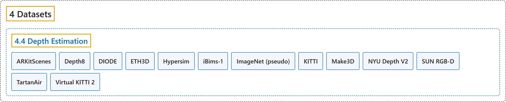

# 4.4 Depth Estimation

## Classification

## Glossary

| Term | Definition | 中文翻译 | Source |
|---|---|---|---|
| **4.4 Depth Estimation** 深度估计数据集 | (context) "Monocular depth estimation **assigns a depth value in meters to every pixel in an image**." | （语境）单目深度估计**给图像中的每个像素分配一个以米为单位的深度值**。 | [Ultralytics, n.d.-b, "Depth Estimation Datasets Overview", para. 1](https://docs.ultralytics.com/datasets/depth/#depth-estimation-datasets-overview) |
| **ARKitScenes** ARKitScenes | "ARKitScenes is **a large-scale real-world indoor RGB-D dataset captured with Apple's ARKit on iPad Pro devices equipped with a LiDAR scanner**." | ARKitScenes 是**一个大规模真实室内 RGB-D 数据集，用苹果 ARKit 在配备激光雷达扫描仪的 iPad Pro 上采集**。 | [Ultralytics, n.d.-a, "ARKitScenes Depth Dataset", para. 1](https://docs.ultralytics.com/datasets/depth/arkitscenes/#arkitscenes-depth-dataset) |
| **Depth8** Depth8 | "The Ultralytics Depth8 dataset is **a compact monocular depth estimation dataset with 8 images sampled from the SUN RGB-D dataset**: 4 for training and 4 for validation, drawn from its Kinect v1 and Kinect v2 captures (two per sensor in each split) for dense, artifact-free ground-truth depth maps." | Ultralytics Depth8 数据集是**一个紧凑的单目深度估计数据集，含从 SUN RGB-D 数据集中抽取的 8 张图像**：4 张训练，4 张验证，取自 Kinect v1 和 Kinect v2 的采集（每个划分中每种传感器各两张），以获得稠密、无伪影的真值深度图。 | [Ultralytics, n.d.-c, "Depth8 Dataset", para. 1](https://docs.ultralytics.com/datasets/depth/depth8/#depth8-dataset) |
| **DIODE** DIODE | "DIODE (Dense Indoor/Outdoor DEpth) is **a real-world dataset with very high-quality dense depth ground truth captured by a FARO Focus survey-grade laser scanner**." | DIODE（稠密室内/室外深度）是**一个真实世界数据集，带有用 FARO Focus 测绘级激光扫描仪采集的高质量稠密深度真值**。 | [Ultralytics, n.d.-d, "DIODE Depth Dataset", para. 1](https://docs.ultralytics.com/datasets/depth/diode/#diode-depth-dataset) |
| **ETH3D** ETH3D | "ETH3D is **a high-resolution multi-view-stereo benchmark used for monocular depth estimation**." | ETH3D 是**一个用于单目深度估计的高分辨率多视图立体基准**。 | [Ultralytics, n.d.-e, "ETH3D Depth Dataset", para. 1](https://docs.ultralytics.com/datasets/depth/eth3d/#eth3d-depth-dataset) |
| **Hypersim** Hypersim | "Hypersim is **a photorealistic synthetic dataset of indoor scenes designed for holistic indoor scene understanding**." | Hypersim 是**一个逼真的室内场景合成数据集，用于整体的室内场景理解**。 | [Ultralytics, n.d.-f, "Hypersim Depth Dataset", para. 1](https://docs.ultralytics.com/datasets/depth/hypersim/#hypersim-depth-dataset) |
| **iBims-1** iBims-1 | (context) "iBims-1 is **a zero-shot evaluation benchmark** for the YOLO26-Depth family; the published models are not trained on it." | （语境）iBims-1 是 **YOLO26-Depth 系列的零样本评估基准**；已发布的模型没有在它上面训练。 | [Ultralytics, n.d.-g, "iBims-1 Depth Dataset", para. 1](https://docs.ultralytics.com/datasets/depth/ibims-1/#ibims-1-depth-dataset) |
| **ImageNet (pseudo)** ImageNet（伪标签） | "The ImageNet (pseudo-labeled depth) dataset **reuses the 1,281,167 ImageNet-1K training images, which have no ground-truth depth, and pairs each image with a pseudo depth map produced by a Depth Anything 3 teacher**, combining its monocular and metric checkpoints." | ImageNet（伪标签深度）数据集**沿用 1,281,167 张没有深度真值的 ImageNet-1K 训练图像，并为每张图像配上由 Depth Anything 3 教师模型生成的伪深度图**，结合了它的单目和度量检查点。 | [Ultralytics, n.d.-h, "ImageNet (Pseudo-Labeled) Depth Dataset", para. 1](https://docs.ultralytics.com/datasets/depth/imagenet-pseudo/#imagenet-pseudo-labeled-depth-dataset) |
| **KITTI** KITTI 深度版 | "The KITTI dataset is **a real-world outdoor autonomous-driving benchmark captured from a moving vehicle in and around the city of Karlsruhe**." | KITTI 数据集是**一个真实室外自动驾驶基准，从在卡尔斯鲁厄市内及周边行驶的车辆上采集**。 | [Ultralytics, n.d.-i, "KITTI Depth Dataset", para. 1](https://docs.ultralytics.com/datasets/depth/kitti/#kitti-depth-dataset) |
| **Make3D** Make3D | "Make3D is **a classic outdoor benchmark for monocular depth estimation**." | Make3D 是**一个经典的室外单目深度估计基准**。 | [Ultralytics, n.d.-j, "Make3D Depth Dataset", para. 1](https://docs.ultralytics.com/datasets/depth/make3d/#make3d-depth-dataset) |
| **NYU Depth V2** NYU Depth V2 | "NYU Depth V2 is **the standard indoor benchmark for monocular depth estimation**." | NYU Depth V2 是**单目深度估计的标准室内基准**。 | [Ultralytics, n.d.-k, "NYU Depth V2 Depth Dataset", para. 1](https://docs.ultralytics.com/datasets/depth/nyu-depth-v2/#nyu-depth-v2-depth-dataset) |
| **SUN RGB-D** SUN RGB-D | "SUN RGB-D is **a real-world indoor scene-understanding benchmark captured with four different RGB-D sensors**: Intel RealSense, Asus Xtion, and Microsoft Kinect v1 and v2." | SUN RGB-D 是**一个真实室内场景理解基准，用四种不同的 RGB-D 传感器采集**：Intel RealSense、Asus Xtion，以及 Microsoft Kinect v1 和 v2。 | [Ultralytics, n.d.-l, "SUN RGB-D Depth Dataset", para. 1](https://docs.ultralytics.com/datasets/depth/sunrgbd/#sun-rgb-d-depth-dataset) |
| **TartanAir** TartanAir | "TartanAir is **a large-scale synthetic dataset generated in the AirSim simulator**." | TartanAir 是**一个在 AirSim 仿真器中生成的大规模合成数据集**。 | [Ultralytics, n.d.-m, "TartanAir Depth Dataset", para. 1](https://docs.ultralytics.com/datasets/depth/tartanair/#tartanair-depth-dataset) |
| **Virtual KITTI 2** Virtual KITTI 2 | "Virtual KITTI 2 (vKITTI2) is **a photorealistic synthetic recreation of the KITTI driving scenes**." | Virtual KITTI 2（vKITTI2）是**对 KITTI 驾驶场景的逼真合成重建**。 | [Ultralytics, n.d.-n, "Virtual KITTI 2 Depth Dataset", para. 1](https://docs.ultralytics.com/datasets/depth/vkitti2/#virtual-kitti-2-depth-dataset) |

## References

Ultralytics. (n.d.-a). *ARKitScenes Depth Dataset*. Ultralytics YOLO Docs (ultralytics 8.4.194). Retrieved October 31, 2026, from <https://docs.ultralytics.com/datasets/depth/arkitscenes/>

Ultralytics. (n.d.-b). *Depth Estimation Datasets Overview*. Ultralytics YOLO Docs (ultralytics 8.4.194). Retrieved October 31, 2026, from <https://docs.ultralytics.com/datasets/depth/>

Ultralytics. (n.d.-c). *Depth8 Dataset*. Ultralytics YOLO Docs (ultralytics 8.4.194). Retrieved October 31, 2026, from <https://docs.ultralytics.com/datasets/depth/depth8/>

Ultralytics. (n.d.-d). *DIODE Depth Dataset*. Ultralytics YOLO Docs (ultralytics 8.4.194). Retrieved October 31, 2026, from <https://docs.ultralytics.com/datasets/depth/diode/>

Ultralytics. (n.d.-e). *ETH3D Depth Dataset*. Ultralytics YOLO Docs (ultralytics 8.4.194). Retrieved October 31, 2026, from <https://docs.ultralytics.com/datasets/depth/eth3d/>

Ultralytics. (n.d.-f). *Hypersim Depth Dataset*. Ultralytics YOLO Docs (ultralytics 8.4.194). Retrieved October 31, 2026, from <https://docs.ultralytics.com/datasets/depth/hypersim/>

Ultralytics. (n.d.-g). *iBims-1 Depth Dataset*. Ultralytics YOLO Docs (ultralytics 8.4.194). Retrieved October 31, 2026, from <https://docs.ultralytics.com/datasets/depth/ibims-1/>

Ultralytics. (n.d.-h). *ImageNet (Pseudo-Labeled) Depth Dataset*. Ultralytics YOLO Docs (ultralytics 8.4.194). Retrieved October 31, 2026, from <https://docs.ultralytics.com/datasets/depth/imagenet-pseudo/>

Ultralytics. (n.d.-i). *KITTI Depth Dataset*. Ultralytics YOLO Docs (ultralytics 8.4.194). Retrieved October 31, 2026, from <https://docs.ultralytics.com/datasets/depth/kitti/>

Ultralytics. (n.d.-j). *Make3D Depth Dataset*. Ultralytics YOLO Docs (ultralytics 8.4.194). Retrieved October 31, 2026, from <https://docs.ultralytics.com/datasets/depth/make3d/>

Ultralytics. (n.d.-k). *NYU Depth V2 Depth Dataset*. Ultralytics YOLO Docs (ultralytics 8.4.194). Retrieved October 31, 2026, from <https://docs.ultralytics.com/datasets/depth/nyu-depth-v2/>

Ultralytics. (n.d.-l). *SUN RGB-D Depth Dataset*. Ultralytics YOLO Docs (ultralytics 8.4.194). Retrieved October 31, 2026, from <https://docs.ultralytics.com/datasets/depth/sunrgbd/>

Ultralytics. (n.d.-m). *TartanAir Depth Dataset*. Ultralytics YOLO Docs (ultralytics 8.4.194). Retrieved October 31, 2026, from <https://docs.ultralytics.com/datasets/depth/tartanair/>

Ultralytics. (n.d.-n). *Virtual KITTI 2 Depth Dataset*. Ultralytics YOLO Docs (ultralytics 8.4.194). Retrieved October 31, 2026, from <https://docs.ultralytics.com/datasets/depth/vkitti2/>
