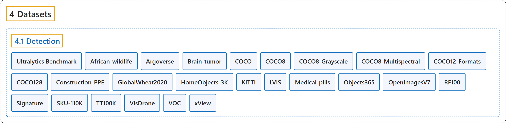

# 4.1 Detection

## Classification

## Glossary

| Term | Definition | 中文翻译 | Source |
|---|---|---|---|
| **4.1 Detection** 检测数据集 | (context) "This guide introduces **various formats of datasets that are compatible with the Ultralytics YOLO model** and provides insights into their structure, usage, and how to convert between different formats." | （语境）本指南介绍**与 Ultralytics YOLO 模型兼容的各种数据集格式**，并说明它们的结构、用法以及如何在不同格式之间转换。 | [Ultralytics, n.d.-p, "Object Detection Datasets Overview", para. 1](https://docs.ultralytics.com/datasets/detect/#object-detection-datasets-overview) |
| **Ultralytics Benchmark** Ultralytics 基准 | "Ultralytics Benchmark is **a benchmark dataset for measuring model generalizability**) across 37 curated object detection datasets with high-quality bounding box labels." | Ultralytics Benchmark 是**一个衡量模型泛化能力的基准数据集**，涵盖 37 个精选的、带高质量边界框标注的目标检测数据集。 | [Ultralytics, n.d.-x, "Ultralytics Benchmark", para. 1](https://docs.ultralytics.com/datasets/detect/ultralytics-benchmark/#ultralytics-benchmark) |
| **African-wildlife** 非洲野生动物 | "The Ultralytics African Wildlife Dataset is **an object detection dataset of 1,504 images across 4 animal classes** — buffalo, elephant, rhino, and zebra — commonly found in South African nature reserves." | Ultralytics 非洲野生动物数据集是**一个目标检测数据集，含 1,504 张图像、4 个动物类别**：水牛、大象、犀牛和斑马，都是南非自然保护区常见的动物。 | [Ultralytics, n.d.-a, "African Wildlife Dataset", para. 1](https://docs.ultralytics.com/datasets/detect/african-wildlife/#african-wildlife-dataset) |
| **Argoverse** Argoverse | "The Ultralytics Argoverse dataset (Argoverse-HD) is **a 2D object detection dataset of 54,446 labeled autonomous-driving images** — 39,384 for training and 15,062 for validation — across 8 classes: person, bicycle, car, motorcycle, bus, truck, traffic light, and stop sign." | Ultralytics Argoverse 数据集（Argoverse-HD）是**一个二维目标检测数据集，含 54,446 张带标注的自动驾驶图像**（训练 39,384 张，验证 15,062 张），共 8 个类别：行人、自行车、汽车、摩托车、公交车、卡车、交通灯和停车标志。 | [Ultralytics, n.d.-b, "Argoverse Dataset", para. 1](https://docs.ultralytics.com/datasets/detect/argoverse/#argoverse-dataset) |
| **Brain-tumor** 脑肿瘤 | "The Ultralytics Brain Tumor dataset is **an object detection dataset of 1,116 medical images** (893 for training and 223 for validation) from MRI and CT scans, labeled across 2 classes: negative (no tumor) and positive (tumor present)." | Ultralytics 脑肿瘤数据集是**一个目标检测数据集，含 1,116 张医学图像**（训练 893 张，验证 223 张），来自 MRI 和 CT 扫描，标注为两个类别：negative（无肿瘤）和 positive（有肿瘤）。 | [Ultralytics, n.d.-c, "Brain Tumor Dataset", para. 1](https://docs.ultralytics.com/datasets/detect/brain-tumor/#brain-tumor-dataset) |
| **COCO** COCO | "The COCO (Common Objects in Context) dataset is **a large-scale object detection, segmentation, and captioning dataset**." | COCO（Common Objects in Context）数据集是**一个大规模的目标检测、分割和图像描述数据集**。 | [Ultralytics, n.d.-d, "COCO Dataset", para. 1](https://docs.ultralytics.com/datasets/detect/coco/#coco-dataset) |
| **COCO8** COCO8 | "The Ultralytics COCO8 dataset is **a compact yet powerful object detection dataset, consisting of the first 8 images from the COCO train 2017 set**—4 for training and 4 for validation." | Ultralytics COCO8 数据集是**一个小巧而强大的目标检测数据集，由 COCO train 2017 集的前 8 张图像组成**：4 张训练，4 张验证。 | [Ultralytics, n.d.-g, "COCO8 Dataset", para. 1](https://docs.ultralytics.com/datasets/detect/coco8/#coco8-dataset) |
| **COCO8-Grayscale** COCO8 灰度版 | "The Ultralytics COCO8-Grayscale dataset is **a compact yet powerful object detection dataset, consisting of the first 8 images from the COCO train 2017 set and converted to grayscale format**—4 for training and 4 for validation." | Ultralytics COCO8 灰度数据集是**一个小巧而强大的目标检测数据集，由 COCO train 2017 集的前 8 张图像转换为灰度格式而成**：4 张训练，4 张验证。 | [Ultralytics, n.d.-h, "COCO8-Grayscale Dataset", para. 1](https://docs.ultralytics.com/datasets/detect/coco8-grayscale/#coco8-grayscale-dataset) |
| **COCO8-Multispectral** COCO8 多光谱版 | "The Ultralytics COCO8-Multispectral dataset is **an advanced variant of the original COCO8 dataset, designed to facilitate experimentation with multispectral object detection models**." | Ultralytics COCO8 多光谱数据集是**原始 COCO8 数据集的进阶变体，用于方便地试验多光谱目标检测模型**。 | [Ultralytics, n.d.-i, "COCO8-Multispectral Dataset", para. 1](https://docs.ultralytics.com/datasets/detect/coco8-multispectral/#coco8-multispectral-dataset) |
| **COCO12-Formats** COCO12 多格式版 | "The Ultralytics COCO12-Formats dataset is **a specialized test dataset designed to validate image loading across 12 supported image format extensions**." | Ultralytics COCO12 多格式数据集是**一个专用测试数据集，用于验证对 12 种受支持图像格式扩展名的加载**。 | [Ultralytics, n.d.-e, "COCO12-Formats Dataset", para. 1](https://docs.ultralytics.com/datasets/detect/coco12-formats/#coco12-formats-dataset) |
| **COCO128** COCO128 | "Ultralytics COCO128 is **a small, but versatile object detection dataset composed of the first 128 images of the COCO train 2017 set**." | Ultralytics COCO128 是**一个小而多用途的目标检测数据集，由 COCO train 2017 集的前 128 张图像组成**。 | [Ultralytics, n.d.-f, "COCO128 Dataset", para. 1](https://docs.ultralytics.com/datasets/detect/coco128/#coco128-dataset) |
| **Construction-PPE** 施工个人防护装备 | "The Ultralytics Construction-PPE dataset is **an object detection dataset of 1,416 images** (1,132 for training, 143 for validation, and 141 for testing) labeled across 11 classes for detecting personal protective equipment — helmets, gloves, vests, boots, and goggles — and flagging missing gear on construction sites." | Ultralytics 施工个人防护装备数据集是**一个目标检测数据集，含 1,416 张图像**（训练 1,132 张、验证 143 张、测试 141 张），标注了 11 个类别，用于检测安全帽、手套、背心、靴子和护目镜等个人防护装备，并标出施工现场缺少的装备。 | [Ultralytics, n.d.-j, "Construction-PPE Dataset", para. 1](https://docs.ultralytics.com/datasets/detect/construction-ppe/#construction-ppe-dataset) |
| **GlobalWheat2020** 全球麦穗 2020 | "The Global Wheat Head Dataset (GWHD) is **a single-class object detection dataset for detecting wheat heads** — the grain-bearing spikes of the wheat plant — in outdoor field images." | 全球麦穗数据集（GWHD）是**一个单类别目标检测数据集，用于在室外田间图像中检测麦穗**，即小麦植株上结籽的穗。 | [Ultralytics, n.d.-k, "Global Wheat Head Dataset", para. 1](https://docs.ultralytics.com/datasets/detect/globalwheat2020/#global-wheat-head-dataset) |
| **HomeObjects-3K** 家居物品 3K | "The Ultralytics HomeObjects-3K dataset is **an indoor object detection dataset of 2,689 images** (2,285 training and 404 validation) labeled across 12 everyday household classes — bed, sofa, chair, table, lamp, tv, laptop, wardrobe, window, door, potted plant, and photo frame." | Ultralytics 家居物品 3K 数据集是**一个室内目标检测数据集，含 2,689 张图像**（训练 2,285 张，验证 404 张），标注了 12 个日常家居类别：床、沙发、椅子、桌子、灯、电视、笔记本电脑、衣柜、窗户、门、盆栽和相框。 | [Ultralytics, n.d.-l, "HomeObjects-3K Dataset", para. 1](https://docs.ultralytics.com/datasets/detect/homeobjects-3k/#homeobjects-3k-dataset) |
| **KITTI** KITTI | "The Ultralytics KITTI dataset is **a 2D object detection dataset for autonomous driving**, containing 7,481 annotated images (5,985 for training and 1,496 for validation) across 8 classes — car, van, truck, pedestrian, person_sitting, cyclist, tram, and misc." | Ultralytics KITTI 数据集是**一个用于自动驾驶的二维目标检测数据集**，含 7,481 张标注图像（训练 5,985 张，验证 1,496 张），共 8 个类别：汽车、厢式车、卡车、行人、坐着的人、骑车人、电车和其他。 | [Ultralytics, n.d.-m, "KITTI Dataset", para. 1](https://docs.ultralytics.com/datasets/detect/kitti/#kitti-dataset) |
| **LVIS** LVIS | "The LVIS dataset is **a large-scale object detection and instance segmentation benchmark with 1,203 object categories across roughly 160,000 images**." | LVIS 数据集是**一个大规模的目标检测和实例分割基准，约 16 万张图像，涵盖 1,203 个物体类别**。 | [Ultralytics, n.d.-n, "LVIS Dataset", para. 1](https://docs.ultralytics.com/datasets/detect/lvis/#lvis-dataset) |
| **Medical-pills** 药片 | "The Ultralytics Medical Pills dataset is **a proof-of-concept (POC) object detection dataset of 115 labeled images across a single class**, pill — 92 for training and 23 for validation." | Ultralytics 药片数据集是**一个概念验证（POC）目标检测数据集，含 115 张带标注的图像，只有一个类别**：pill（药片），训练 92 张，验证 23 张。 | [Ultralytics, n.d.-o, "Medical Pills Dataset", para. 1](https://docs.ultralytics.com/datasets/detect/medical-pills/#medical-pills-dataset) |
| **Objects365** Objects365 | "The Objects365 dataset is **a large-scale object detection benchmark with 1,742,289 training images and 80,000 validation images spanning 365 object classes** — from people, cars, and chairs to bottles, dogs, and street lights." | Objects365 数据集是**一个大规模目标检测基准，含 1,742,289 张训练图像和 80,000 张验证图像，涵盖 365 个物体类别**：从人、汽车、椅子到瓶子、狗和路灯。 | [Ultralytics, n.d.-q, "Objects365 Dataset", para. 1](https://docs.ultralytics.com/datasets/detect/objects365/#objects365-dataset) |
| **OpenImagesV7** Open Images V7 | "Open Images V7 is **a large-scale object detection dataset created by Google**, with 1,743,042 training images and 41,620 validation images across 601 object classes in the Ultralytics configuration." | Open Images V7 是**谷歌创建的大规模目标检测数据集**，在 Ultralytics 配置中含 1,743,042 张训练图像和 41,620 张验证图像，涵盖 601 个物体类别。 | [Ultralytics, n.d.-r, "Open Images V7 Dataset", para. 1](https://docs.ultralytics.com/datasets/detect/open-images-v7/#open-images-v7-dataset) |
| **RF100** Roboflow 100 | "Roboflow 100, sponsored by Intel, is **a groundbreaking object detection benchmark dataset**." | Roboflow 100 由英特尔赞助，是**一个开创性的目标检测基准数据集**。 | [Ultralytics, n.d.-t, "Roboflow 100 Dataset", para. 1](https://docs.ultralytics.com/datasets/detect/roboflow-100/#roboflow-100-dataset) |
| **Signature** 签名 | "The Ultralytics Signature Detection Dataset is **an object detection dataset of 178 document images annotated with a single signature class**, pre-split into 143 training and 35 validation images." | Ultralytics 签名检测数据集是**一个目标检测数据集，含 178 张文档图像，只标注了 signature（签名）一个类别**，已预先划分为 143 张训练图像和 35 张验证图像。 | [Ultralytics, n.d.-u, "Signature Detection Dataset", para. 1](https://docs.ultralytics.com/datasets/detect/signature/#signature-detection-dataset) |
| **SKU-110K** SKU-110K | "The SKU-110K dataset is **a single-class object detection dataset of 11,743 densely packed retail-shelf images**, split into 8,219 training, 588 validation, and 2,936 test images." | SKU-110K 数据集是**一个单类别目标检测数据集，含 11,743 张商品密集的零售货架图像**，划分为训练 8,219 张、验证 588 张、测试 2,936 张。 | [Ultralytics, n.d.-v, "SKU-110K Dataset", para. 1](https://docs.ultralytics.com/datasets/detect/sku-110k/#sku-110k-dataset) |
| **TT100K** TT100K | "The Tsinghua-Tencent 100K (TT100K) dataset is **a traffic-sign benchmark for object detection**, created by Zhu et al. for the CVPR 2016 paper Traffic-Sign Detection and Classification in the Wild." | 清华-腾讯 100K（TT100K）数据集是**一个用于目标检测的交通标志基准**，由 Zhu 等人为 CVPR 2016 论文 Traffic-Sign Detection and Classification in the Wild 创建。 | [Ultralytics, n.d.-w, "TT100K Dataset", para. 1](https://docs.ultralytics.com/datasets/detect/tt100k/#tt100k-dataset) |
| **VisDrone** VisDrone | "The VisDrone Dataset is **a large-scale drone-imagery benchmark** whose detection subset (VisDrone2019-DET) provides 8,629 aerial images — 6,471 train, 548 validation, and 1,610 test-dev — annotated with 10 object classes for object detection." | VisDrone 数据集是**一个大规模的无人机影像基准**，其检测子集（VisDrone2019-DET）提供 8,629 张航拍图像（训练 6,471 张、验证 548 张、test-dev 1,610 张），标注了 10 个物体类别，用于目标检测。 | [Ultralytics, n.d.-y, "VisDrone Dataset", para. 1](https://docs.ultralytics.com/datasets/detect/visdrone/#visdrone-dataset) |
| **VOC** VOC | "The PASCAL VOC (Visual Object Classes) dataset is **a classic object detection benchmark with 20 everyday object classes**." | PASCAL VOC（视觉物体类别）数据集是**一个经典的目标检测基准，含 20 个日常物体类别**。 | [Ultralytics, n.d.-s, "PASCAL VOC Dataset", para. 1](https://docs.ultralytics.com/datasets/detect/voc/#pascal-voc-dataset) |
| **xView** xView | "The xView dataset is **one of the largest publicly available satellite-imagery benchmarks for object detection**, providing over 1 million object instances across 60 classes annotated with bounding boxes in more than 1,400 km² of 0.3 m WorldView-3 imagery." | xView 数据集是**最大的公开卫星影像目标检测基准之一**，在超过 1,400 平方公里、分辨率 0.3 米的 WorldView-3 影像中，用边界框标注了 60 个类别、超过 100 万个物体实例。 | [Ultralytics, n.d.-z, "xView Dataset", para. 1](https://docs.ultralytics.com/datasets/detect/xview/#xview-dataset) |

## References

Ultralytics. (n.d.-a). *African Wildlife Dataset*. Ultralytics YOLO Docs (ultralytics 8.4.194). Retrieved October 31, 2026, from <https://docs.ultralytics.com/datasets/detect/african-wildlife/>

Ultralytics. (n.d.-b). *Argoverse Dataset*. Ultralytics YOLO Docs (ultralytics 8.4.194). Retrieved October 31, 2026, from <https://docs.ultralytics.com/datasets/detect/argoverse/>

Ultralytics. (n.d.-c). *Brain Tumor Dataset*. Ultralytics YOLO Docs (ultralytics 8.4.194). Retrieved October 31, 2026, from <https://docs.ultralytics.com/datasets/detect/brain-tumor/>

Ultralytics. (n.d.-d). *COCO Dataset*. Ultralytics YOLO Docs (ultralytics 8.4.194). Retrieved October 31, 2026, from <https://docs.ultralytics.com/datasets/detect/coco/>

Ultralytics. (n.d.-e). *COCO12-Formats Dataset*. Ultralytics YOLO Docs (ultralytics 8.4.194). Retrieved October 31, 2026, from <https://docs.ultralytics.com/datasets/detect/coco12-formats/>

Ultralytics. (n.d.-f). *COCO128 Dataset*. Ultralytics YOLO Docs (ultralytics 8.4.194). Retrieved October 31, 2026, from <https://docs.ultralytics.com/datasets/detect/coco128/>

Ultralytics. (n.d.-g). *COCO8 Dataset*. Ultralytics YOLO Docs (ultralytics 8.4.194). Retrieved October 31, 2026, from <https://docs.ultralytics.com/datasets/detect/coco8/>

Ultralytics. (n.d.-h). *COCO8-Grayscale Dataset*. Ultralytics YOLO Docs (ultralytics 8.4.194). Retrieved October 31, 2026, from <https://docs.ultralytics.com/datasets/detect/coco8-grayscale/>

Ultralytics. (n.d.-i). *COCO8-Multispectral Dataset*. Ultralytics YOLO Docs (ultralytics 8.4.194). Retrieved October 31, 2026, from <https://docs.ultralytics.com/datasets/detect/coco8-multispectral/>

Ultralytics. (n.d.-j). *Construction-PPE Dataset*. Ultralytics YOLO Docs (ultralytics 8.4.194). Retrieved October 31, 2026, from <https://docs.ultralytics.com/datasets/detect/construction-ppe/>

Ultralytics. (n.d.-k). *Global Wheat Head Dataset*. Ultralytics YOLO Docs (ultralytics 8.4.194). Retrieved October 31, 2026, from <https://docs.ultralytics.com/datasets/detect/globalwheat2020/>

Ultralytics. (n.d.-l). *HomeObjects-3K Dataset*. Ultralytics YOLO Docs (ultralytics 8.4.194). Retrieved October 31, 2026, from <https://docs.ultralytics.com/datasets/detect/homeobjects-3k/>

Ultralytics. (n.d.-m). *KITTI Dataset*. Ultralytics YOLO Docs (ultralytics 8.4.194). Retrieved October 31, 2026, from <https://docs.ultralytics.com/datasets/detect/kitti/>

Ultralytics. (n.d.-n). *LVIS Dataset*. Ultralytics YOLO Docs (ultralytics 8.4.194). Retrieved October 31, 2026, from <https://docs.ultralytics.com/datasets/detect/lvis/>

Ultralytics. (n.d.-o). *Medical Pills Dataset*. Ultralytics YOLO Docs (ultralytics 8.4.194). Retrieved October 31, 2026, from <https://docs.ultralytics.com/datasets/detect/medical-pills/>

Ultralytics. (n.d.-p). *Object Detection Datasets Overview*. Ultralytics YOLO Docs (ultralytics 8.4.194). Retrieved October 31, 2026, from <https://docs.ultralytics.com/datasets/detect/>

Ultralytics. (n.d.-q). *Objects365 Dataset*. Ultralytics YOLO Docs (ultralytics 8.4.194). Retrieved October 31, 2026, from <https://docs.ultralytics.com/datasets/detect/objects365/>

Ultralytics. (n.d.-r). *Open Images V7 Dataset*. Ultralytics YOLO Docs (ultralytics 8.4.194). Retrieved October 31, 2026, from <https://docs.ultralytics.com/datasets/detect/open-images-v7/>

Ultralytics. (n.d.-s). *PASCAL VOC Dataset*. Ultralytics YOLO Docs (ultralytics 8.4.194). Retrieved October 31, 2026, from <https://docs.ultralytics.com/datasets/detect/voc/>

Ultralytics. (n.d.-t). *Roboflow 100 Dataset*. Ultralytics YOLO Docs (ultralytics 8.4.194). Retrieved October 31, 2026, from <https://docs.ultralytics.com/datasets/detect/roboflow-100/>

Ultralytics. (n.d.-u). *Signature Detection Dataset*. Ultralytics YOLO Docs (ultralytics 8.4.194). Retrieved October 31, 2026, from <https://docs.ultralytics.com/datasets/detect/signature/>

Ultralytics. (n.d.-v). *SKU-110K Dataset*. Ultralytics YOLO Docs (ultralytics 8.4.194). Retrieved October 31, 2026, from <https://docs.ultralytics.com/datasets/detect/sku-110k/>

Ultralytics. (n.d.-w). *TT100K Dataset*. Ultralytics YOLO Docs (ultralytics 8.4.194). Retrieved October 31, 2026, from <https://docs.ultralytics.com/datasets/detect/tt100k/>

Ultralytics. (n.d.-x). *Ultralytics Benchmark*. Ultralytics YOLO Docs (ultralytics 8.4.194). Retrieved October 31, 2026, from <https://docs.ultralytics.com/datasets/detect/ultralytics-benchmark/>

Ultralytics. (n.d.-y). *VisDrone Dataset*. Ultralytics YOLO Docs (ultralytics 8.4.194). Retrieved October 31, 2026, from <https://docs.ultralytics.com/datasets/detect/visdrone/>

Ultralytics. (n.d.-z). *xView Dataset*. Ultralytics YOLO Docs (ultralytics 8.4.194). Retrieved October 31, 2026, from <https://docs.ultralytics.com/datasets/detect/xview/>
