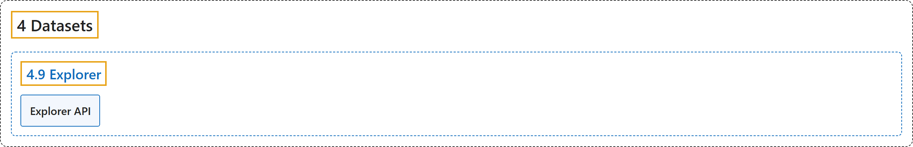

# 4.9 Explorer

## Classification

## Glossary

| Term | Definition | 中文翻译 | Source |
|---|---|---|---|
| **4.9 Explorer** Explorer | (context) "As of ultralytics>=8.3.12, **Ultralytics Explorer has been removed**." | （语境）从 ultralytics>=8.3.12 起，**Ultralytics Explorer 已被移除**。 | [Ultralytics, n.d.-a, "Ultralytics Explorer", para. 1](https://docs.ultralytics.com/datasets/explorer/#ultralytics-explorer) |
| **Explorer API** Explorer API | (context) "As of ultralytics>=8.3.12, **Ultralytics Explorer has been removed**." | （语境）从 ultralytics>=8.3.12 起，**Ultralytics Explorer 已被移除**。 | [Ultralytics, n.d.-b, "Ultralytics Explorer API", para. 1](https://docs.ultralytics.com/datasets/explorer/api/#ultralytics-explorer-api) |

## References

Ultralytics. (n.d.-a). *Ultralytics Explorer*. Ultralytics YOLO Docs (ultralytics 8.4.194). Retrieved October 31, 2026, from <https://docs.ultralytics.com/datasets/explorer/>

Ultralytics. (n.d.-b). *Ultralytics Explorer API*. Ultralytics YOLO Docs (ultralytics 8.4.194). Retrieved October 31, 2026, from <https://docs.ultralytics.com/datasets/explorer/api/>
