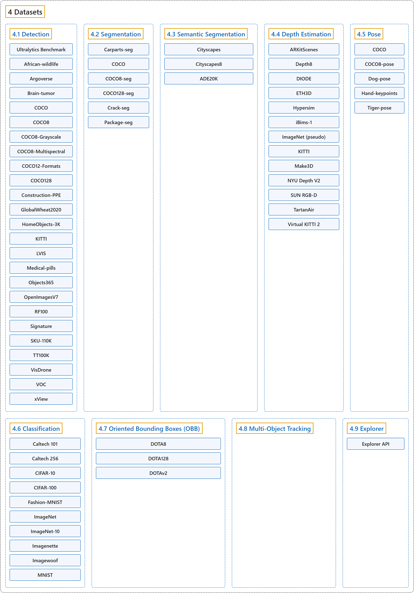

# 4. Datasets

## Classification

## Glossary

| Term | Definition | 中文翻译 | Source |
|---|---|---|---|
| **4 Datasets** 数据集 | (context) "Ultralytics provides **support for various datasets to facilitate computer vision tasks** such as detection, instance segmentation, semantic segmentation, depth estimation, classification, pose estimation, and oriented bounding boxes (OBB)." | （语境）Ultralytics **支持多种数据集，以便开展计算机视觉任务**，如检测、实例分割、语义分割、深度估计、分类、姿态估计和旋转边界框（OBB）。 | [Ultralytics, n.d.-a, "Datasets Overview", para. 1](https://docs.ultralytics.com/datasets/#datasets-overview) |
| **[4.1 Detection](detection.md)** 检测数据集 | (context) "This guide introduces **various formats of datasets that are compatible with the Ultralytics YOLO model** and provides insights into their structure, usage, and how to convert between different formats." | （语境）本指南介绍**与 Ultralytics YOLO 模型兼容的各种数据集格式**，并说明它们的结构、用法以及如何在不同格式之间转换。 | [Ultralytics, n.d.-f, "Object Detection Datasets Overview", para. 1](https://docs.ultralytics.com/datasets/detect/#object-detection-datasets-overview) |
| **[4.2 Segmentation](segmentation.md)** 实例分割数据集 | (context) "Instance segmentation is **a computer vision task that involves identifying and delineating individual objects within an image**." | （语境）实例分割是**一项识别并勾勒图像中各个物体的计算机视觉任务**。 | [Ultralytics, n.d.-d, "Instance Segmentation Datasets Overview", para. 1](https://docs.ultralytics.com/datasets/segment/#instance-segmentation-datasets-overview) |
| **[4.3 Semantic Segmentation](semantic-segmentation.md)** 语义分割数据集 | (context) "Semantic segmentation **assigns one class label to every pixel in an image**." | （语境）语义分割**给图像中的每个像素分配一个类别标签**。 | [Ultralytics, n.d.-i, "Semantic Segmentation Datasets Overview", para. 1](https://docs.ultralytics.com/datasets/semantic/#semantic-segmentation-datasets-overview) |
| **[4.4 Depth Estimation](depth-estimation.md)** 深度估计数据集 | (context) "Monocular depth estimation **assigns a depth value in meters to every pixel in an image**." | （语境）单目深度估计**给图像中的每个像素分配一个以米为单位的深度值**。 | [Ultralytics, n.d.-b, "Depth Estimation Datasets Overview", para. 1](https://docs.ultralytics.com/datasets/depth/#depth-estimation-datasets-overview) |
| **[4.5 Pose](pose.md)** 姿态数据集 | (No definition) | （无定义） | [Ultralytics, n.d.-h, "Pose Estimation Datasets Overview"](https://docs.ultralytics.com/datasets/pose/#pose-estimation-datasets-overview) |
| **[4.6 Classification](classification.md)** 分类数据集 | (No definition) | （无定义） | [Ultralytics, n.d.-c, "Image Classification Datasets Overview"](https://docs.ultralytics.com/datasets/classify/#image-classification-datasets-overview) |
| **[4.7 Oriented Bounding Boxes (OBB)](oriented-bounding-boxes-obb.md)** 旋转边界框数据集 | (context) "This guide explains **the various OBB dataset formats compatible with Ultralytics YOLO models**, offering insights into their structure, application, and methods for format conversions." | （语境）本指南说明**与 Ultralytics YOLO 模型兼容的各种 OBB 数据集格式**，介绍它们的结构、用途和格式转换方法。 | [Ultralytics, n.d.-g, "Oriented Bounding Box (OBB) Datasets Overview", para. 1](https://docs.ultralytics.com/datasets/obb/#oriented-bounding-box-obb-datasets-overview) |
| **[4.8 Multi-Object Tracking](multi-object-tracking.md)** 多目标跟踪数据集 | "Multi-object tracking is **a critical component in video analytics that identifies objects and maintains unique IDs for each detected object across video frames**." | 多目标跟踪是**视频分析中的一个关键组成部分，它识别物体，并在各视频帧中为每个检测到的物体保持唯一的 ID**。 | [Ultralytics, n.d.-e, "Multi-object Tracking Datasets Overview", para. 1](https://docs.ultralytics.com/datasets/track/#multi-object-tracking-datasets-overview) |
| **[4.9 Explorer](explorer.md)** Explorer | (context) "As of ultralytics>=8.3.12, **Ultralytics Explorer has been removed**." | （语境）从 ultralytics>=8.3.12 起，**Ultralytics Explorer 已被移除**。 | [Ultralytics, n.d.-j, "Ultralytics Explorer", para. 1](https://docs.ultralytics.com/datasets/explorer/#ultralytics-explorer) |

## References

Ultralytics. (n.d.-a). *Datasets Overview*. Ultralytics YOLO Docs (ultralytics 8.4.194). Retrieved October 31, 2026, from <https://docs.ultralytics.com/datasets/>

Ultralytics. (n.d.-b). *Depth Estimation Datasets Overview*. Ultralytics YOLO Docs (ultralytics 8.4.194). Retrieved October 31, 2026, from <https://docs.ultralytics.com/datasets/depth/>

Ultralytics. (n.d.-c). *Image Classification Datasets Overview*. Ultralytics YOLO Docs (ultralytics 8.4.194). Retrieved October 31, 2026, from <https://docs.ultralytics.com/datasets/classify/>

Ultralytics. (n.d.-d). *Instance Segmentation Datasets Overview*. Ultralytics YOLO Docs (ultralytics 8.4.194). Retrieved October 31, 2026, from <https://docs.ultralytics.com/datasets/segment/>

Ultralytics. (n.d.-e). *Multi-object Tracking Datasets Overview*. Ultralytics YOLO Docs (ultralytics 8.4.194). Retrieved October 31, 2026, from <https://docs.ultralytics.com/datasets/track/>

Ultralytics. (n.d.-f). *Object Detection Datasets Overview*. Ultralytics YOLO Docs (ultralytics 8.4.194). Retrieved October 31, 2026, from <https://docs.ultralytics.com/datasets/detect/>

Ultralytics. (n.d.-g). *Oriented Bounding Box (OBB) Datasets Overview*. Ultralytics YOLO Docs (ultralytics 8.4.194). Retrieved October 31, 2026, from <https://docs.ultralytics.com/datasets/obb/>

Ultralytics. (n.d.-h). *Pose Estimation Datasets Overview*. Ultralytics YOLO Docs (ultralytics 8.4.194). Retrieved October 31, 2026, from <https://docs.ultralytics.com/datasets/pose/>

Ultralytics. (n.d.-i). *Semantic Segmentation Datasets Overview*. Ultralytics YOLO Docs (ultralytics 8.4.194). Retrieved October 31, 2026, from <https://docs.ultralytics.com/datasets/semantic/>

Ultralytics. (n.d.-j). *Ultralytics Explorer*. Ultralytics YOLO Docs (ultralytics 8.4.194). Retrieved October 31, 2026, from <https://docs.ultralytics.com/datasets/explorer/>
