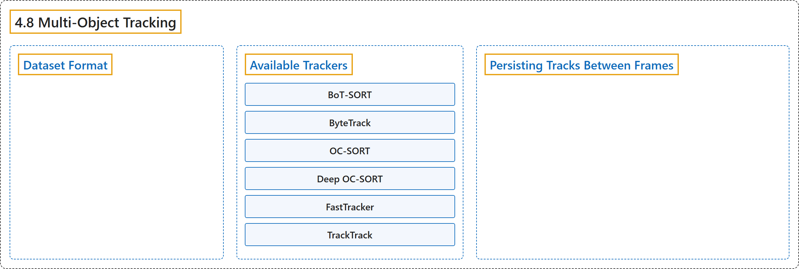

# 4.8 Multi-Object Tracking

## Classification

## Glossary

| Term | Definition | 中文翻译 | Source |
|---|---|---|---|
| **4.8 Multi-Object Tracking** 多目标跟踪数据集 | "Multi-object tracking is **a critical component in video analytics that identifies objects and maintains unique IDs for each detected object across video frames**." | 多目标跟踪是**视频分析中的一个关键组成部分，它识别物体，并在各视频帧中为每个检测到的物体保持唯一的 ID**。 | [Ultralytics, n.d., "Multi-object Tracking Datasets Overview", para. 1](https://docs.ultralytics.com/datasets/track/#multi-object-tracking-datasets-overview) |
| **Dataset Format** 数据集格式 | "**Track mode does not train a tracker or require a tracker-specific dataset.**" | **跟踪模式不训练跟踪器，也不需要跟踪器专用的数据集。** | [Ultralytics, n.d., "Dataset Format", para. 1](https://docs.ultralytics.com/datasets/track/#dataset-format) |
| **Available Trackers** 可用的跟踪器 | (context) "Ultralytics YOLO supports **the following tracking algorithms**:" | （语境）Ultralytics YOLO 支持**以下跟踪算法**： | [Ultralytics, n.d., "Available Trackers", para. 1](https://docs.ultralytics.com/datasets/track/#available-trackers) |
| **BoT-SORT** BoT-SORT | (context) "BoT-SORT - Use `botsort.yaml` **to enable this tracker**" | （语境）BoT-SORT：使用 `botsort.yaml` **启用此跟踪器** | [Ultralytics, n.d., "Available Trackers", item 1](https://docs.ultralytics.com/datasets/track/#available-trackers) |
| **ByteTrack** ByteTrack | (context) "ByteTrack - Use `bytetrack.yaml` **to enable this tracker**" | （语境）ByteTrack：使用 `bytetrack.yaml` **启用此跟踪器** | [Ultralytics, n.d., "Available Trackers", item 2](https://docs.ultralytics.com/datasets/track/#available-trackers) |
| **OC-SORT** OC-SORT | (context) "OC-SORT - Use `ocsort.yaml` **to enable this tracker**" | （语境）OC-SORT：使用 `ocsort.yaml` **启用此跟踪器** | [Ultralytics, n.d., "Available Trackers", item 3](https://docs.ultralytics.com/datasets/track/#available-trackers) |
| **Deep OC-SORT** Deep OC-SORT | (context) "Deep OC-SORT - Use `deepocsort.yaml` **to enable this tracker**" | （语境）Deep OC-SORT：使用 `deepocsort.yaml` **启用此跟踪器** | [Ultralytics, n.d., "Available Trackers", item 4](https://docs.ultralytics.com/datasets/track/#available-trackers) |
| **FastTracker** FastTracker | (context) "FastTracker - Use `fasttrack.yaml` **to enable this tracker**" | （语境）FastTracker：使用 `fasttrack.yaml` **启用此跟踪器** | [Ultralytics, n.d., "Available Trackers", item 5](https://docs.ultralytics.com/datasets/track/#available-trackers) |
| **TrackTrack** TrackTrack | (context) "TrackTrack - Use `tracktrack.yaml` **to enable this tracker** (default)" | （语境）TrackTrack：使用 `tracktrack.yaml` **启用此跟踪器**（默认） | [Ultralytics, n.d., "Available Trackers", item 6](https://docs.ultralytics.com/datasets/track/#available-trackers) |
| **Persisting Tracks Between Frames** 在帧之间保持轨迹 | "For **continuous tracking across video frames**, you can use the `persist=True` parameter:" | 要**在视频帧之间连续跟踪**，可以使用 `persist=True` 参数： | [Ultralytics, n.d., "Persisting Tracks Between Frames", para. 1](https://docs.ultralytics.com/datasets/track/#persisting-tracks-between-frames) |

## References

Ultralytics. (n.d.). *Multi-object Tracking Datasets Overview*. Ultralytics YOLO Docs (ultralytics 8.4.194). Retrieved October 31, 2026, from <https://docs.ultralytics.com/datasets/track/>
