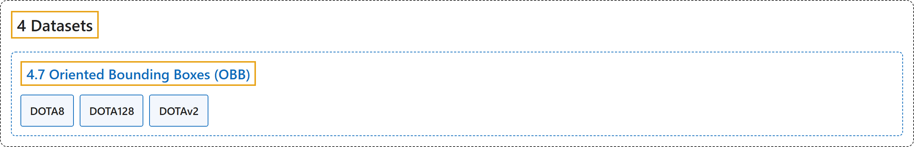

# 4.7 Oriented Bounding Boxes (OBB)

## Classification

## Glossary

| Term | Definition | 中文翻译 | Source |
|---|---|---|---|
| **4.7 Oriented Bounding Boxes (OBB)** 旋转边界框数据集 | (context) "This guide explains **the various OBB dataset formats compatible with Ultralytics YOLO models**, offering insights into their structure, application, and methods for format conversions." | （语境）本指南说明**与 Ultralytics YOLO 模型兼容的各种 OBB 数据集格式**，介绍它们的结构、用途和格式转换方法。 | [Ultralytics, n.d.-d, "Oriented Bounding Box (OBB) Datasets Overview", para. 1](https://docs.ultralytics.com/datasets/obb/#oriented-bounding-box-obb-datasets-overview) |
| **DOTA8** DOTA8 | "Ultralytics DOTA8 is **a small but versatile oriented object detection dataset composed of the first 8 images of the split DOTAv1 set**, 4 for training and 4 for validation." | Ultralytics DOTA8 是**一个小而多用途的旋转目标检测数据集，由切分后的 DOTAv1 集的前 8 张图像组成**，4 张训练，4 张验证。 | [Ultralytics, n.d.-c, "DOTA8 Dataset", para. 1](https://docs.ultralytics.com/datasets/obb/dota8/#dota8-dataset) |
| **DOTA128** DOTA128 | "Ultralytics DOTA128 is **a small but versatile oriented object detection dataset composed of 128 images from the DOTAv1 set** that serve as both the training and validation split." | Ultralytics DOTA128 是**一个小而多用途的旋转目标检测数据集，由 DOTAv1 集的 128 张图像组成**，这些图像同时用作训练集和验证集。 | [Ultralytics, n.d.-b, "DOTA128 Dataset", para. 1](https://docs.ultralytics.com/datasets/obb/dota128/#dota128-dataset) |
| **DOTAv2** DOTA v2 | "The DOTA dataset is **a large-scale benchmark for object detection in aerial images**, released in three versions (v1.0, v1.5, v2.0) with up to 1.7M Oriented Bounding Box (OBB) annotations across 18 categories, captured from diverse aerial sensors and platforms." | DOTA 数据集是**一个航拍图像目标检测的大规模基准**，发布了三个版本（v1.0、v1.5、v2.0），用多种航拍传感器和平台采集，最多有 170 万个旋转边界框（OBB）标注，涵盖 18 个类别。 | [Ultralytics, n.d.-a, "DOTA Dataset with OBB", para. 1](https://docs.ultralytics.com/datasets/obb/dota-v2/#dota-dataset-with-obb) |

## References

Ultralytics. (n.d.-a). *DOTA Dataset with OBB*. Ultralytics YOLO Docs (ultralytics 8.4.194). Retrieved October 31, 2026, from <https://docs.ultralytics.com/datasets/obb/dota-v2/>

Ultralytics. (n.d.-b). *DOTA128 Dataset*. Ultralytics YOLO Docs (ultralytics 8.4.194). Retrieved October 31, 2026, from <https://docs.ultralytics.com/datasets/obb/dota128/>

Ultralytics. (n.d.-c). *DOTA8 Dataset*. Ultralytics YOLO Docs (ultralytics 8.4.194). Retrieved October 31, 2026, from <https://docs.ultralytics.com/datasets/obb/dota8/>

Ultralytics. (n.d.-d). *Oriented Bounding Box (OBB) Datasets Overview*. Ultralytics YOLO Docs (ultralytics 8.4.194). Retrieved October 31, 2026, from <https://docs.ultralytics.com/datasets/obb/>
