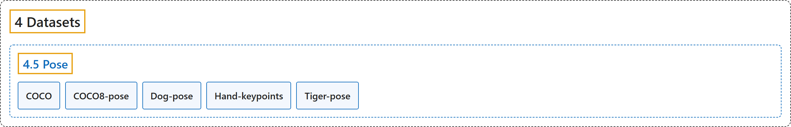

# 4.5 Pose

## Classification

## Glossary

| Term | Definition | 中文翻译 | Source |
|---|---|---|---|
| **4.5 Pose** 姿态数据集 | (No definition) | （无定义） | [Ultralytics, n.d.-e, "Pose Estimation Datasets Overview"](https://docs.ultralytics.com/datasets/pose/#pose-estimation-datasets-overview) |
| **COCO** COCO 姿态版 | "The COCO-Pose dataset **adapts COCO (Common Objects in Context) for pose estimation**: 58,945 images from COCO Keypoints 2017, annotated with 156,165 people using a 17-keypoint schema." | COCO-Pose 数据集**把 COCO 改编用于姿态估计**：含 COCO Keypoints 2017 的 58,945 张图像，用 17 个关键点的方案标注了 156,165 个人。 | [Ultralytics, n.d.-a, "COCO-Pose Dataset", para. 1](https://docs.ultralytics.com/datasets/pose/coco/#coco-pose-dataset) |
| **COCO8-pose** COCO8 姿态版 | "Ultralytics COCO8-Pose is **a small but versatile pose estimation dataset composed of the first 8 images of the COCO train 2017 set** (4 for training, 4 for validation), using a 17-keypoint schema for the single "person" class." | Ultralytics COCO8-Pose 是**一个小而多用途的姿态估计数据集，由 COCO train 2017 集的前 8 张图像组成**（4 张训练，4 张验证），对单一“person”类别使用 17 个关键点的方案。 | [Ultralytics, n.d.-b, "COCO8-Pose Dataset", para. 1](https://docs.ultralytics.com/datasets/pose/coco8-pose/#coco8-pose-dataset) |
| **Dog-pose** 狗姿态 | "The Ultralytics Dog-Pose dataset is **a high-quality and extensive dataset specifically curated for dog keypoint estimation**, providing 6,773 training and 1,703 validation images." | Ultralytics 狗姿态数据集是**一个高质量、规模大的数据集，专为狗的关键点估计而整理**，提供 6,773 张训练图像和 1,703 张验证图像。 | [Ultralytics, n.d.-c, "Dog-Pose Dataset", para. 1](https://docs.ultralytics.com/datasets/pose/dog-pose/#dog-pose-dataset) |
| **Hand-keypoints** 手部关键点 | "The Ultralytics Hand Keypoints dataset **contains 26,768 images of hands annotated with 21 keypoints each**, generated using the Google MediaPipe library for high accuracy and consistency." | Ultralytics 手部关键点数据集**含 26,768 张手部图像，每只手标注 21 个关键点**，用谷歌 MediaPipe 库生成，以保证高精度和一致性。 | [Ultralytics, n.d.-d, "Hand Keypoints Dataset", para. 1](https://docs.ultralytics.com/datasets/pose/hand-keypoints/#hand-keypoints-dataset) |
| **Tiger-pose** 老虎姿态 | "Ultralytics introduces the Tiger-Pose dataset, **a versatile collection designed for pose estimation tasks**." | Ultralytics 推出了老虎姿态数据集，**一套为姿态估计任务设计的多用途数据**。 | [Ultralytics, n.d.-f, "Tiger-Pose Dataset", para. 1](https://docs.ultralytics.com/datasets/pose/tiger-pose/#tiger-pose-dataset) |

## References

Ultralytics. (n.d.-a). *COCO-Pose Dataset*. Ultralytics YOLO Docs (ultralytics 8.4.194). Retrieved October 31, 2026, from <https://docs.ultralytics.com/datasets/pose/coco/>

Ultralytics. (n.d.-b). *COCO8-Pose Dataset*. Ultralytics YOLO Docs (ultralytics 8.4.194). Retrieved October 31, 2026, from <https://docs.ultralytics.com/datasets/pose/coco8-pose/>

Ultralytics. (n.d.-c). *Dog-Pose Dataset*. Ultralytics YOLO Docs (ultralytics 8.4.194). Retrieved October 31, 2026, from <https://docs.ultralytics.com/datasets/pose/dog-pose/>

Ultralytics. (n.d.-d). *Hand Keypoints Dataset*. Ultralytics YOLO Docs (ultralytics 8.4.194). Retrieved October 31, 2026, from <https://docs.ultralytics.com/datasets/pose/hand-keypoints/>

Ultralytics. (n.d.-e). *Pose Estimation Datasets Overview*. Ultralytics YOLO Docs (ultralytics 8.4.194). Retrieved October 31, 2026, from <https://docs.ultralytics.com/datasets/pose/>

Ultralytics. (n.d.-f). *Tiger-Pose Dataset*. Ultralytics YOLO Docs (ultralytics 8.4.194). Retrieved October 31, 2026, from <https://docs.ultralytics.com/datasets/pose/tiger-pose/>
