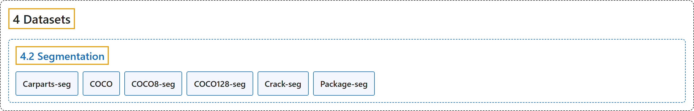

# 4.2 Segmentation

## Classification

## Glossary

| Term | Definition | 中文翻译 | Source |
|---|---|---|---|
| **4.2 Segmentation** 实例分割数据集 | (context) "Instance segmentation is **a computer vision task that involves identifying and delineating individual objects within an image**." | （语境）实例分割是**一项识别并勾勒图像中各个物体的计算机视觉任务**。 | [Ultralytics, n.d.-f, "Instance Segmentation Datasets Overview", para. 1](https://docs.ultralytics.com/datasets/segment/#instance-segmentation-datasets-overview) |
| **Carparts-seg** 汽车部件分割 | "The Ultralytics Carparts Segmentation Dataset **provides 3,833 annotated images across 23 car-part classes** — including bumpers, doors, lights, mirrors, hood, and trunk — for training instance segmentation models on automotive computer vision tasks." | Ultralytics 汽车部件分割数据集**提供 3,833 张标注图像，涵盖 23 个汽车部件类别**，包括保险杠、车门、车灯、后视镜、引擎盖和后备箱，用于在汽车计算机视觉任务上训练实例分割模型。 | [Ultralytics, n.d.-a, "Carparts Segmentation Dataset", para. 1](https://docs.ultralytics.com/datasets/segment/carparts-seg/#carparts-segmentation-dataset) |
| **COCO** COCO 分割版 | "The COCO-Seg dataset **provides COCO (Common Objects in Context) instance segmentation masks** — 118,287 training and 5,000 validation images with polygon masks across 80 object categories — in the Ultralytics YOLO label format." | COCO-Seg 数据集**以 Ultralytics YOLO 标注格式提供 COCO 的实例分割掩码**：118,287 张训练图像和 5,000 张验证图像，带多边形掩码，涵盖 80 个物体类别。 | [Ultralytics, n.d.-b, "COCO-Seg Dataset", para. 1](https://docs.ultralytics.com/datasets/segment/coco/#coco-seg-dataset) |
| **COCO8-seg** COCO8 分割版 | "Ultralytics COCO8-Seg is **a small but versatile instance segmentation dataset composed of the first 8 images of the COCO train 2017 set**, 4 for training and 4 for validation." | Ultralytics COCO8-Seg 是**一个小而多用途的实例分割数据集，由 COCO train 2017 集的前 8 张图像组成**，4 张训练，4 张验证。 | [Ultralytics, n.d.-d, "COCO8-Seg Dataset", para. 1](https://docs.ultralytics.com/datasets/segment/coco8-seg/#coco8-seg-dataset) |
| **COCO128-seg** COCO128 分割版 | "Ultralytics COCO128-Seg is **a small but versatile instance segmentation dataset composed of the first 128 images of the COCO train 2017 set**." | Ultralytics COCO128-Seg 是**一个小而多用途的实例分割数据集，由 COCO train 2017 集的前 128 张图像组成**。 | [Ultralytics, n.d.-c, "COCO128-Seg Dataset", para. 1](https://docs.ultralytics.com/datasets/segment/coco128-seg/#coco128-seg-dataset) |
| **Crack-seg** 裂缝分割 | "The Ultralytics Crack Segmentation Dataset **provides 4,029 annotated images of cracks on roads and walls for training instance segmentation models on a single crack class**." | Ultralytics 裂缝分割数据集**提供 4,029 张道路和墙面裂缝的标注图像，用于在单一 crack（裂缝）类别上训练实例分割模型**。 | [Ultralytics, n.d.-e, "Crack Segmentation Dataset", para. 1](https://docs.ultralytics.com/datasets/segment/crack-seg/#crack-segmentation-dataset) |
| **Package-seg** 包裹分割 | "The Ultralytics Package Segmentation Dataset is **a curated collection of 2,197 annotated images of packages for training instance segmentation models on a single package class**." | Ultralytics 包裹分割数据集是**一套精选的 2,197 张包裹标注图像，用于在单一 package（包裹）类别上训练实例分割模型**。 | [Ultralytics, n.d.-g, "Package Segmentation Dataset", para. 1](https://docs.ultralytics.com/datasets/segment/package-seg/#package-segmentation-dataset) |

## References

Ultralytics. (n.d.-a). *Carparts Segmentation Dataset*. Ultralytics YOLO Docs (ultralytics 8.4.194). Retrieved October 31, 2026, from <https://docs.ultralytics.com/datasets/segment/carparts-seg/>

Ultralytics. (n.d.-b). *COCO-Seg Dataset*. Ultralytics YOLO Docs (ultralytics 8.4.194). Retrieved October 31, 2026, from <https://docs.ultralytics.com/datasets/segment/coco/>

Ultralytics. (n.d.-c). *COCO128-Seg Dataset*. Ultralytics YOLO Docs (ultralytics 8.4.194). Retrieved October 31, 2026, from <https://docs.ultralytics.com/datasets/segment/coco128-seg/>

Ultralytics. (n.d.-d). *COCO8-Seg Dataset*. Ultralytics YOLO Docs (ultralytics 8.4.194). Retrieved October 31, 2026, from <https://docs.ultralytics.com/datasets/segment/coco8-seg/>

Ultralytics. (n.d.-e). *Crack Segmentation Dataset*. Ultralytics YOLO Docs (ultralytics 8.4.194). Retrieved October 31, 2026, from <https://docs.ultralytics.com/datasets/segment/crack-seg/>

Ultralytics. (n.d.-f). *Instance Segmentation Datasets Overview*. Ultralytics YOLO Docs (ultralytics 8.4.194). Retrieved October 31, 2026, from <https://docs.ultralytics.com/datasets/segment/>

Ultralytics. (n.d.-g). *Package Segmentation Dataset*. Ultralytics YOLO Docs (ultralytics 8.4.194). Retrieved October 31, 2026, from <https://docs.ultralytics.com/datasets/segment/package-seg/>
