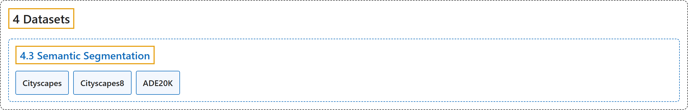

# 4.3 Semantic Segmentation

## Classification

## Glossary

| Term | Definition | 中文翻译 | Source |
|---|---|---|---|
| **4.3 Semantic Segmentation** 语义分割数据集 | (context) "Semantic segmentation **assigns one class label to every pixel in an image**." | （语境）语义分割**给图像中的每个像素分配一个类别标签**。 | [Ultralytics, n.d.-d, "Semantic Segmentation Datasets Overview", para. 1](https://docs.ultralytics.com/datasets/semantic/#semantic-segmentation-datasets-overview) |
| **Cityscapes** Cityscapes | "The Cityscapes dataset is **a large-scale semantic segmentation benchmark of urban street scenes captured across 50 European cities**, with 2,975 finely annotated training images and 500 validation images across 19 classes." | Cityscapes 数据集是**一个大规模语义分割基准，收录了在 50 个欧洲城市拍摄的城市街景**，含 2,975 张精细标注的训练图像和 500 张验证图像，共 19 个类别。 | [Ultralytics, n.d.-b, "Cityscapes Dataset", para. 1](https://docs.ultralytics.com/datasets/semantic/cityscapes/#cityscapes-dataset) |
| **Cityscapes8** Cityscapes8 | "The Ultralytics Cityscapes8 dataset is **a compact semantic segmentation dataset with 8 images sampled from the Cityscapes dataset**: 4 for training and 4 for validation." | Ultralytics Cityscapes8 数据集是**一个紧凑的语义分割数据集，含从 Cityscapes 数据集中抽取的 8 张图像**：4 张训练，4 张验证。 | [Ultralytics, n.d.-c, "Cityscapes8 Dataset", para. 1](https://docs.ultralytics.com/datasets/semantic/cityscapes8/#cityscapes8-dataset) |
| **ADE20K** ADE20K | "The ADE20K dataset is **a large-scale semantic segmentation benchmark from MIT CSAIL** with 20,210 training and 2,000 validation images densely annotated across 150 indoor, outdoor, object, and stuff categories." | ADE20K 数据集是**来自 MIT CSAIL 的大规模语义分割基准**，含 20,210 张训练图像和 2,000 张验证图像，稠密标注了 150 个室内、室外、物体和背景类别。 | [Ultralytics, n.d.-a, "ADE20K Dataset", para. 1](https://docs.ultralytics.com/datasets/semantic/ade20k/#ade20k-dataset) |

## References

Ultralytics. (n.d.-a). *ADE20K Dataset*. Ultralytics YOLO Docs (ultralytics 8.4.194). Retrieved October 31, 2026, from <https://docs.ultralytics.com/datasets/semantic/ade20k/>

Ultralytics. (n.d.-b). *Cityscapes Dataset*. Ultralytics YOLO Docs (ultralytics 8.4.194). Retrieved October 31, 2026, from <https://docs.ultralytics.com/datasets/semantic/cityscapes/>

Ultralytics. (n.d.-c). *Cityscapes8 Dataset*. Ultralytics YOLO Docs (ultralytics 8.4.194). Retrieved October 31, 2026, from <https://docs.ultralytics.com/datasets/semantic/cityscapes8/>

Ultralytics. (n.d.-d). *Semantic Segmentation Datasets Overview*. Ultralytics YOLO Docs (ultralytics 8.4.194). Retrieved October 31, 2026, from <https://docs.ultralytics.com/datasets/semantic/>
