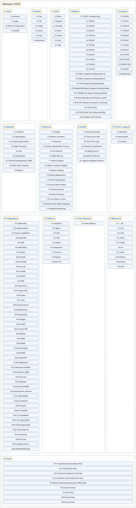

# Ultralytics YOLO

## Classification

## Glossary

| Term | Definition | 中文翻译 | Source |
|---|---|---|---|
| **Ultralytics YOLO** Ultralytics YOLO | "Ultralytics YOLO is **a family of real-time computer vision models for object detection, instance segmentation, semantic segmentation, depth estimation, classification, pose estimation, oriented bounding boxes, and tracking**, available through one Python package and CLI." | Ultralytics YOLO 是**一系列实时计算机视觉模型，用于目标检测、实例分割、语义分割、深度估计、分类、姿态估计、旋转边界框和跟踪**，通过一个 Python 包和命令行工具提供。 | [Ultralytics, n.d., "Ultralytics YOLO Docs", para. 1](https://docs.ultralytics.com/#ultralytics-yolo-docs) |
| **[1 Home](home/index.md)** 首页 | (context) "Explore the Ultralytics Docs, **a comprehensive resource covering the YOLO package and CLI as well as the Ultralytics Platform**, which adds data annotation, cloud training, and deployment on top of the same models." | （语境）浏览 Ultralytics 文档，这是**一份全面的资源，涵盖 YOLO 包和命令行工具，以及 Ultralytics Platform**，后者在同样的模型之上增加了数据标注、云端训练和部署。 | [Ultralytics, n.d., "Ultralytics YOLO Docs", para. 2](https://docs.ultralytics.com/#ultralytics-yolo-docs) |
| **[2 Modes](modes/index.md)** 模式 | (context) "Ultralytics YOLO26 is not just another object detection model; it's **a versatile framework designed to cover the entire lifecycle of machine learning models—from data ingestion and model training to validation, deployment, and real-world tracking**. Each mode serves a specific purpose and is engineered to offer you the flexibility and efficiency required for different tasks and use cases." | （语境）Ultralytics YOLO26 不只是又一个目标检测模型；它是**一个多用途框架，旨在覆盖机器学习模型的整个生命周期：从数据摄取、模型训练，到验证、部署和真实场景中的跟踪**。每种模式都有特定用途，设计上让你在不同任务和用例中获得所需的灵活性和效率。 | [Ultralytics, n.d., "Introduction", para. 1](https://docs.ultralytics.com/modes/#introduction) |
| **[3 Tasks](tasks/index.md)** 任务 | (context) "Ultralytics YOLO26 is a versatile AI framework that supports multiple computer vision **tasks**. The framework can be used to perform **detection, segmentation, semantic segmentation, depth estimation, classification, pose estimation, and OBB**." | （语境）Ultralytics YOLO26 是一个支持多种计算机视觉**任务**的多用途 AI 框架。该框架可以用来做**检测、分割、语义分割、深度估计、分类、姿态估计和旋转边界框（OBB）**。 | [Ultralytics, n.d., "Computer Vision Tasks Supported by Ultralytics YOLO26", para. 1](https://docs.ultralytics.com/tasks/#computer-vision-tasks-supported-by-ultralytics-yolo26) |
| **[4 Models](models/index.md)** 模型 | (context) "We offer support for **a wide range of models, each tailored to specific tasks** like object detection, instance segmentation, semantic segmentation, depth estimation, image classification, pose estimation, and oriented bounding boxes." | （语境）我们支持**多种模型，每种都针对特定任务而设计**，如目标检测、实例分割、语义分割、深度估计、图像分类、姿态估计和旋转边界框。 | [Ultralytics, n.d., "Models Supported by Ultralytics", para. 1](https://docs.ultralytics.com/models/#models-supported-by-ultralytics) |
| **[5 Compare](compare/index.md)** 对比 | (context) "This page centralizes **detailed technical analyses and performance benchmarks, dissecting the trade-offs between the latest Ultralytics YOLO26 and other leading architectures** like YOLO11, YOLOv10, RT-DETR, and EfficientDet." | （语境）本页集中提供**详细的技术分析和性能基准，剖析最新的 Ultralytics YOLO26 与其他领先架构之间的取舍**，如 YOLO11、YOLOv10、RT-DETR 和 EfficientDet。 | [Ultralytics, n.d., "Model Comparisons", para. 1](https://docs.ultralytics.com/compare/#model-comparisons) |
| **[6 Datasets](datasets/index.md)** 数据集 | (context) "Ultralytics provides **support for various datasets to facilitate computer vision tasks** such as detection, instance segmentation, semantic segmentation, depth estimation, classification, pose estimation, and oriented bounding boxes (OBB)." | （语境）Ultralytics **支持多种数据集，以便开展计算机视觉任务**，如检测、实例分割、语义分割、深度估计、分类、姿态估计和旋转边界框（OBB）。 | [Ultralytics, n.d., "Datasets Overview", para. 1](https://docs.ultralytics.com/datasets/#datasets-overview) |
| **[7 Solutions](solutions/index.md)** 解决方案 | "Ultralytics Solutions provide **cutting-edge applications of YOLO models, offering real-world solutions like object counting, blurring, and security systems**, enhancing efficiency and accuracy in diverse industries." | Ultralytics Solutions 提供 **YOLO 模型的前沿应用，给出目标计数、模糊处理、安防系统等真实场景的解决方案**，在各行各业提升效率和准确率。 | [Ultralytics, n.d., "Ultralytics Solutions: Harness YOLO26 to Solve Real-World Problems", para. 1](https://docs.ultralytics.com/solutions/#ultralytics-solutions-harness-yolo26-to-solve-real-world-problems) |
| **[8 Guides](guides/index.md)** 指南 | "Our comprehensive tutorials **cover various aspects of the YOLO object detection model, ranging from training and prediction to deployment**." | 我们的全面教程**涵盖 YOLO 目标检测模型的各个方面，从训练、预测到部署**。 | [Ultralytics, n.d., "Comprehensive Tutorials for Ultralytics YOLO", para. 1](https://docs.ultralytics.com/guides/#comprehensive-tutorials-for-ultralytics-yolo) |
| **[9 YOLOv5 (Legacy)](yolov5-legacy/index.md)** YOLOv5（旧版） | "Ultralytics YOLOv5, **the fifth iteration of the revolutionary "You Only Look Once" object detection model**, is designed to deliver high-speed, high-accuracy results in real-time." | Ultralytics YOLOv5 是**革命性的“You Only Look Once”目标检测模型的第五代**，旨在实时给出高速、高准确率的结果。 | [Ultralytics, n.d., "Comprehensive Guide to Ultralytics YOLOv5", para. 1](https://docs.ultralytics.com/yolov5/#comprehensive-guide-to-ultralytics-yolov5) |
| **[10 Integrations](integrations/index.md)** 集成 | (context) "This page provides **an overview of our partnerships with various tools and platforms**, designed to streamline your machine learning workflows, enhance dataset management, simplify model training, and facilitate efficient deployment." | （语境）本页概述**我们与各种工具和平台的合作**，旨在简化你的机器学习工作流、加强数据集管理、简化模型训练并便于高效部署。 | [Ultralytics, n.d., "Ultralytics Integrations", para. 1](https://docs.ultralytics.com/integrations/#ultralytics-integrations) |
| **[11 Platform](platform/index.md)** 平台 | "Ultralytics Platform is **a comprehensive end-to-end computer vision platform that streamlines the entire ML workflow from data preparation to model deployment**." | Ultralytics Platform 是**一个全面的端到端计算机视觉平台，简化从数据准备到模型部署的整个机器学习工作流**。 | [Ultralytics, n.d., "Ultralytics Platform", para. 1](https://docs.ultralytics.com/platform/#ultralytics-platform) |
| **[12 Rust Inference](rust-inference/index.md)** Rust 推理 | "Ultralytics Inference is **a high-performance YOLO inference library and command-line tool written in Rust**." | Ultralytics Inference 是**一个用 Rust 编写的高性能 YOLO 推理库和命令行工具**。 | [Ultralytics, n.d., "Ultralytics Inference for Rust", para. 1](https://docs.ultralytics.com/inference/#ultralytics-inference-for-rust) |
| **[13 Reference](reference/index.md)** 参考 | "This section is **the complete Python API reference for the ultralytics package**." | 本节是 **ultralytics 包的完整 Python API 参考**。 | [Ultralytics, n.d., "Ultralytics Python API Reference", para. 1](https://docs.ultralytics.com/reference/#ultralytics-python-api-reference) |
| **[14 Help](help/index.md)** 帮助 | (context) "This page **brings together practical guides, policies, and FAQs to support your work with Ultralytics YOLO models and repositories**." | （语境）本页**汇集了实用指南、政策和常见问题，为你使用 Ultralytics YOLO 模型和代码仓库提供支持**。 | [Ultralytics, n.d., "Help", para. 1](https://docs.ultralytics.com/help/#help) |

## References

Ultralytics. (n.d.). *Ultralytics YOLO docs* (ultralytics 8.4.194). Retrieved October 30, 2026, from <https://docs.ultralytics.com/>
