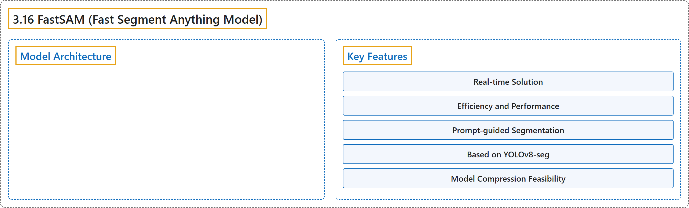

# 3.16 FastSAM (Fast Segment Anything Model)

## Classification

## Glossary

| Term | Definition | 中文翻译 | Source |
|---|---|---|---|
| **3.16 FastSAM (Fast Segment Anything Model)** FastSAM（快速分割一切模型） | "The Fast Segment Anything Model (FastSAM) is **a novel, real-time CNN-based solution for the Segment Anything task**." | 快速分割一切模型（FastSAM）是**一种新颖的、基于 CNN 的实时方案，用于“分割一切”任务**。 | [Ultralytics, n.d., "Fast Segment Anything Model (FastSAM)", para. 1](https://docs.ultralytics.com/models/fast-sam/#fast-segment-anything-model-fastsam) |
| **Model Architecture** 模型架构 | (No definition) | （无定义） | [Ultralytics, n.d., "Model Architecture"](https://docs.ultralytics.com/models/fast-sam/#model-architecture) |
| **Key Features** 主要特性 | (No definition) | （无定义） | [Ultralytics, n.d., "Key Features"](https://docs.ultralytics.com/models/fast-sam/#key-features) |
| **Real-time Solution** 实时解决方案 | "Real-time Solution: By leveraging the computational efficiency of CNNs, FastSAM **provides a real-time solution for the segment anything task**" | 实时解决方案：借助 CNN 的计算效率，FastSAM **为“分割一切”任务提供了实时解决方案** | [Ultralytics, n.d., "Key Features", item 1](https://docs.ultralytics.com/models/fast-sam/#key-features) |
| **Efficiency and Performance** 效率与性能 | "Efficiency and Performance: FastSAM offers **a significant reduction in computational and resource demands without compromising on performance quality**." | 效率与性能：FastSAM **在不牺牲性能质量的前提下大幅降低了计算和资源需求**。 | [Ultralytics, n.d., "Key Features", item 2](https://docs.ultralytics.com/models/fast-sam/#key-features) |
| **Prompt-guided Segmentation** 提示引导分割 | "Prompt-guided Segmentation: FastSAM **can segment any object within an image guided by various possible user interaction prompts**" | 提示引导分割：FastSAM **能在各种可能的用户交互提示引导下分割图像中的任何物体** | [Ultralytics, n.d., "Key Features", item 3](https://docs.ultralytics.com/models/fast-sam/#key-features) |
| **Based on YOLOv8-seg** 基于 YOLOv8-seg | "Based on YOLOv8-seg: FastSAM is based on YOLOv8-seg, **an object detector equipped with an instance segmentation branch**." | 基于 YOLOv8-seg：FastSAM 基于 YOLOv8-seg，它是**一种配有实例分割分支的目标检测器**。 | [Ultralytics, n.d., "Key Features", item 4](https://docs.ultralytics.com/models/fast-sam/#key-features) |
| **Model Compression Feasibility** 模型压缩可行性 | "Model Compression Feasibility: FastSAM demonstrates **the feasibility of a path that can significantly reduce the computational effort by introducing an artificial prior to the structure**" | 模型压缩可行性：FastSAM 证明了**通过给结构引入人工先验来大幅减少计算量这条路径的可行性** | [Ultralytics, n.d., "Key Features", item 7](https://docs.ultralytics.com/models/fast-sam/#key-features) |

## References

Ultralytics. (n.d.). *Fast Segment Anything Model (FastSAM)*. Ultralytics YOLO Docs (ultralytics 8.4.194). Retrieved October 31, 2026, from <https://docs.ultralytics.com/models/fast-sam/>
