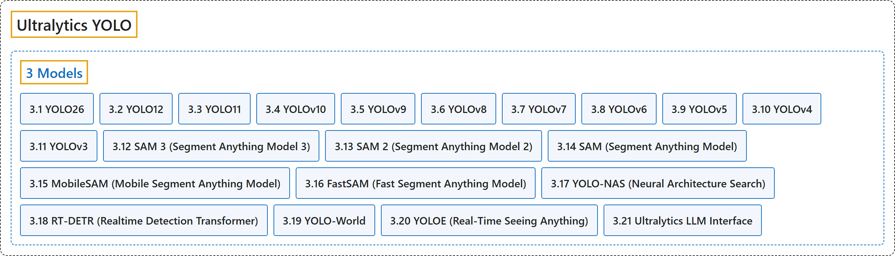

# 3. Models

## Classification

## Glossary

| Term | Definition | 中文翻译 | Source |
|---|---|---|---|
| **3 Models** 模型 | (context) "We offer support for **a wide range of models, each tailored to specific tasks** like object detection, instance segmentation, semantic segmentation, depth estimation, image classification, pose estimation, and oriented bounding boxes." | （语境）我们支持**多种模型，每种都针对特定任务而设计**，如目标检测、实例分割、语义分割、深度估计、图像分类、姿态估计和旋转边界框。 | [Ultralytics, n.d.-f, "Models Supported by Ultralytics", para. 1](https://docs.ultralytics.com/models/#models-supported-by-ultralytics) |
| **[3.1 YOLO26](yolo26.md)** YOLO26 | "YOLO26 is **a unified family of real-time vision models** described in the Ultralytics YOLO26 paper." | YOLO26 是 **Ultralytics YOLO26 论文中描述的一个统一的实时视觉模型家族**。 | [Ultralytics, n.d.-l, "Ultralytics YOLO26", para. 1](https://docs.ultralytics.com/models/yolo26/#ultralytics-yolo26) |
| **[3.2 YOLO12](yolo12.md)** YOLO12 | "YOLO12, released in early 2025, **introduces an attention-centric architecture that departs from the traditional CNN-based approaches used in previous YOLO models**, yet retains the real-time inference speed essential for many applications." | YOLO12 于 2025 年初发布，**引入了以注意力为中心的架构，不同于以往 YOLO 模型使用的传统 CNN 方法**，同时保留了许多应用所需的实时推理速度。 | [Ultralytics, n.d.-p, "YOLO12: Attention-Centric Object Detection", para. 1](https://docs.ultralytics.com/models/yolo12/#yolo12-attention-centric-object-detection) |
| **[3.3 YOLO11](yolo11.md)** YOLO11 | (context) "Released September 2024. **Current stable release and the recommended choice for all use cases.**" | （语境）2024 年 9 月发布。**当前的稳定版本，所有用例的推荐选择。** | [Ultralytics, n.d.-k, "Ultralytics YOLO11", para. 1](https://docs.ultralytics.com/models/yolo11/#ultralytics-yolo11) |
| **[3.4 YOLOv10](yolov10.md)** YOLOv10 | "YOLOv10, released in May 2024 and built on the Ultralytics Python package by researchers at Tsinghua University, **introduces a new approach to real-time object detection, addressing both the post-processing and model architecture deficiencies found in previous YOLO versions**." | YOLOv10 于 2024 年 5 月发布，由清华大学的研究人员基于 Ultralytics Python 包构建，**提出了一种新的实时目标检测方法，同时解决了以往 YOLO 版本在后处理和模型架构上的不足**。 | [Ultralytics, n.d.-r, "YOLOv10: Real-Time End-to-End Object Detection", para. 1](https://docs.ultralytics.com/models/yolov10/#yolov10-real-time-end-to-end-object-detection) |
| **[3.5 YOLOv9](yolov9.md)** YOLOv9 | "YOLOv9 marks a significant advancement in real-time object detection, **introducing groundbreaking techniques such as Programmable Gradient Information (PGI) and the Generalized Efficient Layer Aggregation Network (GELAN)**." | YOLOv9 标志着实时目标检测的重大进步，**引入了可编程梯度信息（PGI）和广义高效层聚合网络（GELAN）等开创性技术**。 | [Ultralytics, n.d.-v, "YOLOv9: A Leap Forward in Object Detection Technology", para. 1](https://docs.ultralytics.com/models/yolov9/#yolov9-a-leap-forward-in-object-detection-technology) |
| **[3.6 YOLOv8](yolov8.md)** YOLOv8 | (context) "Released January 2023. **Proven and widely adopted with extensive community support.**" | （语境）2023 年 1 月发布。**久经验证、广泛采用，社区支持丰富。** | [Ultralytics, n.d.-b, "Explore Ultralytics YOLOv8", para. 1](https://docs.ultralytics.com/models/yolov8/#explore-ultralytics-yolov8) |
| **[3.7 YOLOv7](yolov7.md)** YOLOv7 | "YOLOv7, released in July 2022, was **a significant advancement in real-time object detection at its time of release**." | YOLOv7 于 2022 年 7 月发布，在发布时是**实时目标检测的一项重大进步**。 | [Ultralytics, n.d.-u, "YOLOv7: Trainable Bag-of-Freebies", para. 1](https://docs.ultralytics.com/models/yolov7/#yolov7-trainable-bag-of-freebies) |
| **[3.8 YOLOv6](yolov6.md)** YOLOv6 | "Meituan YOLOv6, released in 2022, **offers a strong balance between speed and accuracy**, making it a popular choice for real-time applications." | 美团 YOLOv6 于 2022 年发布，**在速度和精度之间取得了很好的平衡**，因此常用于实时应用。 | [Ultralytics, n.d.-d, "Meituan YOLOv6", para. 1](https://docs.ultralytics.com/models/yolov6/#meituan-yolov6) |
| **[3.9 YOLOv5](yolov5.md)** YOLOv5 | (context) "Released June 2020. **The foundational PyTorch implementation, battle-tested across millions of deployments.**" | （语境）2020 年 6 月发布。**奠基性的 PyTorch 实现，经过数百万次部署的实战检验。** | [Ultralytics, n.d.-m, "Ultralytics YOLOv5", para. 1](https://docs.ultralytics.com/models/yolov5/#ultralytics-yolov5) |
| **[3.10 YOLOv4](yolov4.md)** YOLOv4 | "YOLOv4 is **designed to provide the optimal balance between speed and accuracy**, making it an excellent choice for many applications." | YOLOv4 **旨在提供速度与精度之间的最佳平衡**，因此是许多应用的绝佳选择。 | [Ultralytics, n.d.-t, "YOLOv4: High-Speed and Precise Object Detection", para. 1](https://docs.ultralytics.com/models/yolov4/#yolov4-high-speed-and-precise-object-detection) |
| **[3.11 YOLOv3](yolov3.md)** YOLOv3 | (context) "This document presents an overview of **three closely related object detection models, namely YOLOv3, YOLOv3-Ultralytics, and YOLOv3u**." | （语境）本文档概述**三个密切相关的目标检测模型，即 YOLOv3、YOLOv3-Ultralytics 和 YOLOv3u**。 | [Ultralytics, n.d.-s, "YOLOv3 and YOLOv3u", para. 1](https://docs.ultralytics.com/models/yolov3/#yolov3-and-yolov3u) |
| **[3.12 SAM 3 (Segment Anything Model 3)](sam-3-segment-anything-model-3.md)** SAM 3（分割一切模型 3） | "SAM 3 (Segment Anything Model 3) is **Meta's released foundation model for Promptable Concept Segmentation (PCS)**." | SAM 3（分割一切模型 3）是 **Meta 发布的、用于可提示概念分割（PCS）的基础模型**。 | [Ultralytics, n.d.-h, "SAM 3: Segment Anything with Concepts", para. 1](https://docs.ultralytics.com/models/sam-3/#sam-3-segment-anything-with-concepts) |
| **[3.13 SAM 2 (Segment Anything Model 2)](sam-2-segment-anything-model-2.md)** SAM 2（分割一切模型 2） | "SAM 2 **builds upon the original SAM with video segmentation capabilities**." | SAM 2 **在原始 SAM 的基础上增加了视频分割能力**。 | [Ultralytics, n.d.-g, "SAM 2: Segment Anything Model 2", para. 1](https://docs.ultralytics.com/models/sam-2/#sam-2-segment-anything-model-2) |
| **[3.14 SAM (Segment Anything Model)](sam-segment-anything-model.md)** SAM（分割一切模型） | "This is **the original SAM model from Meta**." | 这是 **Meta 推出的原始 SAM 模型**。 | [Ultralytics, n.d.-i, "Segment Anything Model (SAM)", para. 1](https://docs.ultralytics.com/models/sam/#segment-anything-model-sam) |
| **[3.15 MobileSAM (Mobile Segment Anything Model)](mobilesam-mobile-segment-anything-model.md)** MobileSAM（移动端分割一切模型） | "MobileSAM is **a compact, efficient image segmentation model purpose-built for mobile and edge devices**." | MobileSAM 是**一个专为移动和边缘设备打造的紧凑、高效的图像分割模型**。 | [Ultralytics, n.d.-e, "Mobile Segment Anything (MobileSAM)", para. 1](https://docs.ultralytics.com/models/mobile-sam/#mobile-segment-anything-mobilesam) |
| **[3.16 FastSAM (Fast Segment Anything Model)](fastsam-fast-segment-anything-model.md)** FastSAM（快速分割一切模型） | "The Fast Segment Anything Model (FastSAM) is **a novel, real-time CNN-based solution for the Segment Anything task**." | 快速分割一切模型（FastSAM）是**一种新颖的、基于 CNN 的实时方案，用于“分割一切”任务**。 | [Ultralytics, n.d.-c, "Fast Segment Anything Model (FastSAM)", para. 1](https://docs.ultralytics.com/models/fast-sam/#fast-segment-anything-model-fastsam) |
| **[3.17 YOLO-NAS (Neural Architecture Search)](yolo-nas-neural-architecture-search.md)** YOLO-NAS（神经架构搜索） | "Developed by Deci AI, YOLO-NAS is **a groundbreaking object detection foundational model**." | YOLO-NAS 由 Deci AI 开发，是**一个开创性的目标检测基础模型**。 | [Ultralytics, n.d.-n, "YOLO-NAS", para. 2](https://docs.ultralytics.com/models/yolo-nas/#yolo-nas) |
| **[3.18 RT-DETR (Realtime Detection Transformer)](rt-detr-realtime-detection-transformer.md)** RT-DETR（实时检测 Transformer） | "Real-Time Detection Transformer (RT-DETR), developed by Baidu, is **a cutting-edge end-to-end object detector that provides real-time performance while maintaining high accuracy**." | 实时检测 Transformer（RT-DETR）由百度开发，是**一种前沿的端到端目标检测器，在保持高精度的同时提供实时性能**。 | [Ultralytics, n.d.-a, "Baidu's RT-DETR: A Vision Transformer -Based Real-Time Object Detector", para. 1](https://docs.ultralytics.com/models/rtdetr/#baidus-rt-detr-a-vision-transformer-based-real-time-object-detector) |
| **[3.19 YOLO-World](yolo-world.md)** YOLO-World | "The YOLO-World Model introduces **an advanced, real-time Ultralytics YOLOv8-based approach for Open-Vocabulary Detection tasks**." | YOLO-World 模型提出了**一种先进的、基于 Ultralytics YOLOv8 的实时方法，用于开放词汇检测任务**。 | [Ultralytics, n.d.-o, "YOLO-World Model", para. 1](https://docs.ultralytics.com/models/yolo-world/#yolo-world-model) |
| **[3.20 YOLOE (Real-Time Seeing Anything)](yoloe-real-time-seeing-anything.md)** YOLOE（实时看见一切） | "Ultralytics YOLOE (Real-Time Seeing Anything) is **an open-vocabulary detection and instance segmentation model**: instead of a class list fixed at training time, it takes the categories you want at inference time, as a text prompt, a visual example, or a built-in 4,585-name vocabulary." | Ultralytics YOLOE（实时看见一切）是**一个开放词汇的检测和实例分割模型**：它不用训练时固定的类别表，而是在推理时接收你想要的类别，形式可以是文本提示、视觉示例或内置的 4,585 个名称的词表。 | [Ultralytics, n.d.-q, "YOLOE: Real-Time Open-Vocabulary Detection and Segmentation", para. 1](https://docs.ultralytics.com/models/yoloe/#yoloe-real-time-open-vocabulary-detection-and-segmentation) |
| **[3.21 Ultralytics LLM Interface](ultralytics-llm-interface.md)** Ultralytics LLM 接口 | "LLM is **a small interface for calling language and vision models through an OpenAI-compatible API**." | LLM 是**一个小型接口，通过兼容 OpenAI 的 API 调用语言模型和视觉模型**。 | [Ultralytics, n.d.-j, "Ultralytics LLM Interface", para. 1](https://docs.ultralytics.com/models/llm/#ultralytics-llm-interface) |

## References

Ultralytics. (n.d.-a). *Baidu's RT-DETR: A Vision Transformer -Based Real-Time Object Detector*. Ultralytics YOLO Docs (ultralytics 8.4.194). Retrieved October 31, 2026, from <https://docs.ultralytics.com/models/rtdetr/>

Ultralytics. (n.d.-b). *Explore Ultralytics YOLOv8*. Ultralytics YOLO Docs (ultralytics 8.4.194). Retrieved October 31, 2026, from <https://docs.ultralytics.com/models/yolov8/>

Ultralytics. (n.d.-c). *Fast Segment Anything Model (FastSAM)*. Ultralytics YOLO Docs (ultralytics 8.4.194). Retrieved October 31, 2026, from <https://docs.ultralytics.com/models/fast-sam/>

Ultralytics. (n.d.-d). *Meituan YOLOv6*. Ultralytics YOLO Docs (ultralytics 8.4.194). Retrieved October 31, 2026, from <https://docs.ultralytics.com/models/yolov6/>

Ultralytics. (n.d.-e). *Mobile Segment Anything (MobileSAM)*. Ultralytics YOLO Docs (ultralytics 8.4.194). Retrieved October 31, 2026, from <https://docs.ultralytics.com/models/mobile-sam/>

Ultralytics. (n.d.-f). *Models Supported by Ultralytics*. Ultralytics YOLO Docs (ultralytics 8.4.194). Retrieved October 31, 2026, from <https://docs.ultralytics.com/models/>

Ultralytics. (n.d.-g). *SAM 2: Segment Anything Model 2*. Ultralytics YOLO Docs (ultralytics 8.4.194). Retrieved October 31, 2026, from <https://docs.ultralytics.com/models/sam-2/>

Ultralytics. (n.d.-h). *SAM 3: Segment Anything with Concepts*. Ultralytics YOLO Docs (ultralytics 8.4.194). Retrieved October 31, 2026, from <https://docs.ultralytics.com/models/sam-3/>

Ultralytics. (n.d.-i). *Segment Anything Model (SAM)*. Ultralytics YOLO Docs (ultralytics 8.4.194). Retrieved October 31, 2026, from <https://docs.ultralytics.com/models/sam/>

Ultralytics. (n.d.-j). *Ultralytics LLM Interface*. Ultralytics YOLO Docs (ultralytics 8.4.194). Retrieved October 31, 2026, from <https://docs.ultralytics.com/models/llm/>

Ultralytics. (n.d.-k). *Ultralytics YOLO11*. Ultralytics YOLO Docs (ultralytics 8.4.194). Retrieved October 31, 2026, from <https://docs.ultralytics.com/models/yolo11/>

Ultralytics. (n.d.-l). *Ultralytics YOLO26*. Ultralytics YOLO Docs (ultralytics 8.4.194). Retrieved October 31, 2026, from <https://docs.ultralytics.com/models/yolo26/>

Ultralytics. (n.d.-m). *Ultralytics YOLOv5*. Ultralytics YOLO Docs (ultralytics 8.4.194). Retrieved October 31, 2026, from <https://docs.ultralytics.com/models/yolov5/>

Ultralytics. (n.d.-n). *YOLO-NAS*. Ultralytics YOLO Docs (ultralytics 8.4.194). Retrieved October 31, 2026, from <https://docs.ultralytics.com/models/yolo-nas/>

Ultralytics. (n.d.-o). *YOLO-World Model*. Ultralytics YOLO Docs (ultralytics 8.4.194). Retrieved October 31, 2026, from <https://docs.ultralytics.com/models/yolo-world/>

Ultralytics. (n.d.-p). *YOLO12: Attention-Centric Object Detection*. Ultralytics YOLO Docs (ultralytics 8.4.194). Retrieved October 31, 2026, from <https://docs.ultralytics.com/models/yolo12/>

Ultralytics. (n.d.-q). *YOLOE: Real-Time Open-Vocabulary Detection and Segmentation*. Ultralytics YOLO Docs (ultralytics 8.4.194). Retrieved October 31, 2026, from <https://docs.ultralytics.com/models/yoloe/>

Ultralytics. (n.d.-r). *YOLOv10: Real-Time End-to-End Object Detection*. Ultralytics YOLO Docs (ultralytics 8.4.194). Retrieved October 31, 2026, from <https://docs.ultralytics.com/models/yolov10/>

Ultralytics. (n.d.-s). *YOLOv3 and YOLOv3u*. Ultralytics YOLO Docs (ultralytics 8.4.194). Retrieved October 31, 2026, from <https://docs.ultralytics.com/models/yolov3/>

Ultralytics. (n.d.-t). *YOLOv4: High-Speed and Precise Object Detection*. Ultralytics YOLO Docs (ultralytics 8.4.194). Retrieved October 31, 2026, from <https://docs.ultralytics.com/models/yolov4/>

Ultralytics. (n.d.-u). *YOLOv7: Trainable Bag-of-Freebies*. Ultralytics YOLO Docs (ultralytics 8.4.194). Retrieved October 31, 2026, from <https://docs.ultralytics.com/models/yolov7/>

Ultralytics. (n.d.-v). *YOLOv9: A Leap Forward in Object Detection Technology*. Ultralytics YOLO Docs (ultralytics 8.4.194). Retrieved October 31, 2026, from <https://docs.ultralytics.com/models/yolov9/>
