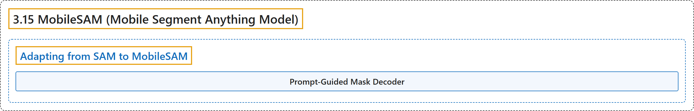

# 3.15 MobileSAM (Mobile Segment Anything Model)

## Classification

## Glossary

| Term | Definition | 中文翻译 | Source |
|---|---|---|---|
| **3.15 MobileSAM (Mobile Segment Anything Model)** MobileSAM（移动端分割一切模型） | "MobileSAM is **a compact, efficient image segmentation model purpose-built for mobile and edge devices**." | MobileSAM 是**一个专为移动和边缘设备打造的紧凑、高效的图像分割模型**。 | [Ultralytics, n.d., "Mobile Segment Anything (MobileSAM)", para. 1](https://docs.ultralytics.com/models/mobile-sam/#mobile-segment-anything-mobilesam) |
| **Adapting from SAM to MobileSAM** 从 SAM 迁移到 MobileSAM | (context) "MobileSAM **retains the same pipeline as the original SAM**, including pre-processing, post-processing, and all interfaces." | （语境）MobileSAM **保留了与原始 SAM 相同的流水线**，包括预处理、后处理和所有接口。 | [Ultralytics, n.d., "Adapting from SAM to MobileSAM", para. 1](https://docs.ultralytics.com/models/mobile-sam/#adapting-from-sam-to-mobilesam) |
| **Prompt-Guided Mask Decoder** 提示引导的掩码解码器 | (No definition) | （无定义） | [Ultralytics, n.d., "Prompt-Guided Mask Decoder"](https://docs.ultralytics.com/models/mobile-sam/#prompt-guided-mask-decoder) |

## References

Ultralytics. (n.d.). *Mobile Segment Anything (MobileSAM)*. Ultralytics YOLO Docs (ultralytics 8.4.194). Retrieved October 31, 2026, from <https://docs.ultralytics.com/models/mobile-sam/>
