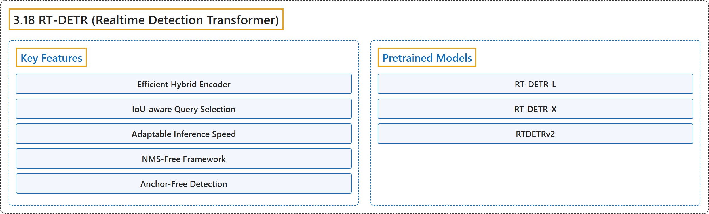

# 3.18 RT-DETR (Realtime Detection Transformer)

## Classification

## Glossary

| Term | Definition | 中文翻译 | Source |
|---|---|---|---|
| **3.18 RT-DETR (Realtime Detection Transformer)** RT-DETR（实时检测 Transformer） | "Real-Time Detection Transformer (RT-DETR), developed by Baidu, is **a cutting-edge end-to-end object detector that provides real-time performance while maintaining high accuracy**." | 实时检测 Transformer（RT-DETR）由百度开发，是**一种前沿的端到端目标检测器，在保持高精度的同时提供实时性能**。 | [Ultralytics, n.d., "Baidu's RT-DETR: A Vision Transformer -Based Real-Time Object Detector", para. 1](https://docs.ultralytics.com/models/rtdetr/#baidus-rt-detr-a-vision-transformer-based-real-time-object-detector) |
| **Key Features** 主要特性 | (No definition) | （无定义） | [Ultralytics, n.d., "Key Features"](https://docs.ultralytics.com/models/rtdetr/#key-features) |
| **Efficient Hybrid Encoder** 高效混合编码器 | "Efficient Hybrid Encoder: Baidu's RT-DETR uses an efficient hybrid encoder **that processes multiscale features by decoupling intra-scale interaction and cross-scale fusion**." | 高效混合编码器：百度的 RT-DETR 使用一种高效混合编码器，它**通过解耦尺度内交互和跨尺度融合来处理多尺度特征**。 | [Ultralytics, n.d., "Key Features", item 1](https://docs.ultralytics.com/models/rtdetr/#key-features) |
| **IoU-aware Query Selection** IoU 感知的查询选择 | "IoU-aware Query Selection: Baidu's RT-DETR **improves object query initialization by utilizing IoU-aware query selection**." | IoU 感知的查询选择：百度的 RT-DETR **利用 IoU 感知的查询选择来改进目标查询的初始化**。 | [Ultralytics, n.d., "Key Features", item 2](https://docs.ultralytics.com/models/rtdetr/#key-features) |
| **Adaptable Inference Speed** 可调的推理速度 | "Adaptable Inference Speed: Baidu's RT-DETR **supports flexible adjustments of inference speed by using different decoder layers without the need for retraining**." | 可调的推理速度：百度的 RT-DETR **支持通过使用不同的解码器层来灵活调整推理速度，而无需重新训练**。 | [Ultralytics, n.d., "Key Features", item 3](https://docs.ultralytics.com/models/rtdetr/#key-features) |
| **NMS-Free Framework** 免 NMS 框架 | "NMS-Free Framework: Based on DETR, RT-DETR **eliminates the need for non-maximum suppression post-processing**" | 免 NMS 框架：基于 DETR，RT-DETR **消除了对非极大值抑制后处理的需要** | [Ultralytics, n.d., "Key Features", item 4](https://docs.ultralytics.com/models/rtdetr/#key-features) |
| **Anchor-Free Detection** 无锚框检测 | "Anchor-Free Detection: As an anchor-free detector, RT-DETR **simplifies the detection process and may improve generalization across different datasets**." | 无锚框检测：作为无锚框检测器，RT-DETR **简化了检测过程，并可能改善在不同数据集上的泛化能力**。 | [Ultralytics, n.d., "Key Features", item 5](https://docs.ultralytics.com/models/rtdetr/#key-features) |
| **Pretrained Models** 预训练模型 | (context) "The Ultralytics Python API provides **pretrained PaddlePaddle RT-DETR models with different scales**:" | （语境）Ultralytics Python API 提供了**不同规模的 PaddlePaddle 预训练 RT-DETR 模型**： | [Ultralytics, n.d., "Pretrained Models", para. 1](https://docs.ultralytics.com/models/rtdetr/#pretrained-models) |
| **RT-DETR-L** RT-DETR-L | (context) "RT-DETR-L: **53.0% AP on COCO val2017, 114 FPS on T4 GPU**" | （语境）RT-DETR-L 的成绩是**在 COCO val2017 上 AP 为 53.0%，在 T4 GPU 上 114 FPS** | [Ultralytics, n.d., "Pretrained Models", item 1](https://docs.ultralytics.com/models/rtdetr/#pretrained-models) |
| **RT-DETR-X** RT-DETR-X | (context) "RT-DETR-X: **54.8% AP on COCO val2017, 74 FPS on T4 GPU**" | （语境）RT-DETR-X 的成绩是**在 COCO val2017 上 AP 为 54.8%，在 T4 GPU 上 74 FPS** | [Ultralytics, n.d., "Pretrained Models", item 2](https://docs.ultralytics.com/models/rtdetr/#pretrained-models) |
| **RTDETRv2** RTDETRv2 | "Additionally, Baidu has released RTDETRv2 in July 2024, which **further improves upon the original architecture with enhanced performance metrics**." | 此外，百度于 2024 年 7 月发布了 RTDETRv2，它**在原有架构的基础上进一步改进，性能指标更高**。 | [Ultralytics, n.d., "Pretrained Models", para. 2](https://docs.ultralytics.com/models/rtdetr/#pretrained-models) |

## References

Ultralytics. (n.d.). *Baidu's RT-DETR: A Vision Transformer -Based Real-Time Object Detector*. Ultralytics YOLO Docs (ultralytics 8.4.194). Retrieved October 31, 2026, from <https://docs.ultralytics.com/models/rtdetr/>
