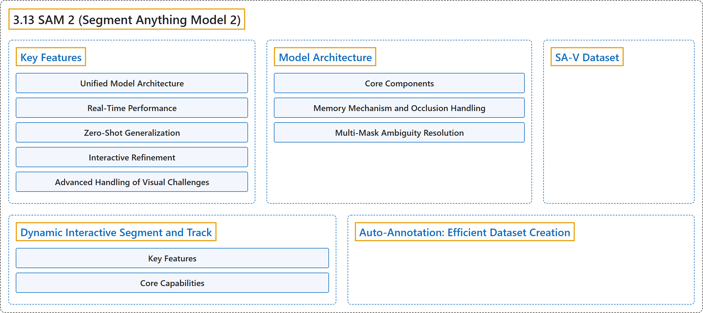

# 3.13 SAM 2 (Segment Anything Model 2)

## Classification

## Glossary

| Term | Definition | 中文翻译 | Source |
|---|---|---|---|
| **3.13 SAM 2 (Segment Anything Model 2)** SAM 2（分割一切模型 2） | "SAM 2 **builds upon the original SAM with video segmentation capabilities**." | SAM 2 **在原始 SAM 的基础上增加了视频分割能力**。 | [Ultralytics, n.d., "SAM 2: Segment Anything Model 2", para. 1](https://docs.ultralytics.com/models/sam-2/#sam-2-segment-anything-model-2) |
| **Key Features** 主要特性 | (No definition) | （无定义） | [Ultralytics, n.d., "Key Features"](https://docs.ultralytics.com/models/sam-2/#key-features) |
| **Unified Model Architecture** 统一的模型架构 | "SAM 2 **combines the capabilities of image and video segmentation in a single model**." | SAM 2 **在单个模型中结合了图像分割和视频分割的能力**。 | [Ultralytics, n.d., "Unified Model Architecture", para. 1](https://docs.ultralytics.com/models/sam-2/#unified-model-architecture) |
| **Real-Time Performance** 实时性能 | "The model **achieves real-time inference speeds, processing approximately 44 frames per second**." | 该模型**达到实时推理速度，每秒约处理 44 帧**。 | [Ultralytics, n.d., "Real-Time Performance", para. 1](https://docs.ultralytics.com/models/sam-2/#real-time-performance) |
| **Zero-Shot Generalization** 零样本泛化 | "SAM 2 **can segment objects it has never encountered before**, demonstrating strong zero-shot generalization." | SAM 2 **能够分割从未见过的物体**，体现出很强的零样本泛化能力。 | [Ultralytics, n.d., "Zero-Shot Generalization", para. 1](https://docs.ultralytics.com/models/sam-2/#zero-shot-generalization) |
| **Interactive Refinement** 交互式细化 | "Users can **iteratively refine the segmentation results by providing additional prompts**, allowing for precise control over the output." | 用户可以**通过提供额外的提示来迭代地细化分割结果**，从而精确控制输出。 | [Ultralytics, n.d., "Interactive Refinement", para. 1](https://docs.ultralytics.com/models/sam-2/#interactive-refinement) |
| **Advanced Handling of Visual Challenges** 视觉难题的高级处理 | "SAM 2 includes **mechanisms to manage common video segmentation challenges, such as object occlusion and reappearance**." | SAM 2 包含**应对常见视频分割难题（如物体遮挡和重新出现）的机制**。 | [Ultralytics, n.d., "Advanced Handling of Visual Challenges", para. 1](https://docs.ultralytics.com/models/sam-2/#advanced-handling-of-visual-challenges) |
| **Model Architecture** 模型架构 | (No definition) | （无定义） | [Ultralytics, n.d., "Model Architecture"](https://docs.ultralytics.com/models/sam-2/#model-architecture) |
| **Core Components** 核心组件 | (No definition) | （无定义） | [Ultralytics, n.d., "Core Components"](https://docs.ultralytics.com/models/sam-2/#core-components) |
| **Image and Video Encoder** 图像与视频编码器 | "Image and Video Encoder: **Utilizes a transformer-based architecture to extract high-level features from both images and video frames.**" | 图像与视频编码器**使用基于 Transformer 的架构，从图像和视频帧中提取高层特征。** | [Ultralytics, n.d., "Core Components", item 1](https://docs.ultralytics.com/models/sam-2/#core-components) |
| **Prompt Encoder** 提示编码器 | "Prompt Encoder: **Processes user-provided prompts (points, boxes, masks) to guide the segmentation task.**" | 提示编码器**处理用户提供的提示（点、框、掩码），以引导分割任务。** | [Ultralytics, n.d., "Core Components", item 2](https://docs.ultralytics.com/models/sam-2/#core-components) |
| **Memory Mechanism** 记忆机制 | "Memory Mechanism: **Includes a memory encoder, memory bank, and memory attention module.**" | 记忆机制**包括记忆编码器、记忆库和记忆注意力模块。** | [Ultralytics, n.d., "Core Components", item 3](https://docs.ultralytics.com/models/sam-2/#core-components) |
| **Mask Decoder** 掩码解码器 | "Mask Decoder: **Generates the final segmentation masks based on the encoded image features and prompts.**" | 掩码解码器**根据编码后的图像特征和提示生成最终的分割掩码。** | [Ultralytics, n.d., "Core Components", item 4](https://docs.ultralytics.com/models/sam-2/#core-components) |
| **Memory Mechanism and Occlusion Handling** 记忆机制与遮挡处理 | "The memory mechanism **allows SAM 2 to handle temporal dependencies and occlusions in video data**." | 记忆机制**使 SAM 2 能够处理视频数据中的时间依赖和遮挡**。 | [Ultralytics, n.d., "Memory Mechanism and Occlusion Handling", para. 1](https://docs.ultralytics.com/models/sam-2/#memory-mechanism-and-occlusion-handling) |
| **Multi-Mask Ambiguity Resolution** 多掩码歧义消解 | "In situations with ambiguity (e.g., overlapping objects), **SAM 2 can generate multiple mask predictions**." | 在存在歧义的情况下（例如物体重叠），**SAM 2 可以生成多个掩码预测**。 | [Ultralytics, n.d., "Multi-Mask Ambiguity Resolution", para. 1](https://docs.ultralytics.com/models/sam-2/#multi-mask-ambiguity-resolution) |
| **SA-V Dataset** SA-V 数据集 | "The SA-V dataset, developed for SAM 2's training, is **one of the largest and most diverse video segmentation datasets available**." | SA-V 数据集为训练 SAM 2 而开发，是**现有规模最大、最多样的视频分割数据集之一**。 | [Ultralytics, n.d., "SA-V Dataset", para. 1](https://docs.ultralytics.com/models/sam-2/#sa-v-dataset) |
| **Dynamic Interactive Segment and Track** 动态交互式分割与跟踪 | "`SAM2DynamicInteractivePredictor` is **an advanced training-free extension of SAM 2 that enables dynamic interaction with multiple frames and continual learning capabilities**." | `SAM2DynamicInteractivePredictor` 是 **SAM 2 的一个无需训练的高级扩展，支持与多帧进行动态交互，并具备持续学习能力**。 | [Ultralytics, n.d., "Dynamic Interactive Segment and Track", para. 1](https://docs.ultralytics.com/models/sam-2/#dynamic-interactive-segment-and-track) |
| **Key Features** 主要特性 | (context) "It offers **three significant enhancements**:" | （语境）它提供了**三项重要增强**： | [Ultralytics, n.d., "Key Features", para. 1](https://docs.ultralytics.com/models/sam-2/#key-features_1) |
| **Dynamic Interactive** 动态交互 | "Dynamic Interactive: **Add new prompts for merging/untracked new instances in following frames anytime during video processing**" | 动态交互指**在视频处理期间随时为后续帧中要合并的或未跟踪的新实例添加新提示** | [Ultralytics, n.d., "Key Features", item 1](https://docs.ultralytics.com/models/sam-2/#key-features_1) |
| **Continual Learning** 持续学习 | "Continual Learning: **Add new prompts for existing instances to improve the model performance over time**" | 持续学习指**为已有实例添加新提示，随时间推移提升模型性能** | [Ultralytics, n.d., "Key Features", item 2](https://docs.ultralytics.com/models/sam-2/#key-features_1) |
| **Independent Multi-Image Support** 独立多图像支持 | "Independent Multi-Image Support: **Process multiple independent images (not necessarily from a video sequence) with memory sharing and cross-image object tracking**" | 独立多图像支持指**借助记忆共享和跨图像目标跟踪，处理多张相互独立的图像（不一定来自视频序列）** | [Ultralytics, n.d., "Key Features", item 3](https://docs.ultralytics.com/models/sam-2/#key-features_1) |
| **Core Capabilities** 核心能力 | (No definition) | （无定义） | [Ultralytics, n.d., "Core Capabilities"](https://docs.ultralytics.com/models/sam-2/#core-capabilities) |
| **Prompt Flexibility** 提示灵活性 | "Prompt Flexibility: **Accepts bounding boxes, points, and masks as prompts**" | 提示灵活性指**接受边界框、点和掩码作为提示** | [Ultralytics, n.d., "Core Capabilities", item 1](https://docs.ultralytics.com/models/sam-2/#core-capabilities) |
| **Memory Bank Management** 记忆库管理 | "Memory Bank Management: **Maintains a dynamic memory bank to store object states across frames**" | 记忆库管理指**维护一个动态记忆库，跨帧存储物体状态** | [Ultralytics, n.d., "Core Capabilities", item 2](https://docs.ultralytics.com/models/sam-2/#core-capabilities) |
| **Multi-Object Tracking** 多目标跟踪 | "Multi-Object Tracking: **Supports tracking multiple objects simultaneously with individual object IDs**" | 多目标跟踪指**支持用各自的物体 ID 同时跟踪多个物体** | [Ultralytics, n.d., "Core Capabilities", item 3](https://docs.ultralytics.com/models/sam-2/#core-capabilities) |
| **Real-Time Updates** 实时更新 | "Real-Time Updates: **Allows adding new prompts during inference without reprocessing previous frames**" | 实时更新指**允许在推理过程中添加新提示，而无需重新处理之前的帧** | [Ultralytics, n.d., "Core Capabilities", item 4](https://docs.ultralytics.com/models/sam-2/#core-capabilities) |
| **Independent Image Processing** 独立图像处理 | "Independent Image Processing: **Process standalone images with shared memory context for cross-image object consistency**" | 独立图像处理指**借助共享的记忆上下文处理独立图像，保持跨图像的物体一致性** | [Ultralytics, n.d., "Core Capabilities", item 5](https://docs.ultralytics.com/models/sam-2/#core-capabilities) |
| **Auto-Annotation: Efficient Dataset Creation** 自动标注：高效创建数据集 | "Auto-annotation is **a powerful feature of SAM 2, enabling users to generate segmentation datasets quickly and accurately by leveraging pretrained models**." | 自动标注是 **SAM 2 的一项强大功能，让用户能借助预训练模型快速而准确地生成分割数据集**。 | [Ultralytics, n.d., "Auto-Annotation: Efficient Dataset Creation", para. 1](https://docs.ultralytics.com/models/sam-2/#auto-annotation-efficient-dataset-creation) |

## References

Ultralytics. (n.d.). *SAM 2: Segment Anything Model 2*. Ultralytics YOLO Docs (ultralytics 8.4.194). Retrieved October 31, 2026, from <https://docs.ultralytics.com/models/sam-2/>
