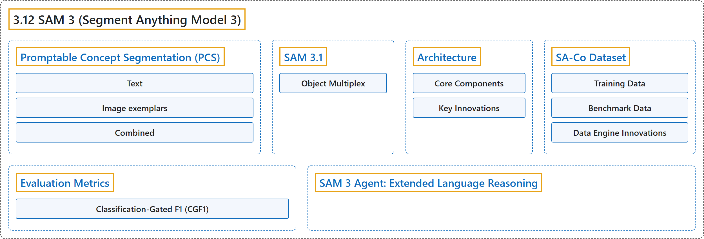

# 3.12 SAM 3 (Segment Anything Model 3)

## Classification

## Glossary

| Term | Definition | 中文翻译 | Source |
|---|---|---|---|
| **3.12 SAM 3 (Segment Anything Model 3)** SAM 3（分割一切模型 3） | "SAM 3 (Segment Anything Model 3) is **Meta's released foundation model for Promptable Concept Segmentation (PCS)**." | SAM 3（分割一切模型 3）是 **Meta 发布的、用于可提示概念分割（PCS）的基础模型**。 | [Ultralytics, n.d., "SAM 3: Segment Anything with Concepts", para. 1](https://docs.ultralytics.com/models/sam-3/#sam-3-segment-anything-with-concepts) |
| **Promptable Concept Segmentation (PCS)** 可提示概念分割（PCS） | "The PCS task **takes a concept prompt as input and returns segmentation masks with unique identities for all matching object instances**." | PCS 任务**以概念提示为输入，为所有匹配的物体实例返回带有唯一身份的分割掩码**。 | [Ultralytics, n.d., "What is Promptable Concept Segmentation (PCS)?", para. 1](https://docs.ultralytics.com/models/sam-3/#what-is-promptable-concept-segmentation-pcs) |
| **Text** 文本 | "Text: **Simple noun phrases like "red apple" or "person wearing a hat"**, similar to zero-shot learning" | 文本指**简单的名词短语，例如“red apple”或“person wearing a hat”**，类似于零样本学习 | [Ultralytics, n.d., "What is Promptable Concept Segmentation (PCS)?", item 1](https://docs.ultralytics.com/models/sam-3/#what-is-promptable-concept-segmentation-pcs) |
| **Image exemplars** 图像示例 | "Image exemplars: **Bounding boxes around example objects (positive or negative)** for fast generalization" | 图像示例指**围住示例物体（正例或负例）的边界框**，用于快速泛化 | [Ultralytics, n.d., "What is Promptable Concept Segmentation (PCS)?", item 2](https://docs.ultralytics.com/models/sam-3/#what-is-promptable-concept-segmentation-pcs) |
| **Combined** 组合 | "Combined: **Both text and image exemplars together** for precise control" | 组合指**文本和图像示例一起使用**，以实现精确控制 | [Ultralytics, n.d., "What is Promptable Concept Segmentation (PCS)?", item 3](https://docs.ultralytics.com/models/sam-3/#what-is-promptable-concept-segmentation-pcs) |
| **SAM 3.1** SAM 3.1 | "SAM 3.1, released by Meta on March 27, 2026, is **a new SAM 3 checkpoint that adds Object Multiplex, a shared-memory approach to multi-object video tracking**." | SAM 3.1 由 Meta 于 2026 年 3 月 27 日发布，是**一个新的 SAM 3 检查点，它加入了 Object Multiplex，一种用于多目标视频跟踪的共享内存方法**。 | [Ultralytics, n.d., "SAM 3.1", para. 1](https://docs.ultralytics.com/models/sam-3/#sam-31) |
| **Object Multiplex** Object Multiplex（对象多路复用） | "Instead of processing every tracked object independently, SAM 3.1 **groups objects into fixed-capacity buckets and processes them jointly**" | SAM 3.1 不再独立处理每个被跟踪的物体，而是**把物体分组放入固定容量的桶中并联合处理** | [Ultralytics, n.d., "SAM 3.1", para. 1](https://docs.ultralytics.com/models/sam-3/#sam-31) |
| **Architecture** 架构 | "SAM 3 consists of **a detector and tracker that share a Perception Encoder (PE) vision backbone**." | SAM 3 由**共用一个感知编码器（PE）视觉骨干网络的检测器和跟踪器**组成。 | [Ultralytics, n.d., "Architecture", para. 1](https://docs.ultralytics.com/models/sam-3/#architecture) |
| **Core Components** 核心组件 | (No definition) | （无定义） | [Ultralytics, n.d., "Core Components"](https://docs.ultralytics.com/models/sam-3/#core-components) |
| **Detector** 检测器 | "Detector: **DETR-based architecture for image-level concept detection**" | 检测器是**用于图像级概念检测的基于 DETR 的架构** | [Ultralytics, n.d., "Core Components", item 1](https://docs.ultralytics.com/models/sam-3/#core-components) |
| **Tracker** 跟踪器 | "Tracker: **Memory-based video segmentation inherited from SAM 2**" | 跟踪器是**继承自 SAM 2 的基于记忆的视频分割** | [Ultralytics, n.d., "Core Components", item 2](https://docs.ultralytics.com/models/sam-3/#core-components) |
| **Presence Token** 存在标记 | "Presence Token: **A learned global token that predicts whether the target concept is present in the image/frame**, improving detection by separating recognition from localization." | 存在标记是**一个学习得到的全局标记，用来预测目标概念是否出现在图像或帧中**，通过把识别与定位分开来改进检测。 | [Ultralytics, n.d., "Core Components", item 3](https://docs.ultralytics.com/models/sam-3/#core-components) |
| **Key Innovations** 关键创新 | (No definition) | （无定义） | [Ultralytics, n.d., "Key Innovations"](https://docs.ultralytics.com/models/sam-3/#key-innovations) |
| **Decoupled Recognition and Localization** 识别与定位解耦 | "Decoupled Recognition and Localization: **The presence head predicts concept presence globally, while proposal queries focus only on localization**, avoiding conflicting objectives." | 识别与定位解耦指**存在头在全局预测概念是否存在，而提议查询只专注于定位**，避免目标相互冲突。 | [Ultralytics, n.d., "Key Innovations", item 1](https://docs.ultralytics.com/models/sam-3/#key-innovations) |
| **Unified Concept and Visual Prompts** 统一的概念提示与视觉提示 | "Unified Concept and Visual Prompts: **Supports both PCS (concept prompts) and PVS (visual prompts like SAM 2's clicks/boxes) in a single model.**" | 统一的概念提示与视觉提示指**在单个模型中同时支持 PCS（概念提示）和 PVS（像 SAM 2 的点击或框那样的视觉提示）。** | [Ultralytics, n.d., "Key Innovations", item 2](https://docs.ultralytics.com/models/sam-3/#key-innovations) |
| **Interactive Exemplar Refinement** 交互式示例细化 | "Interactive Exemplar Refinement: **Users can add positive or negative image exemplars to iteratively refine results**" | 交互式示例细化指**用户可以添加正例或负例图像示例来迭代地细化结果** | [Ultralytics, n.d., "Key Innovations", item 3](https://docs.ultralytics.com/models/sam-3/#key-innovations) |
| **Temporal Disambiguation** 时间消歧 | "Temporal Disambiguation: **Uses masklet detection scores and periodic re-prompting to handle occlusions, crowded scenes, and tracking failures in video**" | 时间消歧指**使用掩码片段检测分数和周期性重新提示来处理视频中的遮挡、拥挤场景和跟踪失败** | [Ultralytics, n.d., "Key Innovations", item 4](https://docs.ultralytics.com/models/sam-3/#key-innovations) |
| **SA-Co Dataset** SA-Co 数据集 | "SAM 3 is trained on Segment Anything with Concepts (SA-Co), **Meta's largest and most diverse segmentation dataset to date**" | SAM 3 在 Segment Anything with Concepts（SA-Co）上训练，它是 **Meta 迄今规模最大、最多样的分割数据集** | [Ultralytics, n.d., "SA-Co Dataset", para. 1](https://docs.ultralytics.com/models/sam-3/#sa-co-dataset) |
| **Training Data** 训练数据 | (No definition) | （无定义） | [Ultralytics, n.d., "Training Data"](https://docs.ultralytics.com/models/sam-3/#training-data) |
| **SA-Co/HQ** SA-Co/HQ | "**High-quality human-annotated image data from 4-phase data engine**" | **来自四阶段数据引擎的高质量人工标注图像数据** | [Ultralytics, n.d., "Training Data", table, row 1](https://docs.ultralytics.com/models/sam-3/#training-data) |
| **SA-Co/SYN** SA-Co/SYN | "**Synthetic dataset labeled by AI without human involvement**" | **由 AI 在无人参与的情况下标注的合成数据集** | [Ultralytics, n.d., "Training Data", table, row 2](https://docs.ultralytics.com/models/sam-3/#training-data) |
| **SA-Co/EXT** SA-Co/EXT | "**15 external datasets enriched with hard negatives**" | **15 个用困难负例充实过的外部数据集** | [Ultralytics, n.d., "Training Data", table, row 3](https://docs.ultralytics.com/models/sam-3/#training-data) |
| **SA-Co/VIDEO** SA-Co/VIDEO | "**Video annotations with temporal tracking**" | **带有时间跟踪的视频标注** | [Ultralytics, n.d., "Training Data", table, row 4](https://docs.ultralytics.com/models/sam-3/#training-data) |
| **Benchmark Data** 基准数据 | (context) "The SA-Co evaluation benchmark contains **214K unique phrases across 126K images and videos**" | （语境）SA-Co 评估基准包含**分布在 12.6 万张图像和视频中的 21.4 万个不同短语** | [Ultralytics, n.d., "Benchmark Data", para. 1](https://docs.ultralytics.com/models/sam-3/#benchmark-data) |
| **SA-Co/Gold** SA-Co/Gold | "SA-Co/Gold: **7 domains, triple-annotated for measuring human performance bounds**" | SA-Co/Gold：**7 个领域，三重标注，用于衡量人类表现的界限** | [Ultralytics, n.d., "Benchmark Data", item 1](https://docs.ultralytics.com/models/sam-3/#benchmark-data) |
| **SA-Co/Silver** SA-Co/Silver | "SA-Co/Silver: **10 domains, single human annotation**" | SA-Co/Silver：**10 个领域，单次人工标注** | [Ultralytics, n.d., "Benchmark Data", item 2](https://docs.ultralytics.com/models/sam-3/#benchmark-data) |
| **SA-Co/Bronze and SA-Co/Bio** SA-Co/Bronze 与 SA-Co/Bio | "SA-Co/Bronze and SA-Co/Bio: **9 existing datasets adapted for concept segmentation**" | SA-Co/Bronze 与 SA-Co/Bio：**9 个为概念分割改编的现有数据集** | [Ultralytics, n.d., "Benchmark Data", item 3](https://docs.ultralytics.com/models/sam-3/#benchmark-data) |
| **SA-Co/VEval** SA-Co/VEval | "SA-Co/VEval: **Video benchmark with 3 domains (SA-V, YT-Temporal-1B, SmartGlasses)**" | SA-Co/VEval 是**包含 3 个领域（SA-V、YT-Temporal-1B、SmartGlasses）的视频基准** | [Ultralytics, n.d., "Benchmark Data", item 4](https://docs.ultralytics.com/models/sam-3/#benchmark-data) |
| **Data Engine Innovations** 数据引擎创新 | (context) "SAM 3's scalable human- and model-in-the-loop data engine achieves **2× annotation throughput** through:" | （语境）SAM 3 的可扩展、人与模型共同参与的数据引擎通过以下方式实现了 **2 倍的标注吞吐量**： | [Ultralytics, n.d., "Data Engine Innovations", para. 1](https://docs.ultralytics.com/models/sam-3/#data-engine-innovations) |
| **AI Annotators** AI 标注器 | "AI Annotators: **Llama based models propose diverse noun phrases including hard negatives**" | AI 标注器指**基于 Llama 的模型提出多样的名词短语，包括困难负例** | [Ultralytics, n.d., "Data Engine Innovations", item 1](https://docs.ultralytics.com/models/sam-3/#data-engine-innovations) |
| **AI Verifiers** AI 校验器 | "AI Verifiers: **Fine-tuned multimodal LLMs verify mask quality and exhaustivity at near-human performance**" | AI 校验器指**微调过的多模态大语言模型以接近人类的水平校验掩码质量和完备性** | [Ultralytics, n.d., "Data Engine Innovations", item 2](https://docs.ultralytics.com/models/sam-3/#data-engine-innovations) |
| **Active Mining** 主动挖掘 | "Active Mining: **Focuses human effort on challenging failure cases where AI struggles**" | 主动挖掘指**把人工精力集中在 AI 难以处理的困难失败案例上** | [Ultralytics, n.d., "Data Engine Innovations", item 3](https://docs.ultralytics.com/models/sam-3/#data-engine-innovations) |
| **Ontology-Driven** 本体驱动 | "Ontology-Driven: **Leverages a large ontology grounded in Wikidata for concept coverage**" | 本体驱动指**利用一个以 Wikidata 为基础的大型本体来覆盖概念** | [Ultralytics, n.d., "Data Engine Innovations", item 4](https://docs.ultralytics.com/models/sam-3/#data-engine-innovations) |
| **Evaluation Metrics** 评估指标 | (context) "SAM 3 introduces **new metrics designed for the PCS task**, complementing familiar measures like F1 score, precision, and recall." | （语境）SAM 3 引入了**为 PCS 任务设计的新指标**，作为 F1 分数、精确率和召回率等常见度量的补充。 | [Ultralytics, n.d., "Evaluation Metrics", para. 1](https://docs.ultralytics.com/models/sam-3/#evaluation-metrics) |
| **Classification-Gated F1 (CGF1)** 分类门控 F1（CGF1） | "**The primary metric combining localization and classification**:" | **结合定位与分类的主要指标**： | [Ultralytics, n.d., "Classification-Gated F1 (CGF1)", para. 1](https://docs.ultralytics.com/models/sam-3/#classification-gated-f1-cgf1) |
| **pmF1** pmF1（正样本宏平均 F1） | "pmF1 (Positive Macro F1): **Measures localization quality on positive examples**" | pmF1（正样本宏平均 F1）用于**衡量正样本上的定位质量** | [Ultralytics, n.d., "Classification-Gated F1 (CGF1)", item 1](https://docs.ultralytics.com/models/sam-3/#classification-gated-f1-cgf1) |
| **IL_MCC** IL_MCC（图像级马修斯相关系数） | "IL_MCC (Image-Level Matthews Correlation Coefficient): **Measures binary classification accuracy**" | IL_MCC（图像级马修斯相关系数）用于**衡量二分类准确率** | [Ultralytics, n.d., "Classification-Gated F1 (CGF1)", item 2](https://docs.ultralytics.com/models/sam-3/#classification-gated-f1-cgf1) |
| **SAM 3 Agent: Extended Language Reasoning** SAM 3 Agent：扩展的语言推理 | "SAM 3 can be combined with Multimodal Large Language Models (MLLMs) **to handle complex queries requiring reasoning**" | SAM 3 可以与多模态大语言模型（MLLM）结合，用来**处理需要推理的复杂查询** | [Ultralytics, n.d., "SAM 3 Agent: Extended Language Reasoning", para. 1](https://docs.ultralytics.com/models/sam-3/#sam-3-agent-extended-language-reasoning) |

## References

Ultralytics. (n.d.). *SAM 3: Segment Anything with Concepts*. Ultralytics YOLO Docs (ultralytics 8.4.194). Retrieved October 31, 2026, from <https://docs.ultralytics.com/models/sam-3/>
