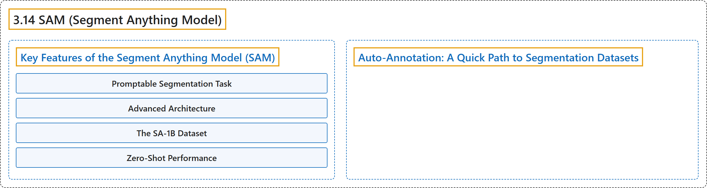

# 3.14 SAM (Segment Anything Model)

## Classification

## Glossary

| Term | Definition | 中文翻译 | Source |
|---|---|---|---|
| **3.14 SAM (Segment Anything Model)** SAM（分割一切模型） | "This is **the original SAM model from Meta**." | 这是 **Meta 推出的原始 SAM 模型**。 | [Ultralytics, n.d., "Segment Anything Model (SAM)", para. 1](https://docs.ultralytics.com/models/sam/#segment-anything-model-sam) |
| **Key Features of the Segment Anything Model (SAM)** Segment Anything Model（SAM）的主要特性 | (No definition) | （无定义） | [Ultralytics, n.d., "Key Features of the Segment Anything Model (SAM)"](https://docs.ultralytics.com/models/sam/#key-features-of-the-segment-anything-model-sam) |
| **Promptable Segmentation Task** 可提示分割任务 | "Promptable Segmentation Task: SAM was designed with a promptable segmentation task in mind, **allowing it to generate valid segmentation masks from any given prompt**, such as spatial or text clues identifying an object." | 可提示分割任务：SAM 在设计时就以可提示分割任务为目标，这**使它能根据任何给定的提示生成有效的分割掩码**，例如标识物体的空间线索或文本线索。 | [Ultralytics, n.d., "Key Features of the Segment Anything Model (SAM)", item 1](https://docs.ultralytics.com/models/sam/#key-features-of-the-segment-anything-model-sam) |
| **Advanced Architecture** 先进的架构 | "Advanced Architecture: The Segment Anything Model **employs a powerful image encoder, a prompt encoder, and a lightweight mask decoder**." | 先进的架构：Segment Anything Model **采用强大的图像编码器、提示编码器和轻量级掩码解码器**。 | [Ultralytics, n.d., "Key Features of the Segment Anything Model (SAM)", item 2](https://docs.ultralytics.com/models/sam/#key-features-of-the-segment-anything-model-sam) |
| **The SA-1B Dataset** SA-1B 数据集 | "The SA-1B Dataset: Introduced by the Segment Anything project, the SA-1B dataset **features over 1 billion masks on 11 million images**." | SA-1B 数据集：SA-1B 数据集由 Segment Anything 项目推出，它**在 1100 万张图像上包含超过 10 亿个掩码**。 | [Ultralytics, n.d., "Key Features of the Segment Anything Model (SAM)", item 3](https://docs.ultralytics.com/models/sam/#key-features-of-the-segment-anything-model-sam) |
| **Zero-Shot Performance** 零样本性能 | "Zero-Shot Performance: SAM **displays outstanding zero-shot performance across various segmentation tasks**" | 零样本性能：SAM **在各种分割任务上表现出出色的零样本性能** | [Ultralytics, n.d., "Key Features of the Segment Anything Model (SAM)", item 4](https://docs.ultralytics.com/models/sam/#key-features-of-the-segment-anything-model-sam) |
| **Auto-Annotation: A Quick Path to Segmentation Datasets** 自动标注：快速获得分割数据集 | "Auto-annotation is **a key feature of SAM, allowing users to generate a segmentation dataset using a pretrained detection model**." | 自动标注是 **SAM 的一项关键功能，让用户能用预训练的检测模型生成分割数据集**。 | [Ultralytics, n.d., "Auto-Annotation: A Quick Path to Segmentation Datasets", para. 1](https://docs.ultralytics.com/models/sam/#auto-annotation-a-quick-path-to-segmentation-datasets) |

## References

Ultralytics. (n.d.). *Segment Anything Model (SAM)*. Ultralytics YOLO Docs (ultralytics 8.4.194). Retrieved October 31, 2026, from <https://docs.ultralytics.com/models/sam/>
