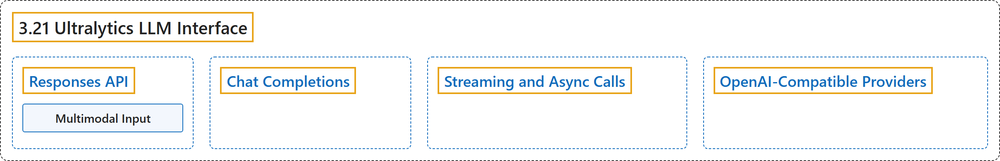

# 3.21 Ultralytics LLM Interface

## Classification

## Glossary

| Term | Definition | 中文翻译 | Source |
|---|---|---|---|
| **3.21 Ultralytics LLM Interface** Ultralytics LLM 接口 | "LLM is **a small interface for calling language and vision models through an OpenAI-compatible API**." | LLM 是**一个小型接口，通过兼容 OpenAI 的 API 调用语言模型和视觉模型**。 | [Ultralytics, n.d., "Ultralytics LLM Interface", para. 1](https://docs.ultralytics.com/models/llm/#ultralytics-llm-interface) |
| **Responses API** Responses API | (context) "The Responses API **is the default**." | （语境）Responses API **是默认选项**。 | [Ultralytics, n.d., "Responses API", para. 1](https://docs.ultralytics.com/models/llm/#responses-api) |
| **Multimodal Input** 多模态输入 | (context) "**Pass a path, HTTP URL, data URI, NumPy array, or PIL image through `image`**:" | （语境）可以**通过 `image` 传入路径、HTTP URL、data URI、NumPy 数组或 PIL 图像**： | [Ultralytics, n.d., "Multimodal Input", para. 1](https://docs.ultralytics.com/models/llm/#multimodal-input) |
| **Chat Completions** Chat Completions | (context) "**Select Chat Completions when required by the endpoint**, and read its native response shape:" | （语境）在**端点要求时选择 Chat Completions**，并读取其原生的响应结构： | [Ultralytics, n.d., "Chat Completions", para. 1](https://docs.ultralytics.com/models/llm/#chat-completions) |
| **Streaming and Async Calls** 流式与异步调用 | (context) "**SDK request arguments pass through unchanged**, including `stream=True`:" | （语境）所有 **SDK 请求参数原样传递**，包括 `stream=True`： | [Ultralytics, n.d., "Streaming and Async Calls", para. 1](https://docs.ultralytics.com/models/llm/#streaming-and-async-calls) |
| **OpenAI-Compatible Providers** 兼容 OpenAI 的提供方 | "`LLM` **works with providers that expose an OpenAI-compatible Responses or Chat Completions API**, including DeepSeek, Kimi, Z.AI GLM, and OpenRouter." | `LLM` **可与提供 OpenAI 兼容的 Responses 或 Chat Completions API 的服务商配合使用**，包括 DeepSeek、Kimi、Z.AI GLM 和 OpenRouter。 | [Ultralytics, n.d., "OpenAI-Compatible Providers", para. 1](https://docs.ultralytics.com/models/llm/#openai-compatible-providers) |

## References

Ultralytics. (n.d.). *Ultralytics LLM Interface*. Ultralytics YOLO Docs (ultralytics 8.4.194). Retrieved October 31, 2026, from <https://docs.ultralytics.com/models/llm/>
