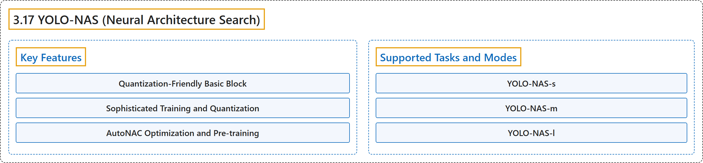

# 3.17 YOLO-NAS (Neural Architecture Search)

## Classification

## Glossary

| Term | Definition | 中文翻译 | Source |
|---|---|---|---|
| **3.17 YOLO-NAS (Neural Architecture Search)** YOLO-NAS（神经架构搜索） | "Developed by Deci AI, YOLO-NAS is **a groundbreaking object detection foundational model**." | YOLO-NAS 由 Deci AI 开发，是**一个开创性的目标检测基础模型**。 | [Ultralytics, n.d., "YOLO-NAS", para. 2](https://docs.ultralytics.com/models/yolo-nas/#yolo-nas) |
| **Key Features** 主要特性 | (No definition) | （无定义） | [Ultralytics, n.d., "Key Features"](https://docs.ultralytics.com/models/yolo-nas/#key-features) |
| **Quantization-Friendly Basic Block** 量化友好的基本模块 | "Quantization-Friendly Basic Block: YOLO-NAS introduces **a new basic block that is friendly to quantization**" | 量化友好的基本模块：YOLO-NAS 引入了**一种对量化友好的新基本模块** | [Ultralytics, n.d., "Key Features", item 1](https://docs.ultralytics.com/models/yolo-nas/#key-features) |
| **Sophisticated Training and Quantization** 精细的训练与量化 | "Sophisticated Training and Quantization: YOLO-NAS **leverages advanced training schemes and post-training quantization to enhance performance**." | 精细的训练与量化：YOLO-NAS **利用先进的训练方案和训练后量化来提升性能**。 | [Ultralytics, n.d., "Key Features", item 2](https://docs.ultralytics.com/models/yolo-nas/#key-features) |
| **AutoNAC Optimization and Pre-training** AutoNAC 优化与预训练 | "AutoNAC Optimization and Pre-training: YOLO-NAS **utilizes AutoNAC optimization and is pretrained on prominent datasets such as COCO, Objects365, and Roboflow 100**." | AutoNAC 优化与预训练：YOLO-NAS **使用 AutoNAC 优化，并在 COCO、Objects365 和 Roboflow 100 等知名数据集上预训练**。 | [Ultralytics, n.d., "Key Features", item 3](https://docs.ultralytics.com/models/yolo-nas/#key-features) |
| **Supported Tasks and Modes** 支持的任务与模式 | (context) "We offer **three variants of the YOLO-NAS models**: Small (s), Medium (m), and Large (l)." | （语境）我们提供 **YOLO-NAS 模型的三个变体**：Small（s）、Medium（m）和 Large（l）。 | [Ultralytics, n.d., "Supported Tasks and Modes", para. 1](https://docs.ultralytics.com/models/yolo-nas/#supported-tasks-and-modes) |
| **YOLO-NAS-s** YOLO-NAS-s | "YOLO-NAS-s: **Optimized for environments where computational resources are limited but efficiency is key.**" | YOLO-NAS-s **为计算资源有限但效率关键的环境优化。** | [Ultralytics, n.d., "Supported Tasks and Modes", item 1](https://docs.ultralytics.com/models/yolo-nas/#supported-tasks-and-modes) |
| **YOLO-NAS-m** YOLO-NAS-m | "YOLO-NAS-m: **Offers a balanced approach, suitable for general-purpose object detection with higher accuracy.**" | YOLO-NAS-m **提供一种平衡的方案，适用于精度更高的通用目标检测。** | [Ultralytics, n.d., "Supported Tasks and Modes", item 2](https://docs.ultralytics.com/models/yolo-nas/#supported-tasks-and-modes) |
| **YOLO-NAS-l** YOLO-NAS-l | "YOLO-NAS-l: **Tailored for scenarios requiring the highest accuracy, where computational resources are less of a constraint.**" | YOLO-NAS-l **为需要最高精度、计算资源约束较小的场景定制。** | [Ultralytics, n.d., "Supported Tasks and Modes", item 3](https://docs.ultralytics.com/models/yolo-nas/#supported-tasks-and-modes) |

## References

Ultralytics. (n.d.). *YOLO-NAS*. Ultralytics YOLO Docs (ultralytics 8.4.194). Retrieved October 31, 2026, from <https://docs.ultralytics.com/models/yolo-nas/>
