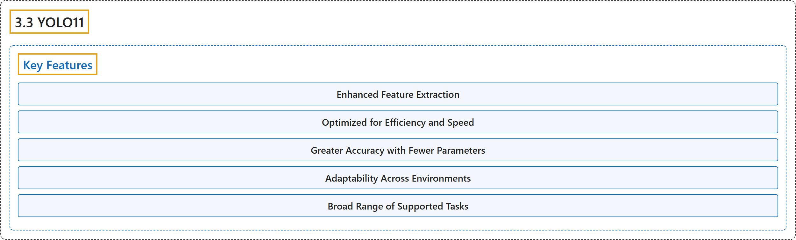

# 3.3 YOLO11

## Classification

## Glossary

| Term | Definition | 中文翻译 | Source |
|---|---|---|---|
| **3.3 YOLO11** YOLO11 | (context) "Released September 2024. **Current stable release and the recommended choice for all use cases.**" | （语境）2024 年 9 月发布。**当前的稳定版本，所有用例的推荐选择。** | [Ultralytics, n.d., "Ultralytics YOLO11", para. 1](https://docs.ultralytics.com/models/yolo11/#ultralytics-yolo11) |
| **Key Features** 主要特性 | (No definition) | （无定义） | [Ultralytics, n.d., "Key Features"](https://docs.ultralytics.com/models/yolo11/#key-features) |
| **Enhanced Feature Extraction** 增强的特征提取 | "Enhanced Feature Extraction: YOLO11 **employs an improved backbone and neck architecture**, which enhances feature extraction capabilities for more precise object detection and complex task performance." | 增强的特征提取：YOLO11 **采用改进的骨干网络和颈部架构**，增强了特征提取能力，使目标检测更精确、复杂任务表现更好。 | [Ultralytics, n.d., "Key Features", item 1](https://docs.ultralytics.com/models/yolo11/#key-features) |
| **Optimized for Efficiency and Speed** 针对效率与速度优化 | "Optimized for Efficiency and Speed: YOLO11 **introduces refined architectural designs and optimized training pipelines**, delivering faster processing speeds and maintaining an optimal balance between accuracy and performance." | 针对效率与速度优化：YOLO11 **引入了改进的架构设计和优化的训练流水线**，带来更快的处理速度，并在精度与性能之间保持最佳平衡。 | [Ultralytics, n.d., "Key Features", item 2](https://docs.ultralytics.com/models/yolo11/#key-features) |
| **Greater Accuracy with Fewer Parameters** 更少参数、更高精度 | "Greater Accuracy with Fewer Parameters: With advancements in model design, **YOLO11m achieves a higher mean Average Precision (mAP) on the COCO dataset while using 22% fewer parameters than YOLOv8m**, making it computationally efficient without compromising accuracy." | 更少参数、更高精度：凭借模型设计上的进步，**YOLO11m 在 COCO 数据集上取得更高的平均精度均值（mAP），而参数比 YOLOv8m 少 22%**，在不牺牲精度的情况下实现计算高效。 | [Ultralytics, n.d., "Key Features", item 3](https://docs.ultralytics.com/models/yolo11/#key-features) |
| **Adaptability Across Environments** 跨环境适应性 | "Adaptability Across Environments: YOLO11 **can be seamlessly deployed across various environments, including edge devices, cloud platforms, and systems supporting NVIDIA GPUs**, ensuring maximum flexibility." | 跨环境适应性：YOLO11 **可以无缝部署到各种环境中，包括边缘设备、云平台和支持 NVIDIA GPU 的系统**，确保最大的灵活性。 | [Ultralytics, n.d., "Key Features", item 4](https://docs.ultralytics.com/models/yolo11/#key-features) |
| **Broad Range of Supported Tasks** 广泛的任务支持 | "Broad Range of Supported Tasks: Whether it's object detection, instance segmentation, image classification, pose estimation, or oriented object detection (OBB), YOLO11 is designed **to cater to a diverse set of computer vision challenges**." | 广泛的任务支持：无论是目标检测、实例分割、图像分类、姿态估计还是旋转目标检测（OBB），YOLO11 都旨在**应对各种计算机视觉挑战**。 | [Ultralytics, n.d., "Key Features", item 5](https://docs.ultralytics.com/models/yolo11/#key-features) |

## References

Ultralytics. (n.d.). *Ultralytics YOLO11*. Ultralytics YOLO Docs (ultralytics 8.4.194). Retrieved October 31, 2026, from <https://docs.ultralytics.com/models/yolo11/>
