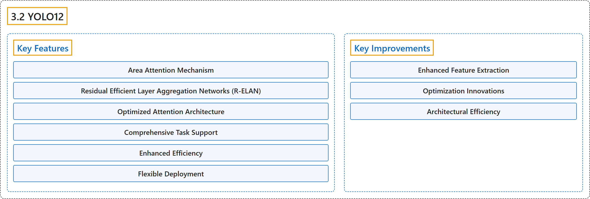

# 3.2 YOLO12

## Classification

## Glossary

| Term | Definition | 中文翻译 | Source |
|---|---|---|---|
| **3.2 YOLO12** YOLO12 | "YOLO12, released in early 2025, **introduces an attention-centric architecture that departs from the traditional CNN-based approaches used in previous YOLO models**, yet retains the real-time inference speed essential for many applications." | YOLO12 于 2025 年初发布，**引入了以注意力为中心的架构，不同于以往 YOLO 模型使用的传统 CNN 方法**，同时保留了许多应用所需的实时推理速度。 | [Ultralytics, n.d., "YOLO12: Attention-Centric Object Detection", para. 1](https://docs.ultralytics.com/models/yolo12/#yolo12-attention-centric-object-detection) |
| **Key Features** 主要特性 | (No definition) | （无定义） | [Ultralytics, n.d., "Key Features"](https://docs.ultralytics.com/models/yolo12/#key-features) |
| **Area Attention Mechanism** 区域注意力机制 | "Area Attention Mechanism: **A new self-attention approach that processes large receptive fields efficiently.**" | 区域注意力机制是**一种高效处理大感受野的新型自注意力方法。** | [Ultralytics, n.d., "Key Features", item 1](https://docs.ultralytics.com/models/yolo12/#key-features) |
| **Residual Efficient Layer Aggregation Networks (R-ELAN)** 残差高效层聚合网络（R-ELAN） | "Residual Efficient Layer Aggregation Networks (R-ELAN): **An improved feature aggregation module based on ELAN**, designed to address optimization challenges, especially in larger-scale attention-centric models." | 残差高效层聚合网络（R-ELAN）是**一种基于 ELAN 的改进特征聚合模块**，用于解决优化难题，尤其是在更大规模、以注意力为中心的模型中。 | [Ultralytics, n.d., "Key Features", item 2](https://docs.ultralytics.com/models/yolo12/#key-features) |
| **Optimized Attention Architecture** 优化的注意力架构 | "Optimized Attention Architecture: YOLO12 **streamlines the standard attention mechanism for greater efficiency and compatibility with the YOLO framework**." | 优化的注意力架构：YOLO12 **精简了标准注意力机制，使其更高效，并与 YOLO 框架更兼容**。 | [Ultralytics, n.d., "Key Features", item 3](https://docs.ultralytics.com/models/yolo12/#key-features) |
| **Comprehensive Task Support** 全面的任务支持 | "Comprehensive Task Support: YOLO12 supports **a range of core computer vision tasks**: object detection, instance segmentation, image classification, pose estimation, and oriented object detection (OBB)." | 全面的任务支持：YOLO12 支持**一系列核心计算机视觉任务**：目标检测、实例分割、图像分类、姿态估计和旋转目标检测（OBB）。 | [Ultralytics, n.d., "Key Features", item 4](https://docs.ultralytics.com/models/yolo12/#key-features) |
| **Enhanced Efficiency** 效率提升 | "Enhanced Efficiency: **Achieves higher accuracy with fewer parameters compared to many prior models**, demonstrating an improved balance between speed and accuracy." | 效率提升体现在**与许多先前的模型相比，用更少的参数达到更高的精度**，体现出速度与精度之间更好的平衡。 | [Ultralytics, n.d., "Key Features", item 5](https://docs.ultralytics.com/models/yolo12/#key-features) |
| **Flexible Deployment** 灵活部署 | "Flexible Deployment: **Designed for deployment across diverse platforms, from edge devices to cloud infrastructure.**" | 灵活部署指**为在从边缘设备到云基础设施的各种平台上部署而设计。** | [Ultralytics, n.d., "Key Features", item 6](https://docs.ultralytics.com/models/yolo12/#key-features) |
| **Key Improvements** 主要改进 | (No definition) | （无定义） | [Ultralytics, n.d., "Key Improvements"](https://docs.ultralytics.com/models/yolo12/#key-improvements) |
| **Enhanced Feature Extraction** 增强的特征提取 | (No definition) | （无定义） | [Ultralytics, n.d., "Key Improvements"](https://docs.ultralytics.com/models/yolo12/#key-improvements) |
| **Area Attention** 区域注意力 | "Area Attention: **Efficiently handles large receptive fields**, reducing computational cost." | 区域注意力**高效处理大感受野**，降低计算成本。 | [Ultralytics, n.d., "Key Improvements", Enhanced Feature Extraction, item 1](https://docs.ultralytics.com/models/yolo12/#key-improvements) |
| **Optimized Balance** 优化的平衡 | "Optimized Balance: **Improved balance between attention and feed-forward network computations.**" | 优化的平衡指**改进了注意力计算与前馈网络计算之间的平衡。** | [Ultralytics, n.d., "Key Improvements", Enhanced Feature Extraction, item 2](https://docs.ultralytics.com/models/yolo12/#key-improvements) |
| **R-ELAN** R-ELAN | "R-ELAN: **Enhances feature aggregation using the R-ELAN architecture.**" | R-ELAN **使用 R-ELAN 架构增强特征聚合。** | [Ultralytics, n.d., "Key Improvements", Enhanced Feature Extraction, item 3](https://docs.ultralytics.com/models/yolo12/#key-improvements) |
| **Optimization Innovations** 优化创新 | (No definition) | （无定义） | [Ultralytics, n.d., "Key Improvements"](https://docs.ultralytics.com/models/yolo12/#key-improvements) |
| **Residual Connections** 残差连接 | "Residual Connections: **Introduces residual connections with scaling to stabilize training**, especially in larger models." | 残差连接指**引入带缩放的残差连接来稳定训练**，在较大的模型中尤其如此。 | [Ultralytics, n.d., "Key Improvements", Optimization Innovations, item 1](https://docs.ultralytics.com/models/yolo12/#key-improvements) |
| **Refined Feature Integration** 改进的特征整合 | "Refined Feature Integration: **Implements an improved method for feature integration within R-ELAN.**" | 改进的特征整合指**在 R-ELAN 中实现一种改进的特征整合方法。** | [Ultralytics, n.d., "Key Improvements", Optimization Innovations, item 2](https://docs.ultralytics.com/models/yolo12/#key-improvements) |
| **FlashAttention** FlashAttention | "FlashAttention: **Incorporates FlashAttention to reduce memory access overhead.**" | FlashAttention **引入 FlashAttention 以减少内存访问开销。** | [Ultralytics, n.d., "Key Improvements", Optimization Innovations, item 3](https://docs.ultralytics.com/models/yolo12/#key-improvements) |
| **Architectural Efficiency** 架构效率 | (No definition) | （无定义） | [Ultralytics, n.d., "Key Improvements"](https://docs.ultralytics.com/models/yolo12/#key-improvements) |
| **Reduced Parameters** 更少的参数 | "Reduced Parameters: **Achieves a lower parameter count while maintaining or improving accuracy** compared to many previous models." | 更少的参数：与许多先前的模型相比，它**在保持或提高精度的同时参数量更少**。 | [Ultralytics, n.d., "Key Improvements", Architectural Efficiency, item 1](https://docs.ultralytics.com/models/yolo12/#key-improvements) |
| **Streamlined Attention** 精简的注意力 | "Streamlined Attention: **Uses a simplified attention implementation, avoiding positional encoding.**" | 精简的注意力指**使用简化的注意力实现，不用位置编码。** | [Ultralytics, n.d., "Key Improvements", Architectural Efficiency, item 2](https://docs.ultralytics.com/models/yolo12/#key-improvements) |
| **Optimized MLP Ratios** 优化的 MLP 比率 | "Optimized MLP Ratios: **Adjusts MLP ratios to more effectively allocate computational resources.**" | 优化的 MLP 比率指**调整 MLP 比率，以更有效地分配计算资源。** | [Ultralytics, n.d., "Key Improvements", Architectural Efficiency, item 3](https://docs.ultralytics.com/models/yolo12/#key-improvements) |

## References

Ultralytics. (n.d.). *YOLO12: Attention-Centric Object Detection*. Ultralytics YOLO Docs (ultralytics 8.4.194). Retrieved October 31, 2026, from <https://docs.ultralytics.com/models/yolo12/>
