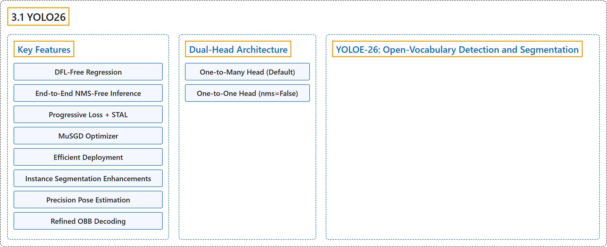

# 3.1 YOLO26

## Classification

## Glossary

| Term | Definition | 中文翻译 | Source |
|---|---|---|---|
| **3.1 YOLO26** YOLO26 | "YOLO26 is **a unified family of real-time vision models** described in the Ultralytics YOLO26 paper." | YOLO26 是 **Ultralytics YOLO26 论文中描述的一个统一的实时视觉模型家族**。 | [Ultralytics, n.d., "Ultralytics YOLO26", para. 1](https://docs.ultralytics.com/models/yolo26/#ultralytics-yolo26) |
| **Key Features** 主要特性 | (No definition) | （无定义） | [Ultralytics, n.d., "Key Features"](https://docs.ultralytics.com/models/yolo26/#key-features) |
| **DFL-Free Regression** 无 DFL 回归 | "DFL-Free Regression YOLO26 **removes Distribution Focal Loss (DFL)**, reducing detection-head complexity and simplifying export." | 无 DFL 回归：YOLO26 **移除了分布焦点损失（DFL）**，降低了检测头的复杂度并简化了导出。 | [Ultralytics, n.d., "Key Features", item 1](https://docs.ultralytics.com/models/yolo26/#key-features) |
| **End-to-End NMS-Free Inference** 端到端免 NMS 推理 | "End-to-End NMS-Free Inference YOLO26 supports native end-to-end inference with `nms=False`, **producing predictions without a separate NMS pass**." | 端到端免 NMS 推理：YOLO26 支持用 `nms=False` 做原生端到端推理，无需单独的 NMS 步骤**即可产生预测**。 | [Ultralytics, n.d., "Key Features", item 2](https://docs.ultralytics.com/models/yolo26/#key-features) |
| **Progressive Loss + STAL** 渐进式损失 + STAL | "Progressive Loss + STAL Progressive Loss **shifts training emphasis toward the inference-time head**, while STAL **improves positive label coverage for small objects**." | 渐进式损失 + STAL：渐进式损失**把训练重心移向推理时使用的检测头**，而 STAL **提高小目标的正样本标签覆盖率**。 | [Ultralytics, n.d., "Key Features", item 3](https://docs.ultralytics.com/models/yolo26/#key-features) |
| **MuSGD Optimizer** MuSGD 优化器 | "MuSGD Optimizer **A hybrid optimizer that combines SGD with Muon**, adapting optimization ideas from large language model training to computer vision." | MuSGD 优化器是**一种把 SGD 与 Muon 结合起来的混合优化器**，把大语言模型训练中的优化思想移用到计算机视觉。 | [Ultralytics, n.d., "Key Features", item 4](https://docs.ultralytics.com/models/yolo26/#key-features) |
| **Efficient Deployment** 高效部署 | "Efficient Deployment The simplified head and optional NMS-free path **reduce inference overhead across export targets and hardware profiles**" | 高效部署：简化的检测头和可选的免 NMS 路径**降低了各种导出目标和硬件配置上的推理开销** | [Ultralytics, n.d., "Key Features", item 5](https://docs.ultralytics.com/models/yolo26/#key-features) |
| **Instance Segmentation Enhancements** 实例分割增强 | "Instance Segmentation Enhancements Introduces **semantic segmentation loss to improve model convergence** and **an upgraded proto module that leverages multi-scale information for superior mask quality**." | 实例分割增强：引入**语义分割损失以改善模型收敛**，以及**一个利用多尺度信息、提升掩码质量的升级版 proto 模块**。 | [Ultralytics, n.d., "Key Features", item 6](https://docs.ultralytics.com/models/yolo26/#key-features) |
| **Precision Pose Estimation** 精确姿态估计 | "Precision Pose Estimation Integrates **Residual Log-Likelihood Estimation (RLE) for more accurate keypoint localization** and optimizes the decoding process for increased inference speed." | 精确姿态估计：集成**残差对数似然估计（RLE），使关键点定位更准确**，并优化解码过程以提高推理速度。 | [Ultralytics, n.d., "Key Features", item 7](https://docs.ultralytics.com/models/yolo26/#key-features) |
| **Refined OBB Decoding** 改进的 OBB 解码 | "Refined OBB Decoding Introduces **a specialized angle loss to improve detection accuracy for square-shaped objects** and optimizes OBB decoding to resolve boundary discontinuity issues." | 改进的 OBB 解码：引入**专门的角度损失，提高方形物体的检测精度**，并优化 OBB 解码以解决边界不连续问题。 | [Ultralytics, n.d., "Key Features", item 8](https://docs.ultralytics.com/models/yolo26/#key-features) |
| **Dual-Head Architecture** 双头架构 | "YOLO26 detection models use a dual-head architecture **that provides flexibility for different deployment scenarios**:" | YOLO26 检测模型采用双头架构，它**为不同的部署场景提供灵活性**： | [Ultralytics, n.d., "Usage Examples", Dual-Head Architecture, para. 1](https://docs.ultralytics.com/models/yolo26/#usage-examples) |
| **One-to-Many Head (Default)** 一对多检测头（默认） | "One-to-Many Head (Default): **Generates traditional YOLO outputs requiring NMS post-processing**, outputting `(N, nc + 4, 8400)` where `nc` is the number of classes." | 一对多检测头（默认）会**生成需要 NMS 后处理的传统 YOLO 输出**，输出形状为 `(N, nc + 4, 8400)`，其中 `nc` 是类别数。 | [Ultralytics, n.d., "Usage Examples", Dual-Head Architecture, item 1](https://docs.ultralytics.com/models/yolo26/#usage-examples) |
| **One-to-One Head (nms=False)** 一对一检测头（nms=False） | "One-to-One Head (`nms=False`): **Produces end-to-end predictions without NMS**, outputting `(N, 300, 6)` with a maximum of 300 detections per image." | 一对一检测头（`nms=False`）会**不经 NMS 直接产生端到端预测**，输出形状为 `(N, 300, 6)`，每张图像最多 300 个检测结果。 | [Ultralytics, n.d., "Usage Examples", Dual-Head Architecture, item 2](https://docs.ultralytics.com/models/yolo26/#usage-examples) |
| **YOLOE-26: Open-Vocabulary Detection and Segmentation** YOLOE-26：开放词汇检测与分割 | "YOLO26 also powers YOLOE-26, **an open-vocabulary variant that detects and segments object categories from text prompts, visual prompts, or a prompt-free mode instead of a fixed class list learned at training time**." | YOLO26 还支撑着 YOLOE-26，它是**一个开放词汇变体，它根据文本提示、视觉提示或无提示模式来检测和分割物体类别，而不是使用训练时学到的固定类别列表**。 | [Ultralytics, n.d., "YOLOE-26: Open-Vocabulary Detection and Segmentation", para. 1](https://docs.ultralytics.com/models/yolo26/#yoloe-26-open-vocabulary-detection-and-segmentation) |

## References

Ultralytics. (n.d.). *Ultralytics YOLO26*. Ultralytics YOLO Docs (ultralytics 8.4.194). Retrieved October 31, 2026, from <https://docs.ultralytics.com/models/yolo26/>
