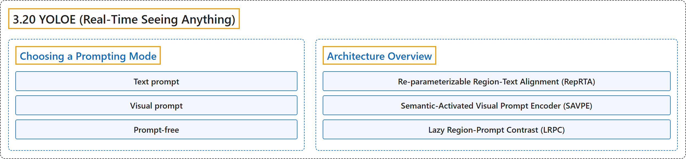

# 3.20 YOLOE (Real-Time Seeing Anything)

## Classification

## Glossary

| Term | Definition | 中文翻译 | Source |
|---|---|---|---|
| **3.20 YOLOE (Real-Time Seeing Anything)** YOLOE（实时看见一切） | "Ultralytics YOLOE (Real-Time Seeing Anything) is **an open-vocabulary detection and instance segmentation model**: instead of a class list fixed at training time, it takes the categories you want at inference time, as a text prompt, a visual example, or a built-in 4,585-name vocabulary." | Ultralytics YOLOE（实时看见一切）是**一个开放词汇的检测和实例分割模型**：它不用训练时固定的类别表，而是在推理时接收你想要的类别，形式可以是文本提示、视觉示例或内置的 4,585 个名称的词表。 | [Ultralytics, n.d., "YOLOE: Real-Time Open-Vocabulary Detection and Segmentation", para. 1](https://docs.ultralytics.com/models/yoloe/#yoloe-real-time-open-vocabulary-detection-and-segmentation) |
| **Choosing a Prompting Mode** 选择提示模式 | (context) "YOLOE supports **three prompting modes**, and the choice decides which checkpoint you load and what your class labels look like." | （语境）YOLOE 支持**三种提示模式**，所选模式决定你加载哪个检查点以及类别标签是什么样子。 | [Ultralytics, n.d., "Choosing a Prompting Mode", para. 1](https://docs.ultralytics.com/models/yoloe/#choosing-a-prompting-mode) |
| **Text prompt** 文本提示 | (context) "**You can describe the target in words** — the usual choice" | （语境）当**你能用文字描述目标**时使用，这是通常的选择 | [Ultralytics, n.d., "Choosing a Prompting Mode", table, row 1](https://docs.ultralytics.com/models/yoloe/#choosing-a-prompting-mode) |
| **Visual prompt** 视觉提示 | (context) "**You cannot put the target into words**: a specific part, logo, or defect" | （语境）当**你无法用文字表述目标**时使用：某个特定部件、标志或缺陷 | [Ultralytics, n.d., "Choosing a Prompting Mode", table, row 2](https://docs.ultralytics.com/models/yoloe/#choosing-a-prompting-mode) |
| **Prompt-free** 无提示 | (context) "**You are cataloging or exploring and do not know what to look for in advance**" | （语境）当**你在编目或探索，事先不知道要找什么**时使用 | [Ultralytics, n.d., "Choosing a Prompting Mode", table, row 3](https://docs.ultralytics.com/models/yoloe/#choosing-a-prompting-mode) |
| **Architecture Overview** 架构概览 | "YOLOE keeps the standard YOLO structure — a convolutional backbone for feature extraction, a neck for multi-scale fusion, and an anchor-free, decoupled head predicting classes and boxes — and **adds three modules, one per prompting mode**:" | YOLOE 保留了标准的 YOLO 结构（用于特征提取的卷积骨干网络、用于多尺度融合的颈部，以及预测类别和框的无锚框解耦检测头），并**增加了三个模块，每种提示模式一个**： | [Ultralytics, n.d., "Architecture Overview", para. 1](https://docs.ultralytics.com/models/yoloe/#architecture-overview) |
| **Re-parameterizable Region-Text Alignment (RepRTA)** 可重参数化区域-文本对齐（RepRTA） | "Re-parameterizable Region-Text Alignment (RepRTA) **refines text embeddings from CLIP through a small auxiliary network**." | 可重参数化区域-文本对齐（RepRTA）负责**通过一个小型辅助网络细化来自 CLIP 的文本嵌入**。 | [Ultralytics, n.d., "Architecture Overview", item 1](https://docs.ultralytics.com/models/yoloe/#architecture-overview) |
| **Semantic-Activated Visual Prompt Encoder (SAVPE)** 语义激活视觉提示编码器（SAVPE） | "Semantic-Activated Visual Prompt Encoder (SAVPE) **encodes semantic and activation features from an example box**, conditioning the model on objects that look like it." | 语义激活视觉提示编码器（SAVPE）负责**对示例框中的语义特征和激活特征进行编码**，使模型以与之外观相似的物体为条件。 | [Ultralytics, n.d., "Architecture Overview", item 2](https://docs.ultralytics.com/models/yoloe/#architecture-overview) |
| **Lazy Region-Prompt Contrast (LRPC)** 惰性区域-提示对比（LRPC） | "Lazy Region-Prompt Contrast (LRPC) **matches region embeddings against a built-in 4,585-name vocabulary**, so prompt-free checkpoints recognize objects with no external prompt and no text encoder." | 惰性区域-提示对比（LRPC）负责**把区域嵌入与内置的 4,585 个名称的词表进行匹配**，使无提示检查点无需外部提示、也无需文本编码器就能识别物体。 | [Ultralytics, n.d., "Architecture Overview", item 3](https://docs.ultralytics.com/models/yoloe/#architecture-overview) |

## References

Ultralytics. (n.d.). *YOLOE: Real-Time Open-Vocabulary Detection and Segmentation*. Ultralytics YOLO Docs (ultralytics 8.4.194). Retrieved October 31, 2026, from <https://docs.ultralytics.com/models/yoloe/>
