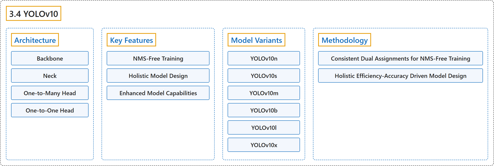

# 3.4 YOLOv10

## Classification

## Glossary

| Term | Definition | 中文翻译 | Source |
|---|---|---|---|
| **3.4 YOLOv10** YOLOv10 | "YOLOv10, released in May 2024 and built on the Ultralytics Python package by researchers at Tsinghua University, **introduces a new approach to real-time object detection, addressing both the post-processing and model architecture deficiencies found in previous YOLO versions**." | YOLOv10 于 2024 年 5 月发布，由清华大学的研究人员基于 Ultralytics Python 包构建，**提出了一种新的实时目标检测方法，同时解决了以往 YOLO 版本在后处理和模型架构上的不足**。 | [Ultralytics, n.d., "YOLOv10: Real-Time End-to-End Object Detection", para. 1](https://docs.ultralytics.com/models/yolov10/#yolov10-real-time-end-to-end-object-detection) |
| **Architecture** 架构 | (context) "The architecture of YOLOv10 **builds upon the strengths of previous YOLO models while introducing several key innovations**." | （语境）YOLOv10 的架构**在以往 YOLO 模型优势的基础上，引入了若干关键创新**。 | [Ultralytics, n.d., "Architecture", para. 1](https://docs.ultralytics.com/models/yolov10/#architecture) |
| **Backbone** 骨干网络 | "Backbone: **Responsible for feature extraction**, the backbone in YOLOv10 uses an enhanced version of CSPNet (Cross Stage Partial Network) to improve gradient flow and reduce computational redundancy." | 骨干网络**负责特征提取**，YOLOv10 的骨干网络使用增强版的 CSPNet（跨阶段局部网络），以改善梯度流并减少计算冗余。 | [Ultralytics, n.d., "Architecture", item 1](https://docs.ultralytics.com/models/yolov10/#architecture) |
| **Neck** 颈部 | "Neck: The neck is designed **to aggregate features from different scales and passes them to the head**." | 颈部：颈部用于**聚合来自不同尺度的特征，并把它们传给检测头**。 | [Ultralytics, n.d., "Architecture", item 2](https://docs.ultralytics.com/models/yolov10/#architecture) |
| **One-to-Many Head** 一对多检测头 | "One-to-Many Head: **Generates multiple predictions per object during training** to provide rich supervisory signals and improve learning accuracy." | 一对多检测头**训练时为每个物体生成多个预测**，以提供丰富的监督信号并提高学习精度。 | [Ultralytics, n.d., "Architecture", item 3](https://docs.ultralytics.com/models/yolov10/#architecture) |
| **One-to-One Head** 一对一检测头 | "One-to-One Head: **Generates a single best prediction per object during inference** to eliminate the need for NMS, thereby reducing latency and improving efficiency." | 一对一检测头**推理时为每个物体只生成一个最佳预测**，从而无需 NMS，降低延迟并提高效率。 | [Ultralytics, n.d., "Architecture", item 4](https://docs.ultralytics.com/models/yolov10/#architecture) |
| **Key Features** 主要特性 | (No definition) | （无定义） | [Ultralytics, n.d., "Key Features"](https://docs.ultralytics.com/models/yolov10/#key-features) |
| **NMS-Free Training** 免 NMS 训练 | "NMS-Free Training: **Utilizes consistent dual assignments to eliminate the need for NMS**, reducing inference latency." | 免 NMS 训练**利用一致的双重分配来消除对 NMS 的需要**，降低推理延迟。 | [Ultralytics, n.d., "Key Features", item 1](https://docs.ultralytics.com/models/yolov10/#key-features) |
| **Holistic Model Design** 整体模型设计 | "Holistic Model Design: **Comprehensive optimization of various components from both efficiency and accuracy perspectives**, including lightweight classification heads, spatial-channel decoupled downsampling, and rank-guided block design." | 整体模型设计指**从效率和精度两个角度全面优化各个组件**，包括轻量级分类头、空间-通道解耦下采样和秩引导的模块设计。 | [Ultralytics, n.d., "Key Features", item 2](https://docs.ultralytics.com/models/yolov10/#key-features) |
| **Enhanced Model Capabilities** 增强的模型能力 | "Enhanced Model Capabilities: **Incorporates large-kernel convolutions and partial self-attention modules** to improve performance without significant computational cost." | 增强的模型能力指**引入大核卷积和部分自注意力模块**，在不显著增加计算成本的情况下提升性能。 | [Ultralytics, n.d., "Key Features", item 3](https://docs.ultralytics.com/models/yolov10/#key-features) |
| **Model Variants** 模型变体 | (context) "YOLOv10 comes in **various model scales to cater to different application needs**:" | （语境）YOLOv10 提供**多种模型规模，以满足不同的应用需求**： | [Ultralytics, n.d., "Model Variants", para. 1](https://docs.ultralytics.com/models/yolov10/#model-variants) |
| **YOLOv10n** YOLOv10n | "YOLOv10n: **Nano version for extremely resource-constrained environments.**" | YOLOv10n 是**面向资源极其受限环境的 Nano 版本。** | [Ultralytics, n.d., "Model Variants", item 1](https://docs.ultralytics.com/models/yolov10/#model-variants) |
| **YOLOv10s** YOLOv10s | "YOLOv10s: **Small version balancing speed and accuracy.**" | YOLOv10s 是**兼顾速度与精度的 Small 版本。** | [Ultralytics, n.d., "Model Variants", item 2](https://docs.ultralytics.com/models/yolov10/#model-variants) |
| **YOLOv10m** YOLOv10m | "YOLOv10m: **Medium version for general-purpose use.**" | YOLOv10m 是**用于通用场景的 Medium 版本。** | [Ultralytics, n.d., "Model Variants", item 3](https://docs.ultralytics.com/models/yolov10/#model-variants) |
| **YOLOv10b** YOLOv10b | "YOLOv10b: **Balanced version with increased width for higher accuracy.**" | YOLOv10b 是**加大宽度以提高精度的 Balanced 版本。** | [Ultralytics, n.d., "Model Variants", item 4](https://docs.ultralytics.com/models/yolov10/#model-variants) |
| **YOLOv10l** YOLOv10l | "YOLOv10l: **Large version for higher accuracy at the cost of increased computational resources.**" | YOLOv10l 是**以更多计算资源换取更高精度的 Large 版本。** | [Ultralytics, n.d., "Model Variants", item 5](https://docs.ultralytics.com/models/yolov10/#model-variants) |
| **YOLOv10x** YOLOv10x | "YOLOv10x: **Extra-large version for maximum accuracy and performance.**" | YOLOv10x 是**追求最高精度和性能的 Extra-large 版本。** | [Ultralytics, n.d., "Model Variants", item 6](https://docs.ultralytics.com/models/yolov10/#model-variants) |
| **Methodology** 方法 | (No definition) | （无定义） | [Ultralytics, n.d., "Methodology"](https://docs.ultralytics.com/models/yolov10/#methodology) |
| **Consistent Dual Assignments for NMS-Free Training** 面向免 NMS 训练的一致双重分配 | "YOLOv10 employs dual label assignments, **combining one-to-many and one-to-one strategies during training** to ensure rich supervision and efficient end-to-end deployment." | YOLOv10 采用双重标签分配，即**在训练中结合一对多和一对一两种策略**，以确保丰富的监督和高效的端到端部署。 | [Ultralytics, n.d., "Consistent Dual Assignments for NMS-Free Training", para. 1](https://docs.ultralytics.com/models/yolov10/#consistent-dual-assignments-for-nms-free-training) |
| **Holistic Efficiency-Accuracy Driven Model Design** 效率与精度驱动的整体模型设计 | (No definition) | （无定义） | [Ultralytics, n.d., "Holistic Efficiency- Accuracy Driven Model Design"](https://docs.ultralytics.com/models/yolov10/#holistic-efficiency-accuracy-driven-model-design) |
| **Lightweight Classification Head** 轻量级分类头 | "Lightweight Classification Head: **Reduces the computational overhead of the classification head by using depth-wise separable convolutions.**" | 轻量级分类头**使用深度可分离卷积来减少分类头的计算开销。** | [Ultralytics, n.d., "Efficiency Enhancements", Efficiency Enhancements, item 1](https://docs.ultralytics.com/models/yolov10/#efficiency-enhancements) |
| **Spatial-Channel Decoupled Downsampling** 空间-通道解耦下采样 | "Spatial-Channel Decoupled Downsampling: **Decouples spatial reduction and channel modulation** to minimize information loss and computational cost." | 空间-通道解耦下采样**把空间缩减与通道调制解耦**，以尽量减少信息损失和计算成本。 | [Ultralytics, n.d., "Efficiency Enhancements", Efficiency Enhancements, item 2](https://docs.ultralytics.com/models/yolov10/#efficiency-enhancements) |
| **Rank-Guided Block Design** 秩引导的模块设计 | "Rank-Guided Block Design: **Adapts block design based on intrinsic stage redundancy**, ensuring optimal parameter utilization." | 秩引导的模块设计**根据各阶段的内在冗余调整模块设计**，确保参数得到最佳利用。 | [Ultralytics, n.d., "Efficiency Enhancements", Efficiency Enhancements, item 3](https://docs.ultralytics.com/models/yolov10/#efficiency-enhancements) |
| **Large-Kernel Convolution** 大核卷积 | "Large-Kernel Convolution: **Enlarges the receptive field to enhance feature extraction capability.**" | 大核卷积**扩大感受野以增强特征提取能力。** | [Ultralytics, n.d., "Accuracy Enhancements", Accuracy Enhancements, item 1](https://docs.ultralytics.com/models/yolov10/#accuracy-enhancements) |
| **Partial Self-Attention (PSA)** 部分自注意力（PSA） | "Partial Self-Attention (PSA): **Incorporates self-attention modules to improve global representation learning with minimal overhead.**" | 部分自注意力（PSA）的做法是**引入自注意力模块，以极小的开销改进全局表征学习。** | [Ultralytics, n.d., "Accuracy Enhancements", Accuracy Enhancements, item 2](https://docs.ultralytics.com/models/yolov10/#accuracy-enhancements) |

## References

Ultralytics. (n.d.). *YOLOv10: Real-Time End-to-End Object Detection*. Ultralytics YOLO Docs (ultralytics 8.4.194). Retrieved October 31, 2026, from <https://docs.ultralytics.com/models/yolov10/>
